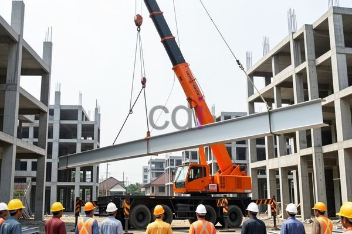

**Sewa Crane Karawang: Pilihan Tepat untuk Proyek Konstruksi Anda** - Hai Mitra CDI! Pernahkah Anda merasa kesulitan memindahkan material berat di area proyek? Atau mungkin terkendala waktu karena proses pengangkatan yang lambat? Nah, layanan sewa crane di Karawang hadir sebagai solusi cerdas untuk menyelesaikan masalah tersebut. Dengan bantuan crane, pekerjaan konstruksi Anda jadi lebih efisien dan produktif.

### Mengapa Layanan Sewa Crane di Karawang Begitu Penting?

Karawang, sebagai pusat industri yang dinamis, memerlukan alat berat andal seperti crane. Mulai dari tahap awal pembangunan hingga pemasangan struktur tinggi, crane memegang peran krusial. Akses mudah ke layanan sewa crane yang handal bisa berdampak besar pada kelancaran proyek Anda – menghemat biaya, mempercepat penyelesaian, dan membebaskan sumber daya untuk fokus pada inti bisnis.

Investasi pada crane sendiri memang terlihat menggiurkan, tapi pikirkan baik-baik. Biaya perawatan rutin, penyimpanan yang memakan tempat, serta kebutuhan operator bersertifikat akan menggerogoti anggaran Anda. Menyewa crane memberikan fleksibilitas: Anda hanya membayar sesuai kebutuhan, tanpa terbebani biaya-biaya tak terduga. Ini solusi yang lebih cerdas, lho!

### Ragam Jenis Crane untuk Kebutuhan Proyek Anda

Kami menyediakan beragam pilihan crane yang bisa disesuaikan dengan skala dan kompleksitas proyek Anda. Berikut beberapa jenis yang paling populer:

*   **Mobile Crane:** Ideal bagi proyek yang membutuhkan fleksibilitas tinggi. Mudah dipindahkan antar lokasi dan tersedia dalam berbagai kapasitas angkat, mulai dari 25 ton hingga 300 ton bahkan lebih.
*   **Tower Crane:** Pilihan utama untuk konstruksi gedung bertingkat. Mampu mengangkat beban berat ke ketinggian yang signifikan, memastikan efisiensi dalam pembangunan vertikal.
*   **Crawler Crane:** Dirancang untuk medan berat seperti tanah berlumpur atau berpasir. Sistem crawler-nya memberikan stabilitas maksimal saat mengangkat beban besar.
*   **Truck Crane:** Perpaduan praktis antara truk dan crane. Kemudahan mobilitas dan pengoperasiannya membuat truk crane cocok untuk beragam lokasi proyek.

Memilih crane yang tepat penting banget. Pertimbangkan berat beban, tinggi pengangkatan, kondisi medan, dan area kerja. Jangan ragu, tim ahli Kami siap membantu Anda menganalisis kebutuhan proyek dan merekomendasikan solusi yang paling efisien.

### Creative Design Interior: Solusi Sewa Crane Terintegrasi di Karawang

Selama lebih dari 10 tahun, Creative Design Interior telah menjadi mitra terpercaya dalam menyediakan layanan sewa crane di Karawang dan wilayah sekitarnya. Kami paham betul tantangan proyek konstruksi dan berkomitmen memberikan solusi terbaik dengan harga yang bersaing.

Apa saja keunggulan layanan sewa crane Kami?

*   **Armada Lengkap & Terawat:** Kami menyediakan berbagai jenis crane yang selalu dalam kondisi prima dan siap digunakan.
*   **Operator Profesional Bersertifikasi:** Setiap unit crane Kami dikelola oleh operator berpengalaman yang memiliki sertifikasi keselamatan lengkap.
*   **Harga Transparan & All-in-One:** Harga sewa Kami sudah mencakup biaya operasional, pengiriman, dan bongkar muat – tanpa biaya tersembunyi.
*   **Jangkauan Luas:** Kami melayani proyek di Karawang, Cikarang, Purwakarta, Subang, dan area Jawa Barat lainnya.

Pilihlah layanan sewa crane Kami untuk mendapatkan solusi praktis, efisien, dan hemat biaya. Kami juga menawarkan konsultasi gratis untuk membantu Anda menentukan jenis crane yang paling sesuai dengan kebutuhan proyek Anda. [Cat untuk Lantai Gudang: Pilihan Tepat & Biaya Aplikasi 2026](/blog/cat-untuk-lantai-gudang/) – Pastikan lantai gudang Anda juga kokoh menopang aktivitas pengiriman barang!

### Proses Pemesanan dan Pembayaran yang Mudah & Fleksibel

Kami mengerti betapa pentingnya kemudahan dalam setiap langkah. Nikmati proses pemesanan yang cepat dan lancar, serta beragam pilihan pembayaran yang fleksibel. Anda bisa memilih COD, transfer bank, DP 50%, transfer setelah barang diterima, bayar secara bertahap, atau transfer setelah pekerjaan selesai. 

Untuk pemesanan maupun pertanyaan lebih lanjut, cukup hubungi Kami melalui tombol **WhatsApp** atau **Telepon** yang tertera di halaman ini. Tim Kami siap merespons dengan cepat dan memberikan penawaran terbaik. Jangan sungkan untuk berkonsultasi – Kami senang membantu Anda!

Butuh bantuan segera? Atau ingin penawaran harga yang disesuaikan dengan proyek Anda? Klik tombol **WhatsApp** atau **Telepon** di bawah ini untuk berbicara langsung dengan tim Kami. 