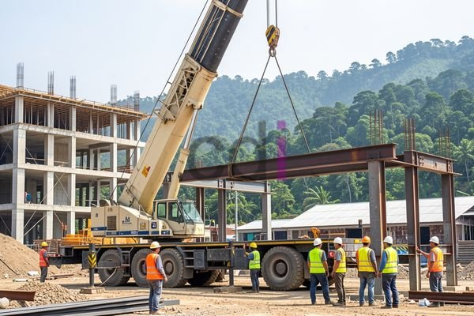

**Sewa Crane Sukabumi: Solusi Efisien untuk Proyek Konstruksi Anda** - Hai Mitra CDI! Proyek konstruksi di Sukabumi sedang berkembang pesat? Kami mengerti tantangannya! Kelancaran operasional seringkali bergantung pada ketersediaan alat berat yang tepat. Pemilihan yang bijak tidak hanya memengaruhi kecepatan penyelesaian proyek, tapi juga anggaran dan keselamatan kerja.

Mengangkat material berat, menempatkan struktur bangunan, hingga memindahkan peralatan konstruksi membutuhkan solusi yang andal. Daripada membeli – yang berarti investasi besar dan biaya perawatan berkelanjutan – menyewa crane di Sukabumi adalah langkah cerdas yang hemat biaya dan praktis. Dengan begitu, Mitra bisa fokus pada inti bisnis: membangun!

## Mengapa Menyewa Crane di Sukabumi Jadi Pilihan Tepat?

Kebutuhan akan layanan sewa crane di Sukabumi terus meningkat, seiring dengan laju pembangunan yang dinamis di kawasan ini. Kondisi geografis Sukabumi yang unik – mulai dari dataran rendah hingga perbukitan – menuntut fleksibilitas dalam penggunaan alat berat. Menyewa memungkinkan Anda memilih crane yang paling sesuai dengan kebutuhan spesifik proyek.

Dengan model sewa, Anda terbebas dari beban perawatan, penyimpanan, dan penyusutan aset. Selain itu, penyedia jasa profesional seperti Kami menyediakan operator bersertifikasi yang ahli di bidangnya, menjamin keamanan dan efisiensi proyek Anda. Ini berarti pengurangan biaya operasional dan investasi awal yang signifikan. Sebuah win-win solution, kan?

## Ragam Jenis Crane yang Tersedia untuk Proyek Anda di Sukabumi

Ada beberapa jenis crane yang bisa disewa di Sukabumi, masing-masing dirancang untuk menangani kebutuhan proyek yang berbeda. Memilih jenis yang tepat bergantung pada faktor-faktor seperti berat beban, tinggi bangunan, dan kondisi lokasi proyek.

*   **Mobile Crane:** Pilihan populer karena kemudahan mobilitasnya. Sangat ideal untuk proyek dengan ruang terbatas atau membutuhkan pemindahan crane antar lokasi kerja. Mobile crane tersedia dalam berbagai kapasitas, mulai dari 25 ton hingga lebih dari 100 ton.
*   **Tower Crane:** Solusi optimal untuk konstruksi gedung bertingkat. Tower crane mampu mengangkat beban berat ke ketinggian yang signifikan, menjadikannya tak tergantikan dalam pembangunan vertikal. Pemasangan dan pembongkarannya memerlukan perencanaan yang cermat.
*   **Crawler Crane:** Dirancang untuk medan berat dan tidak rata. Roda rantainya memberikan stabilitas dan daya cengkeram superior, menjadikannya pilihan utama untuk proyek infrastruktur seperti jembatan dan jalan.

Sebagai gambaran, untuk proyek rumah dua lantai yang membutuhkan pengangkatan bahan seperti batu bata, semen, dan besi beton, mobile crane 25-30 ton adalah solusi yang efisien. Sementara itu, untuk pembangunan gedung apartemen 10 lantai, tower crane dengan kapasitas minimal 50 ton akan lebih mumpuni.

## Kisaran Biaya Sewa Crane di Sukabumi dan Faktor Penentunya

Biaya sewa crane di Sukabumi bervariasi, tergantung pada jenis crane, kapasitas angkat, durasi penyewaan, dan lokasi proyek. Sebagai perkiraan, harga sewa berkisar antara Rp 3.000.000 hingga Rp 15.000.000 per hari.  Harga ini bisa berubah sewaktu-waktu, jadi pastikan untuk menghubungi Kami untuk mendapatkan penawaran terkini yang sesuai dengan kebutuhan proyek Mitra.

Selain biaya sewa dasar, ada biaya tambahan yang perlu dipertimbangkan, seperti biaya transportasi crane ke lokasi proyek, biaya operator (seringkali sudah termasuk dalam harga sewa), biaya bahan bakar, dan biaya perizinan. Pastikan untuk mengklarifikasi semua biaya ini dengan penyedia jasa sebelum menyepakati kontrak.

Sebagai contoh, penggunaan mobile crane 30 ton selama 5 hari, termasuk operator, transportasi, dan bahan bakar, mungkin membutuhkan anggaran sekitar Rp 20.000.000 – Rp 30.000.000. Angka ini hanyalah ilustrasi dan dapat bervariasi berdasarkan kompleksitas proyek dan penyedia jasa.

## Tips Memilih Penyedia Jasa Sewa Crane Sukabumi yang Terpercaya

Memilih penyedia jasa sewa crane Sukabumi yang tepat sangat penting untuk kelancaran proyek Anda. Pastikan Anda memilih perusahaan yang memiliki reputasi baik, pengalaman yang relevan, dan peralatan yang terawat dengan baik.  Periksa juga kelengkapan izin usaha dan sertifikasi keselamatan kerja yang mereka miliki.

Operator yang kompeten adalah kunci keberhasilan. Pastikan penyedia jasa menyediakan operator bersertifikasi yang terlatih dengan baik. Jangan ragu untuk meminta referensi dari klien sebelumnya dan memeriksa rekam jejak perusahaan. 

Layanan purna jual yang responsif juga patut dipertimbangkan. Pemeliharaan yang baik dan dukungan cepat saat Anda membutuhkan adalah tanda penyedia jasa yang profesional.

Yuk, wujudkan proyek impian Mitra CDI! Hubungi Kami sekarang juga melalui tombol **Telepon** atau **WhatsApp** di bawah ini untuk konsultasi gratis dan penawaran terbaik. [Sewa Crane Cipulir: Solusi Efisien untuk Proyek Konstruksi Anda](/blog/sewa-crane-cipulir/) — mungkin informasi ini juga berguna jika proyek Anda menjangkau area Jakarta.