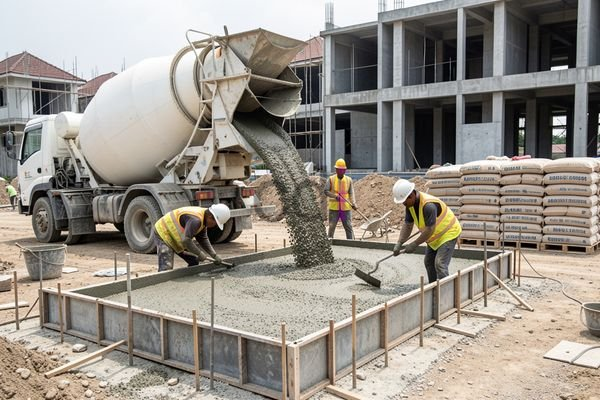

**Pengecoran Beton Berkualitas: Panduan Lengkap untuk Proyek Jabodetabek** - Hai Mitra CDI! Pernahkah Anda merasa khawatir dengan kekuatan fondasi bangunan, atau menghadapi masalah retak yang mengganggu estetika? Masalah ini seringkali berakar pada proses pengecoran beton yang kurang tepat. Nah, artikel ini hadir untuk memberikan panduan menyeluruh tentang pengecoran beton berkualitas, khususnya untuk kebutuhan proyek-proyek di (not detected) dan sekitarnya. Yuk, kita bahas tuntas!

## Memastikan Keunggulan: Mutu Beton dan Standar SNI

Kekuatan dan umur panjang sebuah struktur beton dimulai dari pemilihan mutu beton yang tepat. Di Indonesia, mutu beton diidentifikasi dengan kode 'K-' diikuti angka, seperti K-250, K-300, K-350, dan seterusnya. Angka ini merepresentasikan kuat tekan beton dalam kg/cm². Semakin tinggi angkanya, beton akan semakin tangguh. Pemilihan mutu beton harus diselaraskan dengan fungsi dan beban bangunan. K-250 atau K-300 biasanya memadai untuk rumah tinggal sederhana, tetapi struktur masif atau bangunan bertingkat mungkin memerlukan K-350 atau bahkan K-400.

Pastikan beton yang Anda gunakan telah tersertifikasi SNI. SNI adalah bukti mutlak jaminan kualitas dan keamanan material bangunan. Perhatikan juga komposisi campuran beton – rasio semen, pasir, kerikil, dan air harus sesuai dengan mutu yang ditargetkan. Kombinasi yang tidak tepat berpotensi menghasilkan beton yang rapuh atau kurang kuat. Sebagai ilustrasi, campuran umum untuk beton K-300 adalah 1:2:4 (semen:pasir:kerikil) dengan faktor air-semen antara 0,45 – 0,50.

## Langkah Demi Langkah: Proses Pengecoran Beton yang Optimal

Proses pengecoran yang cermat adalah penentu kualitas akhir beton. Persiapan yang menyeluruh menjadi fondasi utama. Pastikan bekisting (cetakan beton) terpasang dengan kokoh dan dilapisi minyak bekisting agar beton mudah dilepaskan setelah mengeras. Sebelum memulai, verifikasi bahwa tulangan baja (besi beton) telah dipasang persis sesuai rencana desain struktur.

Saat pengecoran berlangsung, tuangkan beton secara merata dan bertahap. Hindari penuangan dari ketinggian berlebihan untuk mencegah pemisahan material. Setelah beton tertuang, gunakan vibrator beton untuk memadatkan dan menghilangkan gelembung udara yang terperangkap di dalamnya. Pemadatan yang baik akan meningkatkan kepadatan dan kekuatan beton secara signifikan. Setelah itu, ratakan permukaan beton dan lakukan perawatan (curing) dengan menutupnya menggunakan karung goni basah atau plastik minimal selama 7 hari agar kelembaban terjaga dan mencegah retak akibat penguapan air yang terlalu cepat.

## Menggandeng Ahli: Memilih Jasa Pengecoran Beton Profesional di Jabodetabek

Pengecoran beton yang andal memerlukan keahlian khusus. Jika Anda belum memiliki pengalaman atau sumber daya yang memadai, mengandalkan jasa pengecoran beton profesional adalah pilihan bijak. Di wilayah (not detected) dan Jabodetabek, tersedia banyak penyedia jasa. Namun, pilihlah yang memiliki rekam jejak terbukti, pengalaman solid, dan tim yang kompeten. 

Perhatikan juga peralatan yang digunakan. Alat-alat modern dan terawat baik menjamin akurasi dan kualitas pengecoran yang lebih tinggi. Jangan ragu untuk meminta referensi dari klien sebelumnya dan meninjau proyek-proyek yang telah mereka selesaikan. Garansi atas pekerjaan adalah indikasi komitmen mereka terhadap kualitas. Biaya jasa pengecoran beton di (not detected) bervariasi tergantung kompleksitas proyek, mutu beton, dan lokasi — untuk informasi harga paling akurat dan penawaran khusus, silakan hubungi Kami. 

## Optimalisasi Anggaran: Biaya dan Material Pelengkap

Biaya pengecoran beton tidak terbatas pada harga material utama (semen, pasir, kerikil, dan tulangan baja) serta upah tenaga kerja. Pertimbangkan juga biaya material tambahan seperti air bersih, minyak bekisting, serta transportasi. Jangan lupakan pentingnya pengujian kualitas beton (slump test, uji kuat tekan) secara berkala untuk memastikan standar mutu terpenuhi.

Sebagai gambaran, harga semen per sak (50 kg) pada tahun 2026 berkisar antara Rp 60.000 – Rp 80.000, harga pasir per meter kubik sekitar Rp 300.000 – Rp 500.000, dan harga kerikil per meter kubik sekitar Rp 400.000 – Rp 600.000. Harga ini dapat fluktuatif tergantung lokasi dan supplier. Dengan memperhitungkan semua faktor ini, Anda dapat merencanakan anggaran proyek pengecoran beton Anda secara lebih akurat.

Kami siap menjadi mitra terpercaya Anda dalam mewujudkan proyek konstruksi yang kokoh dan tahan lama. Jangan ragu untuk menghubungi Kami melalui tombol **Telepon** atau **WhatsApp** di bawah ini untuk konsultasi dan penawaran terbaik! Kami siap melayani kebutuhan pengecoran beton Anda di (not detected) dan wilayah Jabodetabek.