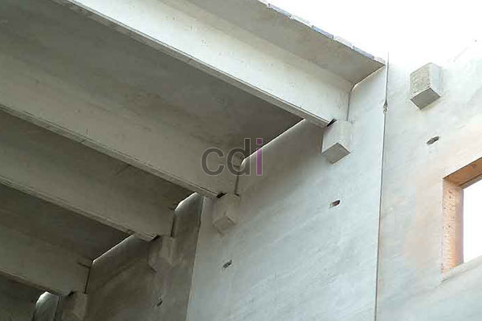

**Solusi Agar Dak Beton Tidak Melengkung** - Hai Mitra CDI! Pernahkah Anda menghadapi kekhawatiran tentang dak beton yang melengkung atau bahkan retak setelah proses pengecoran? Masalah ini memang sering terjadi, dan dampaknya bisa cukup mengganggu – tidak hanya dari segi estetika, tapi juga keamanan struktur bangunan Anda di (not detected). Nah, mari kita bahas bersama bagaimana mencegahnya! Kami akan kupas tuntas penyebab umum dan solusi praktis agar dak beton Anda kuat, lurus, dan tahan lama.

## Perencanaan Matang: Kunci Utama Dak Beton yang Sempurna

Solusi untuk mendapatkan hasil cor beton yang baik terletak pada perencanaan yang menyeluruh, melibatkan Anda sebagai pemilik rumah dan tukang bangunan Anda. Perencanaan yang tepat akan membantu mewujudkan dak beton yang kokoh dan sesuai harapan. Yuk, simak beberapa hal penting yang perlu diperhatikan saat merencanakan proyek dak beton Anda:

- 1. **Kekuatan Tiang Penyangga Bekisting:** Pastikan tiang penyangga bekisting – baik yang terbuat dari kayu atau besi – memiliki kekuatan yang memadai. Pilih kayu berkualitas tinggi yang tidak lapuk atau keropos. Jika menggunakan besi, pastikan kekuatannya sesuai, namun tidak membebani struktur bangunan di bawahnya (misalnya, dinding penopang).
- 2. **Waktu Pembongkaran yang Tepat:** Jangan terburu-buru membongkar tiang penyangga bekisting. Pembongkaran dini dapat menyebabkan retak dan lengkungan pada beton. Idealnya, tunggu hingga beton benar-benar kering dan mengeras, yaitu sekitar 28 hari setelah pengecoran. Konsultasikan dengan ahli atau tukang yang berpengalaman untuk memastikan waktu pembongkaran yang tepat sebagai langkah antisipasi dan Solusi Agar Dak Beton Tidak Melengkung.

<table class="table">
  <caption>Spesifikasi Umum Material Bekisting</caption>
  <thead>
    <tr><th>Material</th><th>Kekuatan Tekan (MPa)</th><th>Ketahanan Terhadap Air</th></tr>
  </thead>
  <tbody>
    <tr><td>Kayu Kelas I</td><td>8-12</td><td>Tahan Lama</td></tr>
    <tr><td>Kayu Kelas II</td><td>6-8</td><td>Cukup Tahan Lama</td></tr>
    <tr><td>Besi Hollow</td><td>20-30</td><td>Sangat Tahan Lama</td></tr>
  </tbody>
</table>

Itulah beberapa cara Agar Dak Beton Tidak Melengkung dan retak yang bisa Anda terapkan. Sebenarnya, kunci utamanya terletak pada kekuatan bekisting dan penyangga saat proses pembuatan. Bekisting dan penyangga dak beton yang kurang kuat adalah penyebab utama terjadinya lengkungan. Semoga artikel ini memberikan manfaat dan menambah pengetahuan Anda sebelum memulai proyek dak beton di (not detected).

Butuh material bangunan berkualitas untuk proyek Anda? [Hubungi Kami](/[telepon]) sekarang untuk penawaran terbaik! Kami siap membantu Anda mewujudkan bangunan impian yang kuat dan aman. Jangan lupa untuk mengecek [[[PLACEHOLDER_N]]] untuk mengetahui harga material terbaru. Anda juga bisa menelusuri [Cara Membuat Dak Beton Tidak Bocor: Panduan Lengkap & Solusi Terbaik](/blog/cara-membuat-dak-beton-tidak-bocor/) untuk solusi komprehensif masalah dak beton.