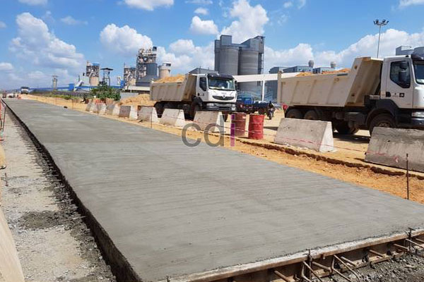

**Cara Finishing Pengecoran Jalan Beton** - Hai Mitra CDI! Apa kabar? Kami kembali hadir dengan informasi penting seputar konstruksi beton, khususnya tips menyelesaikan pengecoran jalan. Artikel ini akan memandu Anda memahami tahap akhir pengecoran agar hasil jalan beton lebih berkualitas dan tahan lama. Yuk, simak bersama!

*Finishing Pengecoran Jalan Beton*

Pengecoran jalan beton melibatkan beberapa tahapan kunci, mulai dari persiapan lahan hingga penyelesaian akhir. Secara garis besar, proses ini terbagi menjadi dua bagian utama: **pertama**, persiapan konstruksi dasar seperti pengerasan lahan, pemasangan besi, dan bekisting; **kedua**, proses pengecoran hingga finishing. Artikel kali ini akan fokus pada tahap akhir—penyelesaian pengecoran. Nah, kalau Anda ingin memahami prosesnya dari awal hingga akhir, silakan kunjungi artikel kami sebelumnya tentang [**Proses Konstruksi Dasar Jalan Beton**](/blog/5-tahapan-kontruksi-dasar-jalan-beton). 

Berikut adalah tahapan-tahapan finishing pengecoran jalan beton yang perlu Anda ketahui:

## Menuangkan Cor Beton

Setelah persiapan konstruksi dasar seperti pemasangan besi dan bekisting (form work) selesai sekitar 70%, saatnya memesan beton cor readymix ke *batching plant* terdekat di (not detected). Untuk jalan rigid, kami merekomendasikan penggunaan 3 lapisan mutu dengan ketebalan 15-20 cm: lapisan dasar 5cm dengan mutu B0, lapisan tengah 5cm dengan K300, dan lapisan atas 5cm dengan K350. Pemilihan mutu beton bisa disesuaikan, baik beton biasa dengan pengeringan 28 hari, maupun beton *fast track* 3 hari, tergantung kebutuhan dan kondisi proyek di (not detected).

Pastikan semua elemen konstruksi sudah terpasang dengan akurat dan kokoh. Siapkan alat perata seperti balok kayu lurus atau material serupa. Vibrator juga penting untuk membantu memadatkan cor beton. Jangan lupakan juga konsumsi untuk para pekerja agar semangat menyelesaikan pekerjaan. Tuangkan cor beton secara perlahan dari truk mixer, mulai dari ujung jalan untuk memudahkan proses perataan.

## Penyebaran Coran

Tahap ini adalah proses pemadatan dan perataan cor beton yang sudah dituang. Pada pengecoran dak lantai atau tiang, vibrator sangat membantu mempercepat dan menjaga mutu beton. Untuk pengecoran jalan beton, kepadatan susunan besi tidak setinggi konstruksi dak atau tiang, sehingga vibrator mungkin tidak terlalu krusial. Namun, penggunaannya tetap disarankan untuk hasil yang lebih padat. Pastikan balok kayu yang digunakan melebihi lebar jalan dan benar-benar lurus. Gunakan balok kayu yang berat untuk memudahkan proses perataan. Teknik menggergaji bisa diterapkan untuk menarik dan mendorong balok kayu dengan efektif. 

## Penghalusan Cor / Finishing

Pada tahap akhir, Anda memerlukan alat penghalus khusus seperti Darby untuk memadatkan lapisan atas cor beton setelah setengah kering. Setelah itu, buatlah tali air atau sendi kontrol dari pinggir ke pinggir jalan untuk mengalirkan air permukaan. Terakhir, tutupi seluruh permukaan beton dengan karung goni atau material penyerap air lainnya. Tujuannya adalah menjaga kelembaban beton selama masa pengeringan, yaitu 28 hari untuk beton biasa atau 3 hari untuk beton *fast track*. Dengan demikian, beton akan memiliki kekuatan maksimal dan siap digunakan.

> _Intinya, keberhasilan tahap finishing pengecoran jalan beton membutuhkan tim yang solid dan manajemen waktu yang baik. Hal ini memastikan proses pengecoran berjalan cepat dan mutu beton tetap optimal._

Demikianlah tips singkat mengenai tahap finishing pengecoran jalan beton dari kami. Semoga informasi ini bermanfaat bagi Anda. Jika Anda membutuhkan supplier cor beton readymix berkualitas di (not detected), jangan ragu untuk menghubungi kami melalui layanan email atau telepon yang tersedia di website ini. Tim kami siap membantu memenuhi semua kebutuhan cor beton Anda! Jangan lupa, Anda juga bisa melihat  untuk memahami pilihan material yang tersedia. Terima kasih.