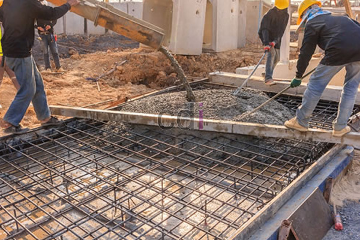

**Tahapan Membuat Pondasi Rumah dengan Cor Beton** - Hai Mitra CDI! Apakah Anda sedang merencanakan pembangunan rumah bertingkat di (not detected)? Atau mungkin sedang mempertimbangkan untuk membangun rumah dengan desain yang unik dan kokoh? Pondasi yang kuat adalah kunci utama dari setiap bangunan, terutama untuk rumah bertingkat. Nah, yuk kita bahas tuntas tahapan membuat pondasi rumah dengan cor beton yang kuat dan tahan lama, lengkap dengan tips memilih material yang tepat. Kami juga akan mengulas sedikit tentang bahan-bahan yang bisa Anda gunakan untuk lantai atas rumah impian Anda.

*Tahapan Membuat Pondasi Rumah dengan Cor Beton*

> _Butuh material berkualitas untuk pondasi rumah Anda di (not detected)? Kami juga menjual Material Batu Kali dan Belah untuk pondasi Rumah /Gedung dengan harga yang bersaing. Untuk informasi lebih lanjut dan pemesanan, jangan ragu untuk menghubungi kami. Anda juga dapat melihat daftar harganya [**DISINI**](/blog/daftar-harga-material-pasir-dan-batu-terlengkap)._

## Tahapan Membuat Pondasi Rumah

Berikut ini adalah panduan langkah demi langkah untuk membangun pondasi rumah bertingkat dengan ukuran 5x10 meter. Prosedur ini tentu bisa disesuaikan dengan skala proyek Anda.

- 1. Pembuatan Tiang Cor Beton: Buat tiang cor beton yang menancap kuat ke dalam tanah dengan jarak 3 meter antar tiang. Kedalaman tiang idealnya antara 2 hingga 3 meter, dengan diameter lingkaran 20 cm.
- 2. Pemasangan Cor Beton Cakar Ayam: Perkuat empat sudut bangunan dengan cor beton cakar ayam. Ukuran ideal cakar ayam adalah 1 meter persegi dengan ketebalan cor beton antara 40 cm hingga 50 cm.
- 3. Pembuatan Pondasi Penghubung: Selanjutnya, buat pondasi bangunan vertikal yang menghubungkan setiap tiang. Diameter pondasi yang disarankan berkisar antara 25 cm hingga 30 cm.
- 4. Penambahan Besi Cor Sudut: Pastikan setiap sudut ruangan diberi besi cor tambahan untuk memperkuat sambungan dengan tiang sudut rumah.

Setelah pondasi dan dinding lantai bawah selesai dicor, giliran kita mempersiapkan cor untuk lantai atas. Tentu saja, Anda perlu menyiapkan bahan-bahan yang memadai terlebih dahulu.
- 1. Persiapan Material: Siapkan triplek untuk bekisting, steger (perancah) sebagai penyangga bekisting, besi yang sudah dirakit (diikat), dan bahan cor beton yang akan dicampur dengan molen. Atau, pertimbangkan penggunaan jasa beton *readymix* untuk kemudahan dan efisiensi waktu.
- 2. Rakitan Besi Bekisting: Untuk hasil yang optimal, jarak rakitan besi bekisting sebaiknya 10 cm dengan model rakitan besi sersak, dan 50 cm untuk rakitan besi balok.
- 3. Pemasangan Bekisting: Gunakan triplek dengan ketebalan 9 milimeter dan kayu dengan ukuran 4 cm x 6 cm sebagai dasar triplek, dengan jarak 50 cm antar kayu.
- 4. Pemasangan Steger: Pastikan steger yang digunakan cukup kuat untuk menopang beban cor beton. Anda bisa menggunakan bambu, pipa besi, atau scaffolding.

Setelah semua material siap, saatnya melakukan pengecoran dak lantai. Untuk mempercepat proses, Anda bisa memanfaatkan [readymix concrete](/blog/ready-mix-concrete-atau-cor-beton-curah-siap-pakai "Ready mix concrete atau cor beton curah siap pakai") (Beton Ready Mix) yang akan menghemat tenaga dan biaya Anda. Mutu beton yang tepat untuk cor dak lantai 2 adalah K225, K250, K275, atau K300. Pemesanan *ready mix concrete* sebaiknya dilakukan 2-3 hari sebelum proses pengecoran. Jangan sungkan untuk menghubungi kami untuk mendapatkan penawaran harga terbaik. Kami siap melayani kebutuhan beton Anda di (not detected)! Semakin kuat pondasinya, semakin nyaman rumah Anda! Jangan ragu untuk berkonsultasi dengan tim ahli kami untuk desain pondasi yang paling sesuai dengan kebutuhan Anda.