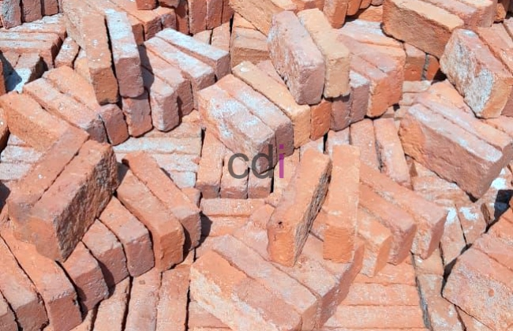

**Takaran Adukan Pasang Bata yang Tepat untuk Dinding Kokoh** - Hai Mitra CDI! Bingung cari komposisi adukan pasang bata yang pas? Adukan yang kurang tepat, entah terlalu encer atau terlalu kental, bisa bikin dinding jadi kurang kuat dan cepat rusak, lho. Jangan khawatir! Artikel ini akan membahas secara detail takaran adukan yang ideal untuk hasil kerja lebih maksimal dan tahan lama. Yuk, kita bahas bersama!

## Mengapa Takaran Adukan Itu Penting?
Sebelum menyelami lebih dalam, penting bagi Mitra CDI untuk memahami mengapa takaran adukan itu krusial. Adukan bukan sekadar bahan campuran biasa, melainkan fondasi utama yang menentukan kekuatan dan keawetan struktur dinding.

Takaran yang salah berpotensi menimbulkan masalah serius. Misalnya, adukan yang terlalu encer membuat bata tidak merekat kuat, sehingga dinding rentan retak dan bergeser. Di sisi lain, adukan yang terlalu kental menyulitkan proses pemasangan dan menghasilkan permukaan yang tidak rata dan kurang estetik. Jadi, memilih takaran yang tepat adalah investasi penting untuk dinding yang kokoh dan punya tampilan bagus.

## Panduan Menentukan Takaran Adukan Pasang Bata
Adukan pasang bata umumnya terdiri dari campuran semen, pasir, dan air. Pertanyaan besarnya: berapa perbandingan idealnya? Berikut adalah panduan praktis yang bisa Anda ikuti:

### 1. Perbandingan Semen dan Pasir
Takaran standar adukan pasang bata adalah 1:4, artinya 1 bagian semen untuk 4 bagian pasir. Perbandingan ini sudah teruji memberikan kekuatan optimal untuk berbagai jenis bangunan di (not detected).

Namun, untuk dinding yang memerlukan kekuatan ekstra – seperti dinding penahan, dinding bangunan bertingkat, atau dinding yang sering terpapar cuaca ekstrem – perbandingan 1:3 bisa menjadi pilihan yang lebih baik. Mitra CDI bisa menyesuaikan pilihan sesuai kebutuhan spesifik proyek Anda, ya!

### 2. Pilih Pasir Berkualitas Tinggi
Pasir berperan vital dalam menentukan kualitas adukan pasang bata. Hindari menggunakan pasir yang tercemar tanah atau lumpur, karena dapat mengganggu daya rekat adukan. Pilihlah pasir dengan tekstur halus dan bebas dari kotoran. 

Tips dari kami di CDI: sebelum mencampur, saring pasir menggunakan ayakan untuk memisahkan kotoran dan partikel kasar. Ini akan menghasilkan adukan yang lebih bersih dan berkualitas.

## Mengapa Ketepatan Takaran Adukan Sangat Krusial?

Adukan bukan hanya perekat antar bata, tetapi juga berperan sebagai penyeimbang tekanan struktural pada dinding. Ketidaktepatan takaran adukan dapat mengurangi daya rekat dan kemampuan dinding dalam menahan getaran sehari-hari, mulai dari kegiatan rutin seperti menutup pintu hingga getaran dari lalu lintas di sekitar bangunan di (not detected).

## Rasio Standar yang Dapat Diandalkan

Rasio yang paling umum digunakan untuk pasang bata adalah **1 bagian semen : 4 bagian pasir**. Rasio ini telah terbukti memberikan kekuatan optimal untuk dinding rumah tinggal pada umumnya.

Untuk aplikasi yang lebih menuntut — dinding penahan, struktur bangunan bertingkat, atau area yang rentan terhadap kelembapan — rasio **1:3** dianjurkan untuk menghasilkan daya rekat dan kekuatan yang lebih tinggi.

## Kualitas Pasir Berpengaruh Besar pada Hasil Akhir

Rasio yang akurat tidak akan berarti banyak jika pasir yang digunakan berkualitas buruk. Hindari pasir dengan kandungan tanah atau lumpur tinggi. Cara mudah untuk memeriksanya adalah dengan menyaring pasir sebelum dicampur untuk menghilangkan kotoran dan partikel kasar yang dapat mengganggu daya rekat. Pasir yang bersih juga membuat adukan lebih mudah diaplikasikan secara merata ke permukaan bata.

## Langkah-Langkah Mencampur Adukan yang Benar

### 1. Campur Bahan Kering Secara Merata
Aduk semen dan pasir dalam kondisi kering sampai warnanya homogen. Hindari menambahkan air terlalu cepat, karena pencampuran kering yang tidak sempurna dapat menciptakan titik-titik lemah pada adukan.

### 2. Tambahkan Air Secara Bertahap
Tuangkan air sedikit demi sedikit sambil terus diaduk hingga adukan mencapai konsistensi yang ideal – cukup membentuk tetapi tidak terlalu cair atau terlalu padat.

### 3. Gunakan Takaran yang Konsisten
Selalu gunakan ember atau wadah dengan ukuran yang sama setiap kali mengambil takaran untuk memastikan konsistensi rasio dari batch ke batch. Ini sangat penting untuk proyek besar yang membutuhkan banyak adukan dalam satu hari kerja di (not detected).

## Ciri-Ciri Adukan yang Siap Digunakan

Adukan yang baik seharusnya menempel dengan baik pada sekop tanpa tetesan air berlebih, namun tetap cukup lentur untuk diratakan dengan cetok. Jika adukan terasa terlalu berat dan mengalir atau justru terlalu kaku untuk dibentuk, periksa kembali jumlah air yang ditambahkan.

## Kesalahan Umum yang Harus Dihindari

Hindari menggunakan adukan yang sudah dibuat lebih dari satu jam—daya rekatnya menurun signifikan meski secara visual masih tampak normal. Jangan juga gunakan semen yang sudah lama disimpan atau menggumpal, karena kekuatannya sudah berkurang. Menambahkan air ke adukan yang mulai mengeras untuk membuatnya dapat digunakan kembali juga merupakan kesalahan umum yang sebaiknya dihindari karena justru merusak struktur ikatan yang sudah terbentuk.

## Perkiraan Kebutuhan Adukan per Meter Persegi Dinding

Sebagai perkiraan kasar, dinding bata merah standar dengan ketebalan nat 1-1,5 cm membutuhkan sekitar 0,02-0,03 m³ adukan per meter persegi. Untuk dinding seluas 20 m², itu berarti sekitar 0,4-0,6 m³ adukan total, setara dengan 3-4 sak semen dengan rasio 1:4. Selalu siapkan sedikit lebih banyak dari perhitungan minimum untuk mengantisipasi kebutuhan perbaikan kecil selama proses pengerjaan.

## Penutup

Takaran adukan pasang bata yang ideal adalah 1:4 untuk keperluan umum atau 1:3 untuk dinding yang membutuhkan kekuatan ekstra – namun rasio ini akan optimal jika dipadukan dengan pasir berkualitas dan teknik pencampuran yang tepat serta lokasi (not detected). Jangan ragu untuk berkonsultasi dengan ahli bangunan jika Anda merasa kesulitan menentukan perbandingan yang tepat.

Butuh bantuan profesional untuk proyek bangunan atau desain interior Anda di (not detected)? Tim Kami siap membantu! Silakan hubungi kami melalui tombol **Telepon** atau **WhatsApp** yang tersedia di bagian bawah halaman ini untuk mendapatkan penawaran terbaik dan solusi bangunan berkualitas. 
<table class="table">
  <caption>Ukuran Bata Merah</caption>
  <thead>
    <tr><th>Panjang (cm)</th><th>Lebar (cm)</th><th>Tinggi (cm)</th></tr>
  </thead>
  <tbody>
    <tr><td>22</td><td>10.5</td><td>6.5</td></tr>
  </tbody>
</table>
