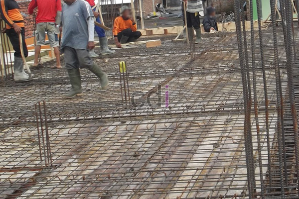

**Takaran Cor Dak Rumah: Panduan Lengkap untuk Hasil Kuat dan Tahan Lama** - Hai Mitra CDI! Punya rencana membangun atau merenovasi dak rumah di (not detected)? Penting banget nih untuk memahami takaran cor yang tepat. Seringkali, kesalahan kecil dalam proporsi campuran bisa berakibat fatal – rentan retak, bocor, bahkan membahayakan struktur bangunan. Yuk, simak panduan lengkap ini agar dak rumah Anda kokoh dan tahan lama!

### Mengapa Takaran Cor Dak Rumah Begitu Penting?

Kualitas beton adalah kunci kekuatan dan umur panjang dak rumah. Nah, beton yang berkualitas itu lahir dari campuran yang pas – antara semen, pasir, kerikil, dan air. Bayangkan kalau takarannya meleset… hasilnya bisa rapuh, mudah retak, dan nggak kuat menahan beban. Lama-lama bisa jadi masalah besar, perlu biaya perbaikan yang lumayan juga.

Selain itu, takaran yang nggak tepat juga bisa bikin waktu pengerasan beton jadi nggak ideal. Terlalu banyak air? Prosesnya lama dan beton jadi kurang kuat. Kekurangan air? Beton susah dipadatkan dan gampang retak. Jadi, memahami rasio yang benar dan mengikuti panduan itu krusial banget, lho!

### Rasio Campuran Cor Dak Rumah yang Direkomendasikan

Rasio campuran 1:2:3 (semen:pasir:kerikil) itu patokan yang umum digunakan untuk cor dak rumah. Tapi ingat, ini hanya dasar ya.  Supaya hasilnya maksimal, Kami sarankan menggunakan mutu beton K-250 sampai K-300. Dengan begitu, ketahanan dak rumah Anda di (not detected) akan lebih terjamin.

Berikut rincian takaran untuk 1 meter kubik cor dak, dengan asumsi memakai semen Portland tipe I:

*   Semen: 350 – 400 kg
*   Pasir: 700 – 800 kg
*   Kerikil: 1050 – 1200 kg
*   Air: 175 – 200 liter

Pastikan bahan bangunan yang digunakan berkualitas SNI ya! Gunakan air bersih, bebas kotoran dan minyak.

### Faktor-Faktor yang Perlu Diperhatikan dalam Menentukan Takaran

Ada beberapa hal yang bisa mempengaruhi takaran cor dak rumah yang ideal:

*   **Mutu Beton yang Dibutuhkan:** Semakin tinggi mutu beton yang Anda inginkan, semakin besar proporsi semen yang dibutuhkan.
*   **Jenis Agregat:** Ukuran dan bentuk pasir serta kerikil memengaruhi jumlah air yang dibutuhkan. Pasir yang lebih halus biasanya butuh air lebih banyak.
*   **Kondisi Cuaca:** Suhu dan kelembapan lingkungan juga berpengaruh pada proses pengerasan beton. Saat cuaca panas, air lebih cepat menguap, jadi perlu ditambahkan air lebih banyak.
*   **Penggunaan Admixture:** Admixture atau bahan tambahan bisa meningkatkan kualitas beton (kekuatan, daya tahan, kemudahan kerja). Penggunaannya juga bisa memengaruhi takaran air dan semen.

### Perkiraan Biaya Cor Dak Rumah per Meter Persegi di (not detected)

Biaya cor dak rumah bisa bervariasi tergantung luas area, ketebalan dak, mutu beton yang dipilih, dan harga material di (not detected). Secara garis besar, estimasi biaya per meter persegi pada 2026 ini berkisar antara Rp 350.000 hingga Rp 600.000.

Ingat, ini hanya perkiraan ya! Untuk penawaran yang lebih akurat sesuai kebutuhan proyek Anda, hubungi Kami. Estimasi ini sudah termasuk biaya material (semen, pasir, kerikil, air, besi tulangan) dan upah tukang. Biaya tambahan mungkin diperlukan untuk perancah, bekisting, atau peralatan khusus.

Butuh informasi lebih lanjut? Jangan sungkan untuk menghubungi Kami melalui tombol **WhatsApp** atau **Telepon** yang ada di halaman ini. Mari wujudkan dak rumah impian Anda di (not detected) dengan beton yang kuat dan berkualitas! [Batu Cor Pondasi: Pilihan Terbaik untuk Konstruksi Rumah Kokoh](/blog/batu-cor-pondasi/) – pastikan pondasi Anda juga kuat, ya! [Besi Dak Cor - Hai Mitra CDI! Gimana kabarnya? Hari ini, kami mau membahas elemen penting dalam konstruksi bangunan – besi dak cor. Baik untuk renovasi rumah, membangun hunian baru, atau proyek komersial, artikel ini aka](/blog/besi-dak-cor/) — penting sekali untuk memperkuat dak dengan besi yang tepat.