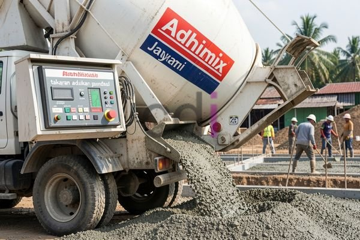

**Takaran Pasir untuk Pondasi: Panduan Lengkap & Perhitungan Akurat** - Hai Mitra CDI! Punya rencana membangun? Fondasi yang kokoh itu segalanya, lho. Seringkali kesalahan kecil dalam takaran material bisa berakibat fatal. Nah, di artikel ini kami akan kupas tuntas soal takaran pasir untuk pondasi agar bangunan Mitra CDI aman dan tahan lama. Yuk, simak panduan lengkapnya!

## Mengapa Takaran Pasir Pondasi Begitu Krusial?

Pasir adalah komponen penting dalam campuran pondasi, berperan sebagai pengisi celah antara material kasar seperti kerikil dan batu split, sekaligus membantu semen dalam proses pengikatan. Takaran yang tepat sangat menentukan kualitas akhir pondasi. Terlalu banyak pasir? Pondasi jadi lebih berpori dan mudah retak akibat perubahan cuaca. Kekurangan pasir? Campuran jadi sulit diolah dan kekuatannya berkurang drastis.

Mitra CDI perlu tahu, bukan cuma jumlahnya, kualitas pasir juga berpengaruh besar. Pasir yang ideal itu bersih, keras, dan memiliki gradasi butiran yang baik. Hindari pasir yang tercampur lumpur, tanah liat, atau bahan organik karena itu bisa mengurangi daya rekat dan ketahanan pondasi. Penggunaan pasir yang kurang berkualitas bisa jadi bumerang di kemudian hari.

## Rasio Campuran Pasir, Semen, dan Kerikil untuk Pondasi Optimal

Rasio ideal campuran pondasi yang sering digunakan adalah 1:2:3 (semen:pasir:kerikil). Artinya, untuk setiap 1 bagian semen, dibutuhkan 2 bagian pasir dan 3 bagian kerikil. Tapi, rasio ini bisa disesuaikan dengan jenis pondasi, beban bangunan, dan kondisi tanah di (not detected). Untuk rumah tinggal biasa, rasio ini umumnya sudah cukup baik.

Kalau bangunannya lebih berat, misalnya untuk ruko atau bangunan bertingkat, Kami sarankan rasio yang lebih kuat, misalnya 1:1,5:3 atau bahkan 1:1:3. Penting banget untuk berkonsultasi dengan ahli konstruksi atau insinyur sipil agar mendapatkan rasio yang paling pas untuk proyek Mitra CDI. Jangan lupa juga memilih mutu semen yang tepat, misalnya K-400 atau K-500, demi kualitas pondasi yang terjamin.

### Menghitung Takaran Pasir Sesuai Volume Pondasi

Sebagai contoh, mari kita hitung kebutuhan pasir untuk pondasi rumah dengan volume 10 meter kubik. Dengan rasio 1:2:3:

*   Volume semen = 10 m³ / (1+2+3) = 2 m³
*   Volume pasir = 2 x 2 m³ = 4 m³
*   Volume kerikil = 3 x 2 m³ = 6 m³

Jadi, untuk membuat 10 meter kubik campuran pondasi dengan rasio 1:2:3, Mitra CDI memerlukan 4 meter kubik pasir. Ingat, angka ini belum termasuk potensi kehilangan material selama proses pencampuran dan pengecoran. Kami anjurkan untuk menambah 5-10% sebagai cadangan, biar lebih aman.

## Jenis Pasir yang Cocok untuk Pondasi yang Kuat

Ada beberapa pilihan jenis pasir yang bisa digunakan untuk konstruksi pondasi:

*   **Pasir Beton:** Pasir dengan butiran keras, tajam, dan gradasi baik. Sangat direkomendasikan untuk campuran beton karena memberikan kekuatan dan daya tahan maksimal.
*   **Pasir Urug:** Teksturnya lebih kasar dan banyak kerikilnya. Cocok untuk pengurugan atau lapisan dasar pondasi.
*   **Pasir Pasang:** Butirannya lebih halus dan bersih. Biasanya dipakai untuk pekerjaan plester atau acian.

Untuk pondasi, Kami tetap merekomendasikan pasir beton. Meski mungkin sedikit lebih mahal, kualitas dan kekuatannya jauh lebih unggul. Harga pasir beton di (not detected) saat ini bervariasi, tergantung lokasi dan supplier. Untuk mendapatkan penawaran harga terbaik sesuai dengan kebutuhan proyek Mitra CDI, silakan hubungi Kami.

## Pertimbangan Biaya Tambahan dan Estimasi Anggaran Pondasi

Selain biaya material utama seperti pasir, semen, dan kerikil, ada juga biaya lain yang perlu diperhitungkan, seperti transportasi, upah tukang, dan biaya cetakan pondasi. Estimasi biaya pembuatan pondasi rumah tipe 45 di (not detected) berkisar antara Rp 20.000.000 hingga Rp 50.000.000, tergantung kedalaman pondasi, kondisi tanah, dan desain bangunan. Biaya ini bisa sangat bervariasi, jadi pastikan untuk membuat perencanaan anggaran yang matang.

Creative Design Interior siap membantu Mitra CDI menghitung anggaran pondasi secara rinci. Kami menyediakan layanan desain pondasi, perhitungan kebutuhan material, dan pengerjaan pondasi berkualitas dengan harga yang bersaing. Jangan ragu untuk berdiskusi dengan tim ahli Kami.

Butuh informasi lebih lanjut? Jangan sungkan untuk menghubungi Kami melalui tombol **Telepon** atau **WhatsApp** yang tersedia di bawah ini. Kami siap membantu Anda sukses dengan proyek konstruksi di (not detected)!

[1 M3 Pasir Beton Berapa Kg? Panduan Lengkap untuk Perhitungan Material](/blog/1-m3-pasir-beton-berapa-kg/) — Panduan praktis menghitung volume dan berat pasir beton untuk proyek konstruksi Anda.