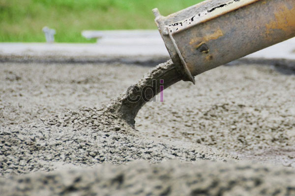

**Takaran yang Tepat untuk Cor Beton** - Hai Mitra CDI! Pernahkah Anda bertanya-tanya, bagaimana caranya mendapatkan cor beton yang kuat dan tahan lama? Nah, takaran yang tepat adalah kuncinya! Membuat cor beton dengan takaran yang pas itu penting banget, lho. Bukan cuma soal kekuatan bangunan, tapi juga efisiensi biaya. Yuk, simak panduan lengkap ini agar perbandingan pasir, semen, dan batu split sesuai kebutuhan. Kami akan membahas berbagai takaran yang umum digunakan – baik dengan timba, sekop, atau dolak – asalkan konsisten dalam satu adukan. Jadi, bagaimana caranya? Mari kita bahas lebih detail!

*Mencari takaran yang ideal untuk cor beton*

## Perhitungan Takaran Cor yang Tepat

Penggunaan timba cor masih menjadi cara favorit para tukang bangunan. Biasanya, takaran yang diterapkan adalah 1 timba semen, 2 timba pasir, dan 3 timba split. Kalau satu karung semen beratnya 40 kg, maka setara dengan 7 timba. Artinya, untuk satu karung semen dibutuhkan 14 timba pasir dan 21 timba split.

Bayangkan Anda akan membuat dak cor beton dengan tebal 12 cm. Dengan perhitungan di atas, satu karung semen cukup untuk 1 meter persegi. Jadi, kalau ukuran dak beton Anda 5 m x 8 m, Anda akan memerlukan sekitar 40 karung semen. Tapi, ada solusi yang lebih praktis dan hemat, yaitu menggunakan *ready mix concrete* atau beton siap pakai dari penyedia seperti Jayamix, Holcim, atau Pionir. Dengan beton siap pakai, takaran sudah pasti akurat, dan seringkali lebih ekonomis dibandingkan cara manual. [Analisa Cor Beton K 225](/blog/analisa-cor-beton-k-225/) juga bisa jadi referensi tambahan untuk menentukan mutu cor yang tepat.

## Beton Berkualitas: Pentingnya Mutu yang Tepat

Kualitas cor beton bukan cuma soal jumlah semen atau split yang digunakan, lho. Penggunaan material berlebihan tidak selalu menjamin kekuatan bangunan. Sebaliknya, ketidaktepatan takaran justru bisa menyebabkan retak-retak, bahkan potensi runtuhnya bangunan dalam jangka waktu tertentu. Itulah mengapa, penggunaan takaran cor beton yang sesuai sangat penting. Memilih mutu cor yang tepat akan berdampak positif bagi ketahanan bangunan Anda. 

Sebagai alternatif, jangan ragu untuk berkonsultasi dengan tukang bangunan terpercaya atau langsung dengan ahli cor beton. Kebutuhan cor bervariasi tergantung proyek. Anda juga bisa langsung menghubungi tim **CDI** untuk mendapatkan konsultasi mengenai kebutuhan cor beton Anda. Kami siap membantu menentukan tipe mutu beton yang paling sesuai untuk konstruksi bangunan Anda. Kami bahkan bersedia melakukan survei lokasi untuk meninjau kebutuhan beton cor di proyek Anda di (not detected). 

Kami juga menyediakan berbagai material bangunan berkualitas, termasuk pasir, semen, dan split untuk kebutuhan cor beton Anda. Jangan lewatkan juga penawaran menarik untuk jasa pengecoran profesional dari CDI di (not detected)! [Apakah Pengertian Cor Beton Itu?](/blog/apakah-sebenarnya-cor-beton-itu/) akan memberikan pemahaman dasar yang berguna bagi Anda.