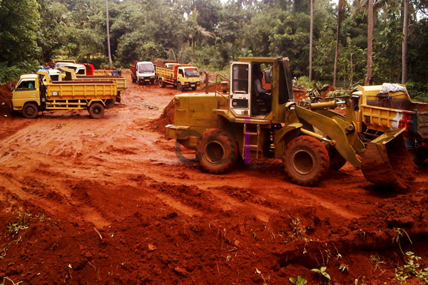

**Tanah Merah Bekasi: Harga Per Kubik dan Tips Penggunaan Terbaik** - Mitra CDI yang berbahagia, tahukah Mitra bahwa permintaan akan tanah merah di wilayah Bekasi dan sekitarnya terus meningkat setiap tahunnya? Hal ini disebabkan oleh banyaknya proyek konstruksi, baik skala kecil maupun besar, yang membutuhkan material urugan dan pondasi yang ekonomis. Kami dari Creative Design Interior hadir untuk membantu Mitra CDI memenuhi kebutuhan akan tanah merah berkualitas tinggi dengan harga yang kompetitif.

## Mengapa Tanah Merah Bekasi Banyak Diminati?

Tanah merah, atau sering disebut juga tanah liat merah, adalah jenis tanah yang banyak ditemukan di wilayah Bekasi dan sekitarnya. Mitra CDI, material ini banyak digunakan dalam konstruksi karena sifatnya yang padat, stabil, dan relatif murah dibandingkan dengan material lainnya seperti pasir atau batu split. Tanah merah sangat ideal untuk digunakan sebagai bahan urugan, pembuatan lantai kerja, atau bahkan sebagai campuran dalam pembuatan bata merah. Selain itu, tanah merah juga memiliki daya dukung yang cukup baik sehingga sering digunakan sebagai lapisan dasar fondasi bangunan.

Untuk proyek sederhana seperti urugan halaman atau pembuatan jalan setapak, tanah merah dapat menjadi solusi yang sangat ekonomis. Namun, penting untuk diingat bahwa tidak semua jenis tanah merah cocok untuk semua aplikasi. Pemilihan jenis tanah merah yang tepat akan sangat berpengaruh terhadap kualitas dan kekuatan struktur bangunan. Kami menyarankan agar Mitra CDI selalu berkonsultasi dengan ahli konstruksi sebelum memutuskan untuk menggunakan tanah merah dalam proyek Mitra.

## Estimasi Harga Tanah Merah Bekasi Per Kubik di Tahun 2026

Harga tanah merah Bekasi per kubik di tahun 2026 sangat bervariasi tergantung pada beberapa faktor, termasuk kualitas tanah, lokasi sumber, jarak pengiriman, dan volume pemesanan. Secara umum, harga tanah merah Bekasi berkisar antara Rp 150.000 hingga Rp 300.000 per kubik. Harga ini bersifat estimasi dan dapat berubah sewaktu-waktu — hubungi Kami untuk penawaran terbaru dan paling akurat sesuai kebutuhan proyek Mitra CDI.

Berikut adalah perkiraan biaya yang mungkin timbul:

*   **Harga Tanah Merah:** Rp 150.000 – Rp 300.000 per kubik (tergantung kualitas)
*   **Biaya Pengiriman:** Rp 50.000 – Rp 150.000 per rit (tergantung jarak)
*   **Biaya Bongkar Muat:** Rp 20.000 – Rp 50.000 per truk

Sebagai contoh, jika Mitra CDI membutuhkan 10 kubik tanah merah untuk proyek urugan di wilayah Bekasi, maka perkiraan biayanya adalah sebagai berikut:

*   10 kubik x Rp 200.000 = Rp 2.000.000 (harga tanah merah)
*   1 rit x Rp 100.000 = Rp 100.000 (biaya pengiriman)
*   1 rit x Rp 30.000 = Rp 30.000 (biaya bongkar muat)
*   **Total: Rp 2.130.000**

## Tips Memilih Tanah Merah Bekasi Berkualitas

Memilih tanah merah yang berkualitas adalah kunci untuk memastikan kekuatan dan ketahanan struktur bangunan Mitra CDI. Berikut beberapa tips yang dapat Mitra CDI perhatikan:

1.  **Perhatikan Warna:** Tanah merah yang berkualitas umumnya memiliki warna merah bata yang seragam. Hindari tanah merah yang berwarna pucat atau banyak mengandung kerikil dan pasir.
2.  **Uji Tekstur:** Tekan tanah merah dengan tangan. Jika tanah mudah menggumpal dan tidak mudah hancur, berarti kualitasnya baik.
3.  **Periksa Kandungan Organik:** Pastikan tanah merah tidak mengandung banyak bahan organik seperti akar, daun, atau sampah. Bahan organik dapat menyebabkan tanah menjadi tidak stabil dan mudah ambles.
4.  **Lakukan Uji Laboratorium:** Untuk proyek-proyek besar, Kami sarankan untuk melakukan uji laboratorium terhadap sampel tanah merah untuk mengetahui komposisi dan sifat-sifat fisik tanah secara lebih akurat.

## Creative Design Interior: Solusi Lengkap Kebutuhan Material Bangunan Mitra CDI

Kami dari Creative Design Interior menyediakan layanan penyediaan tanah merah Bekasi berkualitas tinggi dengan harga yang kompetitif. Kami menawarkan berbagai jenis tanah merah sesuai dengan kebutuhan proyek Mitra CDI. Selain tanah merah, Kami juga menyediakan berbagai macam material bangunan lainnya seperti pasir, split, batu belah, bata merah, batako, hebel, sirtu, dan lainnya. 

Kami memiliki pengalaman lebih dari 10 tahun sebagai jasa kitchen set, pembuatan furniture interior, dan pengadaan material bangunan di wilayah Jabodetabek. Kami memberikan skema harga *all in one* yang sudah termasuk material, pengiriman, dan bongkar muat. Tersedia juga gratis ongkir untuk wilayah-wilayah tertentu. Pilihan pembayaran yang fleksibel seperti COD, transfer bank, DP 50%, atau bayar bertahap semakin memudahkan Mitra CDI dalam menyelesaikan proyek. Jangan tunda lagi, [cek daftar harga lengkap Kami](/daftar-harga/) dan temukan solusi material bangunan yang tepat untuk kebutuhan Mitra!

Tim Kami siap membantu mewujudkan proyek Mitra CDI — silakan hubungi melalui tombol **Telepon** atau **WhatsApp** yang tersedia di bawah.
