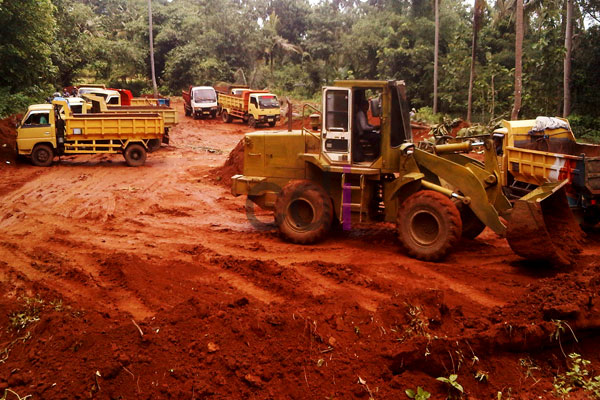

**Tanah Merah Cikarang: Panduan Lengkap Penggunaan untuk Fondasi dan Struktur Bangunan** - Halo Mitra CDI! Pernahkah Anda menghadapi kendala dalam membangun di Cikarang karena penggunaan tanah merah yang kurang tepat? Banyak proyek di sini yang bermasalah dengan retak atau fondasi turun gara-gara pemilihan dan pengolahan material ini kurang pas. Nah, artikel ini hadir untuk memberikan panduan lengkap seputar tanah merah Cikarang – mulai dari karakteristiknya, plus minusnya, sampai cara penggunaannya yang benar untuk fondasi dan struktur bangunan agar kokoh dan tahan lama.

## Mengenal Lebih Dekat Tanah Merah Cikarang

Tanah merah di Cikarang unik, karena terbentuk dari pelapukan batuan vulkanik yang kaya akan besi oksida. Itulah yang bikin warnanya merah khas! Secara fisik, teksturnya lumayan halus sampai sedang, cukup mudah menyerap air (permeabel), dan cenderung plastis. Kandungan liatnya lumayan tinggi, jadi gampang dibentuk. Tapi, perlu diingat, perubahan kadar air bisa bikin volumenya ikut berubah juga, lho.

Kandungan organiknya relatif rendah, yang berarti kurang cocok kalau mau dipakai langsung buat media tanam. Tapi buat keperluan konstruksi, ini sih bukan masalah besar. Penting buat diingat, kualitas tanah merah ini bisa beda-beda tergantung lokasi sumbernya di Cikarang. Ada yang pasirnya lebih banyak, ada juga yang kandungan liatnya lebih dominan.

Supaya yakin kualitasnya, Kami sarankan banget untuk melakukan pengujian di laboratorium dulu. Pengujiannya meliputi analisis butiran, kadar air, batas plastisitas, dan kandungan organik. Hasilnya ini jadi dasar penting untuk menentukan cara pengolahan dan perlakuan yang tepat.

## Kelebihan dan Kekurangan Tanah Merah untuk Konstruksi

Tanah merah Cikarang punya beberapa keunggulan yang membuatnya banyak dipakai di Cikarang, terutama untuk urug dan fondasi sederhana. Harganya relatif murah dibandingkan material lain, gampang dikerjakan, dan gampang dicari di sekitar sini. Nah, kan lumayan hemat biaya!

Tapi, jangan lupa juga kekurangannya. Salah satunya adalah kekuatan gesernya yang kurang begitu tinggi, apalagi kalau kena air. Ini bisa bikin fondasi kehilangan daya dukungnya dan berpotensi menimbulkan masalah struktural. Tanah merah juga gampang tererosi dan berubah volume kalau kadar airnya berubah-ubah.

Sebagai gambaran, kekuatan geser tanah merah yang belum dipadatkan biasanya antara 20-40 kPa. Setelah dipadatkan dengan alat berat, bisa naik jadi 80-120 kPa. Tentu saja, ini tergantung juga tingkat kepadatan dan kadar airnya. Harga tanah merah Cikarang bisa bervariasi, tetapi saat ini berkisar antara Rp 150.000 – Rp 300.000 per truk (kapasitas 6-8 m³). Untuk harga pastinya, yuk, langsung hubungi Kami untuk mendapatkan penawaran terkini sesuai kebutuhan proyek Anda! 

## Cara Mengolah dan Meningkatkan Kualitas Tanah Merah

Kekurangan tanah merah bisa diatasi dengan teknik pengolahan dan peningkatan kualitas yang tepat. Salah satunya, dengan mencampurnya dengan bahan aditif seperti semen, kapur, atau abu terbang. Menambahkan semen bisa meningkatkan kekuatan geser dan mengurangi plastisitas. Biasanya, takaran yang digunakan adalah 5-10% semen terhadap berat tanah merah.

Cara lainnya adalah dengan pemadatan menggunakan alat berat seperti vibratory roller atau static roller. Proses ini akan mengurangi pori-pori tanah, meningkatkan kepadatan, dan kekuatan gesernya. Pemadatan sebaiknya dilakukan bertahap dengan lapisan tipis (15-20 cm setiap lapisan) agar hasilnya maksimal.

Jangan lupakan juga pentingnya drainase yang baik di sekitar fondasi bangunan. Air yang masuk ke dalam tanah merah bisa mengurangi kekuatan gesernya dan menyebabkan fondasi turun. Jadi, Kami rekomendasikan untuk memasang sistem drainase yang efektif agar air bisa mengalir menjauhi fondasi.

## Penerapan Tanah Merah untuk Fondasi Bangunan: Kasus dan Pertimbangan Teknis

Tanah merah Cikarang bisa dipakai untuk fondasi tapak (footing) bangunan 1-2 lantai dengan beban yang tidak terlalu berat. Tapi ingat, harus dilakukan perhitungan kapasitas dukung tanah dengan cermat untuk menjamin keamanan struktur bangunan. Misalnya, untuk bangunan dengan kolom yang menahan beban 100 kN, luas tapak minimalnya harus 1 m² jika tanah merahnya sudah dipadatkan dengan kekuatan geser 100 kPa. (Rumusnya: Luas = Beban / Kekuatan Geser = 100 kN / 100 kPa = 1 m²).

Untuk bangunan yang lebih tinggi atau bebannya lebih berat, sebaiknya gunakan fondasi yang lebih dalam, seperti fondasi menerus atau tiang pancang. Fondasi tiang pancang bisa memindahkan beban bangunan ke lapisan tanah yang lebih keras dan stabil di bagian bawah.

Kalau tanah merah dipakai untuk urugan, pastikan dipadatkan dengan baik dan memiliki kemiringan yang tepat, misalnya 1:1.5 atau 1:2, untuk mencegah longsor. Kami juga sarankan untuk melakukan pengujian kepadatan tanah secara berkala selama proses pengurugan supaya target kepadatan tercapai.

Butuh bantuan untuk memastikan fondasi bangunan Anda aman dan kuat? Atau ada pertanyaan lain seputar penggunaan tanah merah? Klik tombol **WhatsApp** atau **Telepon** di bawah untuk langsung berkonsultasi dengan tim ahli Kami. Kami siap membantu! 

[Tanah Merah Bekasi: Harga Per Kubik dan Tips Penggunaan Terbaik](/blog/tanah-merah-bekasi/) — Artikel ini membahas secara detail penggunaan tanah merah di Bekasi, termasuk informasi harga dan tips penting.