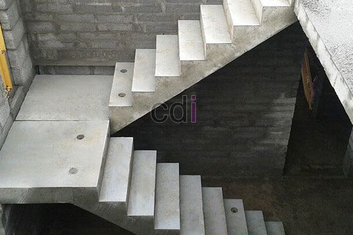

**Tangga Beton: Solusi Kuat dan Estetis untuk Hunian Modern** - Hai Mitra CDI! Sedang merencanakan pembangunan atau renovasi rumah dan mencari solusi tangga yang kuat, tahan lama, serta memiliki tampilan menarik? Tangga beton bisa jadi jawaban tepat! Material ini semakin populer karena kemampuannya menghadirkan perpaduan sempurna antara kekuatan konstruksi dan keindahan desain.

Di artikel ini, kami akan mengulas tuntas segala hal tentang tangga beton, mulai dari keunggulannya, ide desain yang bisa Anda terapkan di (not detected), hingga tips perawatan agar tangga beton Anda tetap awet dan menawan. Yuk, kita mulai!

## Mengapa Tangga Beton Layak Jadi Pilihan Terbaik?

Banyak alasan mengapa tangga beton menjadi favorit di kalangan arsitek dan pemilik rumah. Berikut beberapa di antaranya:

### 1. Ketahanan dan Kekuatan Unggul
Beton dikenal sebagai material konstruksi yang sangat kuat dan tahan lama. Tangga beton mampu menahan beban berat tanpa khawatir retak atau rusak, bahkan mampu bertahan terhadap perubahan cuaca ekstrem. Jadi, bagi Anda yang menginginkan tangga kokoh yang bisa diandalkan bertahun-tahun, tangga beton adalah solusi yang tepat.

### 2. Desain Fleksibel untuk Berbagai Gaya
Salah satu kelebihan utama beton adalah fleksibilitasnya dalam desain. Mau menciptakan tangga dengan gaya minimalis modern, industrial yang <i>stylish</i>, atau klasik yang elegan? Semuanya mungkin diwujudkan dengan tangga beton. Kombinasi dengan material lain seperti kayu, kaca, atau logam juga akan semakin mempercantik tampilan tangga.

### 3. Ideal untuk Aplikasi Interior dan Eksterior
Tangga beton tidak hanya cocok untuk bagian dalam rumah, tapi juga luar ruangan. Tertarik menciptakan akses ke taman atap atau kolam renang yang unik? Tangga beton adalah pilihan yang tepat. Dengan perawatan yang baik, tangga beton outdoor pun akan tetap terlihat cantik dan terawat meski terpapar cuaca.

## Inspirasi Desain Tangga Beton yang Memukau

Bingung mencari ide untuk tangga beton impian Anda? Ini dia beberapa inspirasi desain yang bisa Anda pertimbangkan:

### 1. Gaya Industrial yang Modern dan Edgy
Sedang mengincar tampilan industrial yang sedang tren? Tangga beton dengan finishing kasar yang dipadukan dengan railing besi hitam akan menjadi focal point yang menarik. Gaya ini menciptakan kesan modern, unik, dan penuh karakter pada hunian Anda di (not detected).

### 2. Perpaduan Hangat Beton dan Kayu
Ingin tangga yang kokoh namun tetap terasa hangat dan nyaman? Padukan beton dengan elemen kayu pada pijakan tangga. Kontras antara tekstur beton yang dingin dan kayu yang hangat akan menciptakan keseimbangan visual yang menawan.

### 3. Keanggunan Floating Stairs
Pernah membayangkan tangga yang seolah melayang? Floating stairs adalah solusi yang tepat! Tangga beton jenis ini dirancang tanpa struktur penyangga tambahan, sehingga terlihat minimalis dan elegan. Cocok sekali untuk rumah dengan gaya modern dan ruang yang terbatas.

## Merawat Tangga Beton: Tips Penting Agar Awet dan Indah

Agar tangga beton Anda tetap terlihat prima dan tahan lama, jangan lupa lakukan perawatan rutin. Berikut beberapa tips yang bisa Anda ikuti:

### 1. Pembersihan Rutin untuk Tampilan Optimal
Bersihkan tangga secara berkala dengan sapu atau kain lap lembab untuk menghilangkan debu dan kotoran. Jika ada noda membandel, gunakan sabun ringan yang dilarutkan dalam air.

### 2. Aplikasikan Lapisan Pelindung untuk Keamanan Ekstra
Untuk melindungi tangga beton dari kerusakan akibat cuaca atau paparan sinar matahari langsung, aplikasikan lapisan pelindung seperti sealant. Lapisan ini akan membantu menjaga tampilan dan kekuatan tangga beton Anda.

### 3. Hindari Beban Berlebih demi Keamanan dan Kekuatan
Meskipun tangga beton sangat kuat, hindari memberikan beban yang berlebihan secara terus-menerus. Beban yang terlalu berat dapat merusak struktur tangga dalam jangka panjang.

## Wujudkan Tangga Beton Impian Anda Bersama Kami!

Mitra CDI, tangga beton bukan sekadar elemen struktural, melainkan juga bagian penting dari desain hunian Anda. Dengan kekuatan, fleksibilitas desain, dan daya tahannya yang unggul, tangga beton adalah investasi yang cerdas.

Butuh bantuan untuk merancang dan membangun tangga beton sesuai dengan impian Anda di (not detected)? Jangan ragu untuk menghubungi tim Creative Design Interior! Kami siap membantu mewujudkan tangga impian Anda. Silakan hubungi kami melalui tombol **Telepon** atau **WhatsApp** yang ada di bawah ini untuk konsultasi lebih lanjut. Kami tunggu kabar baik dari Anda!