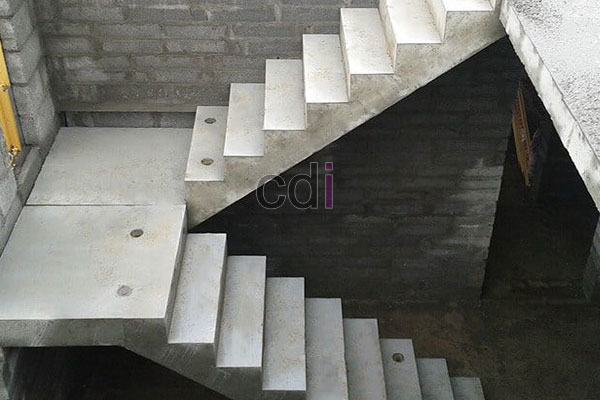

**Tutorial Pengecoran Tangga Beton** - Hai Mitra CDI! Gimana kabarnya? Nah, setelah sebelumnya kita bahas tuntas Tahapan Finishing Pengecoran Jalan Beton, sekarang kami hadir lagi dengan panduan praktis tentang Tehnik Pengecoran Tangga Beton. Semoga artikel ini bisa jadi referensi berharga untuk proyek konstruksi Anda di (not detected) dan sekitarnya, ya!

*Pengecoran Tangga Beton*

Pengecoran tangga beton punya karakteristik yang sedikit berbeda dibandingkan pengecoran dak atau tiang, lho. Pemilihan besi yang tepat itu krusial banget, harus benar-benar seimbang dengan kemiringan dan tinggi tangga yang direncanakan. Yuk, simak langkah-langkah singkat tentang Tehnik Pengecoran Tangga Beton berikut ini.

## Tahap 1: Perencanaan dan Perhitungan

Sebelum mulai belanja material, penting banget untuk mengukur tinggi bangunan dari lantai bawah ke lantai atas di (not detected). Ini akan membantu Anda membayangkan bentuk tangga yang paling pas dan memperkirakan anggaran yang dibutuhkan. Setelah memperoleh tinggi, panjang, dan lebar tangga yang diinginkan, tentukan ukuran besi yang sesuai dengan desain kontruksi Anda. Kami sarankan memilih desain yang tidak terlalu miring atau terlalu datar – idealnya menempel langsung dengan dinding sudut bangunan. Selanjutnya, hitung kebutuhan bahan material pendukung seperti papan kayu, kaso, dan paku untuk bekisting.

## Tahap 2: Pembuatan Bekisting Tangga

Setelah semua material tersedia, kita masuk ke tahap pembuatan form work (bekisting) sebagai penyangga besi dan cor beton. Untuk hasil yang lebih rapi, kami sarankan menggunakan bloktik (triplek tebal ± 9 mm) sebagai alas bawah form work. Ingat, gunakan kaso dengan jarak yang rapat (± 1 m) untuk memastikan keamanan selama pengecoran, terutama di area (not detected).

## Tahap 3: Perakitan Besi

Setelah bekisting siap, potong dan rangkai besi langsung di atas bekisting. Perhatikan betul bagian tangga yang menempel dengan dinding samping. Usahakan besi ditanam langsung ke dinding dengan cara dibor atau menggunakan fisher besi (dinabol) yang kemudian dilas. Untuk sambungan tepi tangga bagian atas dan bawah, pastikan besi dibor atau dilas agar kokoh dan menyatu dengan beton lama. Hal ini sangat penting untuk kekuatan tangga di (not detected).

## Tahap 4: Penuangan Cor Beton

Ini tahap terakhir! Setelah konstruksi besi 70% selesai, siapkan material untuk cor beton: kerikil (split), pasir hitam, dan semen. Jika Anda menggunakan jasa supplier cor beton instan /Readymix di (not detected), pesan minimal 3 atau 2 hari sebelum proses pengecoran. Penting untuk menjaga takaran komposisi semen dan split – jangan sampai terlalu banyak semen (bisa menyebabkan retak) atau terlalu banyak pasir (bisa membuat beton keropos). Olesi bagian atas lantai yang akan disambung dengan tangga beton dengan lem khusus beton agar benar-benar menyatu. Setelah pengecoran selesai, biarkan selama 28 hari hingga beton kering sempurna dan bekisting bisa dibongkar.

Berdasarkan pengalaman kami selama lebih dari 10 tahun menyediakan cor beton instan, mutu beton yang paling cocok untuk pengecoran tangga beton adalah K225, K250, dan K300. Kami siap melayani kebutuhan cor beton Anda di (not detected) dan sekitarnya.

> _Jadi, inti dari Tehnik Pengecoran Tangga Beton ini adalah penggunaan ukuran besi yang tepat, kemiringan tangga yang pas, sambungan besi yang kuat antara beton baru dan lama, serta komposisi adukan cor beton yang ideal._

Demikian panduan singkat dari kami tentang Tehnik Pengecoran Tangga Beton. Semoga bermanfaat untuk perencanaan konstruksi bangunan Anda! Jangan ragu untuk menghubungi kami jika Anda membutuhkan cor beton siap pakai (beton readymix) – detail kontaknya ada di website ini. [Concrete Pump Jakarta: Solusi Efisien untuk Pengecoran Beton Skala Besar](/blog/concrete-pump-jakarta/) bisa jadi pertimbangan tambahan untuk proyek Anda.