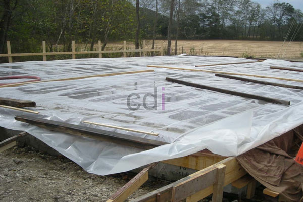

**Tehnik Perawatan /Curing Beton Yang Benar** – Hai Mitra CDI! Pernahkah Anda bertanya-tanya, bagaimana caranya memastikan hasil cor beton di (not detected) benar-benar kuat dan tahan lama? Kuncinya ada pada proses perawatan beton atau *curing*. Proses ini dimulai setelah beton mencapai kondisi *final setting*, atau saat beton mulai mengeras. Tujuan utama curing adalah menjaga proses hidrasi berjalan optimal, mencegah keretakan akibat penguapan air yang terlalu cepat. Nah, minimal seminggu beton perlu dirawat, dengan 3 hari pertama dijaga agar tetap lembab. Dengan perawatan yang tepat, beton akan memiliki daya tekan tinggi, kualitas lebih baik, lebih awet, kedap air, stabil secara struktural, dan tahan terhadap abrasi. Mari kita ulas lebih lengkapnya!

## Berbagai Metode Curing Beton yang Efektif

Ada banyak cara yang bisa Anda terapkan untuk melakukan perawatan beton atau curing beton. Beberapa di antaranya:

- 1. Mengaplikasikan lapisan khusus pada permukaan beton.
- 2. Membasahi permukaan beton secara terus-menerus atau menutupinya dengan material yang lembab.
- 3. Menggunakan uap bertekanan tinggi, uap atmosferik, pelembap, atau pemanasan. 

Yuk, kita bahas satu per satu proses curing beton tersebut.

### _Curing dengan Pembasahan_

Metode perawatan beton dengan pembasahan bisa dilakukan dengan beberapa cara sederhana, seperti menyimpan beton di ruangan yang lembab, merendam beton dalam air, menutupi permukaan beton dengan karung basah, atau menyiram permukaan beton secara berkala. Menggunakan *compound* curing juga termasuk dalam kategori ini, lho!

*Curing Beton dengan Penyiraman Air – Pentingnya Kelembaban*

### _Curing dengan Penguapan_

Curing dengan penguapan melibatkan dua teknik: tekanan rendah dan tekanan tinggi. Untuk tekanan rendah, proses penguapan berlangsung selama 10–12 jam pada suhu 40°–50° Celcius. Sementara itu, curing dengan tekanan tinggi memerlukan waktu 10–16 jam pada suhu 65°–95° Celcius. Penting diingat, sebelum melakukan curing dengan penguapan, suhu beton harus dipertahankan antara 10°–30° Celcius selama beberapa jam terlebih dahulu.

### _Curing dengan Membrane_

Membrane dalam konteks ini adalah lapisan fisik yang berfungsi mencegah penguapan air dari beton. Bahan membrane yang baik harus kering dalam waktu 4 jam, membentuk lapisan yang menempel erat pada beton tanpa memisah, tidak licin, tidak beracun, bebas pori, dan tentunya tidak merusak beton. Metode ini sangat ideal untuk perawatan pada *rigid pavement* atau beton lapisan pondasi. Perawatan dengan membrane sebaiknya segera dilakukan setelah beton mulai mengeras – dan bisa juga sebagai langkah awal sebelum perawatan pembasahan.

### _Curing dengan Metode Alternatif_

Ada juga metode perawatan lainnya, seperti menggunakan sinar infra merah dengan durasi 2–4 jam pada suhu 90° Celcius. Tujuannya adalah mempercepat penguapan air guna menghasilkan beton berkualitas tinggi. Selain itu, Anda bisa menggunakan *curing hidrotermal*, yaitu memanaskan cetakan untuk membuat beton pracetak pada suhu 65° Celcius. Terakhir, ada juga perawatan melalui karbonisasi.

Singkatnya, proses curing atau perawatan beton ini sangat krusial untuk mengembangkan kekuatan dan daya tahan beton. Jadi, pastikan Anda memilih salah satu metode atau teknik perawatan beton (curing) di atas dan terapkan pada pekerjaan cor beton Anda di (not detected). Demikian penjelasan dari kami, apabila ada pertanyaan atau Anda ingin menggunakan jasa pengecoran profesional dari CDI, jangan ragu untuk menghubungi kami. Kami siap membantu! [Pelajari lebih lanjut tentang pentingnya curing beton di sini](/blog/arti-curing/) dan dapatkan tips membangun struktur yang tahan lama.