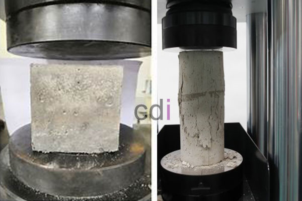

**Tes Silinder Beton: Panduan Lengkap untuk Kualitas Fondasi Anda** - Hai Mitra CDI! Punya proyek konstruksi di (not detected)? Fondasi kuat itu vital, kan? Nah, salah satu cara terbaik memastikan fondasi kokoh adalah dengan tes silinder beton. Proses ini penting banget di setiap pembangunan, baik skala kecil rumah tangga maupun proyek besar. Artikel ini akan membahas semua yang perlu Anda tahu tentang tes silinder beton – mulai dari prosedurnya, standar yang dipakai, sampai cara memahami hasilnya. Yuk, simak bersama!

## Kenapa Tes Silinder Beton Wajib Dilakukan?

Tes silinder beton—atau uji kuat tekan—adalah cara untuk mengukur seberapa kuat beton menahan tekanan. Hasilnya diukur dalam MegaPascal (MPa) dan jadi indikator penting kualitas beton yang dipakai bangunan Anda. Mengapa ini sangat krusial? Sederhananya, kerusakan struktur beton sering kali disebabkan oleh beton yang kualitasnya tidak sesuai dengan rancangan awal. 

Beton yang kurang mutu bisa menyebabkan retak, bengkok, bahkan kegagalan total struktur. Tes silinder beton memastikan beton yang Anda gunakan cukup kuat menahan semua beban yang akan dialaminya selama bangunan berdiri. Selain itu, pengujian ini juga bisa mengungkap masalah pada campuran beton, misalnya kekurangan semen atau terlalu banyak air yang bisa menurunkan kualitas.

## Prosedur Tes Silinder Beton Berdasarkan SNI

Di Indonesia, prosedur tes silinder beton mengikuti standar dari Badan Standarisasi Nasional (SNI). Standar yang berlaku sekarang adalah SNI 03-1971-1990 tentang Cara Uji Kuat Tekan Beton. Secara umum, proses pengujian melibatkan tahapan-tahapan berikut: Pertama, sampel beton dibuat berbentuk silinder dengan diameter 15 cm dan tinggi 30 cm. Sampel ini kemudian dirawat sesuai ketentuan SNI. 

Kedua, setelah usia tertentu (biasanya 7, 14, atau 28 hari), silinder beton ini diuji menggunakan mesin uji tekan. Mesin akan memberikan tekanan secara bertahap sampai silinder beton pecah. Beban maksimum yang terukur kemudian digunakan untuk menghitung kuat tekan beton. Perlu diingat, hasil tes hanya valid kalau sampel beton tidak cacat dan sudah dirawat dengan benar.

## Memahami Hasil Tes dan Mutu Beton

Setelah proses pengujian selesai, Anda akan mendapatkan nilai kuat tekan beton dalam satuan MPa. Nilai ini lalu dibandingkan dengan mutu beton yang dibutuhkan dalam desain struktur bangunan Anda. Mutu beton biasanya ditulis dengan kode K-xxx, di mana xxx menunjukkan kuat tekan karakteristik dalam MPa – contohnya, K-25 artinya beton tersebut diharapkan memiliki kuat tekan minimal 25 MPa.

Penting untuk diingat, kuat tekan karakteristik bukanlah angka pasti. Ini adalah nilai yang diharapkan tercapai oleh sebagian besar sampel beton yang diuji. SNI mengatur jumlah sampel yang harus diuji dan kriteria untuk menentukan apakah beton lulus atau tidak. Umumnya, jika sebagian besar sampel memenuhi atau melebihi mutu beton yang dipersyaratkan, beton tersebut dinyatakan lulus. Sebaliknya, kalau banyak sampel yang tidak memenuhi standar, beton itu gagal dan perlu diperbaiki atau diganti.

## Berapa Biaya Tes Silinder Beton? Faktor-Faktor yang Mempengaruhi

Biaya tes silinder beton bisa berbeda-beda, tergantung beberapa hal. Lokasi laboratorium pengujian, jenis tes yang Anda minta (standar atau tambahan), dan jumlah sampel yang diuji akan memengaruhi harga. Untuk gambaran, biaya tes silinder beton standar di wilayah (not detected) dan sekitarnya pada tahun 2026 berkisar antara Rp 350.000 sampai Rp 600.000 per silinder. Perlu diingat, harga ini hanya perkiraan dan bisa berubah sewaktu-waktu — untuk informasi harga yang lebih akurat sesuai kebutuhan proyek Anda, silakan hubungi Kami.

Faktor lain yang bisa memengaruhi biaya termasuk jarak lokasi proyek ke laboratorium dan tingkat kecepatan layanan yang Anda butuhkan. Beberapa lab menawarkan layanan pengambilan sampel di lokasi proyek, yang tentu saja akan menambah biaya. Kalau Anda butuh hasil tes yang cepat, mungkin ada biaya tambahan untuk layanan prioritas. Di Creative Design Interior, Kami selalu berusaha memberikan solusi pengujian beton yang kompetitif dan sesuai dengan anggaran proyek Anda di (not detected).

Jadi, jangan ragu untuk berkonsultasi dengan Kami. Untuk informasi lebih lanjut dan penawaran khusus, Anda bisa langsung menghubungi Kami melalui tombol **Telepon** atau **WhatsApp** yang ada di halaman ini. Kami siap membantu memastikan fondasi bangunan Anda di (not detected) kokoh dan tahan lama!

[Analisa Campuran Beton 1 3 5: Panduan Lengkap untuk Fondasi Kuat](/blog/analisa-campuran-beton-1-3-5/) — Pelajari lebih lanjut tentang proporsi campuran beton yang ideal untuk fondasi yang kuat dan tahan lama.
[Kualitas Dan Harga Beton Ready Mix](/blog/beton-ready-mix-mutu-dan-harga/) — Cari tahu tentang kualitas dan harga beton readymix saat ini untuk kemudahan konstruksi di lokasi proyek Anda.