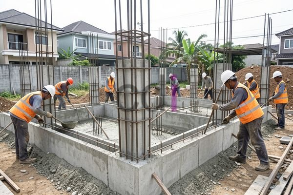

**Tiang Pondasi Rumah: Panduan Lengkap Material, Ukuran, dan Biaya Pemasangan** - Halo Mitra CDI! Tahukah Anda, pondasi adalah jantung dari setiap bangunan? Ibaratnya, tanpa pondasi yang kuat, rumah impian Anda bisa terancam. Artikel ini akan membahas tuntas segala hal tentang tiang pondasi rumah – mulai dari fungsi krusialnya, material yang tepat, cara menentukan ukuran yang pas, hingga perkiraan biayanya di (not detected). Yuk, simak!

### Mengapa Tiang Pondasi Rumah Begitu Penting?

Tiang pondasi berperan vital dalam menyalurkan seluruh beban bangunan ke lapisan tanah yang lebih padat. Bayangkan, semakin berat atap, dinding, dan isinya, semakin besar pula tekanan yang diterima tanah. Nah, tiang pondasi inilah yang bertugas mendistribusikan beban tersebut secara merata, mencegah terjadinya penurunan atau pergeseran bangunan. Terutama jika tanah di lokasi Anda kurang stabil, seperti tanah gambut atau lempung, penggunaan tiang pondasi yang tepat menjadi keharusan.

Sebenarnya, tidak semua rumah membutuhkan tiang pondasi. Rumah dengan struktur ringan, dibangun di atas tanah keras, mungkin cukup dengan pondasi batu kali atau pelat. Tapi, untuk rumah bertingkat, rumah dengan desain unik, atau rumah di (not detected) yang memiliki karakteristik tanah tertentu, tiang pondasi adalah solusi terbaik. Jangan ragu berkonsultasi dengan ahlinya untuk memastikan pondasi rumah Anda sesuai dengan kebutuhan.

### Material Tiang Pondasi: Kelebihan dan Kekurangannya

Memilih material tiang pondasi yang tepat adalah kunci utama. Ada beberapa opsi populer, masing-masing punya kelebihan dan kekurangan tersendiri. Berikut perbandingannya:

*   **Beton Bertulang:** Pilihan paling umum karena kombinasi kekuatan, daya tahan, dan harga yang bersahabat. Terdiri dari semen, pasir, kerikil, air, dan tulangan baja, beton bertulang memenuhi standar mutu K-250 hingga K-300 (SNI).
*   **Baja:** Kuat tarik tinggi dan pemasangan cepat adalah keunggulannya. Namun, baja mudah berkarat dan butuh perawatan khusus. Pemasangannya juga memerlukan alat dan tenaga khusus.
*   **Kayu:** Meski kurang populer, kayu bisa jadi alternatif jika tersedia secara lokal. Pastikan kayu diawetkan agar tahan terhadap rayap dan pembusukan. Kekuatan kayu bervariasi tergantung jenisnya.
*   **Bambu:** Populer di daerah pedesaan karena murah dan mudah didapat. Tapi, kekuatan bambu lebih rendah dari material lain dan memerlukan perawatan rutin.

### Ukuran Tiang Pondasi: Bagaimana Cara Menentukannya?

Ukuran tiang pondasi (diameter/lebar dan panjang) harus dihitung dengan cermat berdasarkan beban bangunan, jenis tanah, dan kedalaman lapisan tanah keras. Diameter umumnya berkisar 30-60 cm, sementara panjangnya disesuaikan dengan kedalaman tanah keras di (not detected).

Contohnya, anggap rumah Anda memiliki beban total 100 ton dan dibangun di atas tanah lempung. Uji sondir menunjukkan daya dukung tanah 10 ton/m² pada kedalaman 3 meter. Maka, luas penampang tiang pondasi yang dibutuhkan adalah 100 ton / 10 ton/m² = 10 m². Jika menggunakan tiang lingkaran, diameter yang dibutuhkan sekitar √(4 x 10 m² / π) ≈ 3.57 meter. Ingat, ini hanya ilustrasi, perhitungan pastinya harus disesuaikan dengan kondisi lahan Anda.

### Perkiraan Biaya Pemasangan Tiang Pondasi di (not detected)

Biaya pemasangan tiang pondasi dipengaruhi oleh material, ukuran, kedalaman, dan lokasi. Di wilayah (not detected), estimasi biaya pemasangan tiang beton bertulang berkisar Rp 300.000 – Rp 600.000 per meter panjang (termasuk material, tenaga kerja, dan alat).

Misalkan Anda membangun rumah dengan 10 tiang, diameter 40 cm, panjang 5 meter. Jika biaya pemasangan Rp 400.000/meter, total biaya menjadi 10 tiang x 5 meter x Rp 400.000 = Rp 20.000.000. Biaya ini belum termasuk perencanaan, pengawasan, dan biaya tambahan lainnya. Untuk informasi harga terkini, silakan melihat tabel  di atas.

Di Creative Design Interior, kami siap mewujudkan pondasi rumah impian Anda yang kokoh dan terpercaya di (not detected)! Kami menggunakan material berkualitas dan didukung tenaga ahli berpengalaman. Jangan khawatir soal biaya, karena kami menawarkan solusi yang sesuai dengan anggaran Anda.

Tertarik untuk berkonsultasi lebih lanjut? Jangan sungkan untuk menghubungi Kami melalui tombol **Telepon** atau **WhatsApp** yang tersedia di halaman ini. Kami siap menjawab semua pertanyaan Anda.