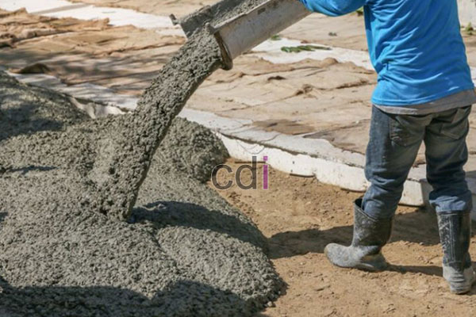

**Tiga Langkah Cara Finishing Cor Beton** - Hai Mitra CDI! Pernahkah Anda bertanya-tanya, bagaimana caranya mendapatkan permukaan cor beton yang benar-benar halus dan rapi? Nah, kami punya solusinya! Artikel ini akan membahas tiga langkah efektif untuk finishing cor beton yang bisa langsung Anda terapkan. Kami sering melihat di lapangan, masih banyak yang belum familiar dengan teknik yang tepat untuk mempercantik tampilan beton mereka. Yuk, simak bersama!

*Mencapai Permukaan Cor Beton yang Sempurna*

Finishing cor beton itu sendiri adalah proses penting untuk meratakan, menghaluskan, dan memadatkan permukaan beton, sehingga menghasilkan tampilan akhir yang sesuai dengan harapan Anda. Proses ini bukan hanya soal estetika, tapi juga berpengaruh pada kekuatan dan daya tahan beton itu sendiri.

## Tiga Langkah Utama Finishing Cor Beton

Ada tiga langkah utama yang kami rekomendasikan untuk menghasilkan finishing cor beton yang berkualitas. Berikut detailnya:

- 1. **Screeding: Meratakan Permukaan Cor** Langkah pertama dalam Tiga Langkah Cara Finishing Cor Beton adalah *screeding*. Tujuannya? Meratakan permukaan cor beton yang sudah dituang ke dalam bekisting. Proses ini biasanya menggunakan alat screed, berupa balok kayu panjang dengan sisi rata. Teknik yang baik adalah membuat galangan memanjang setiap lebar 2 meter pada lahan bekisting, dengan ketebalan sesuai finishing yang diinginkan. Setelah galangan mengering, ratakan cor beton dengan screed dalam gerakan menggergaji (diperlukan minimal dua orang). Proses diulangi sampai permukaan benar-benar rata dan bebas gelombang.
- 2. **Floating: Menghilangkan Ketidaksempurnaan** Setelah screeding selesai, lanjutkan dengan *floating*. Proses ini bertujuan untuk menghilangkan ketidakrataan kecil yang mungkin masih tersisa setelah screeding. Alat yang digunakan adalah pelampung kayu (atau bahan lain seperti aluminium) dengan ukuran standar 1,5 meter x 20 cm, dan pegangan sepanjang 3 meter. Lakukan gerakan maju mundur sampai sisa material dari proses screeding benar-benar hilang dan permukaan rata.
- 3. **Trowelling: Finishing Halus dan Tahan Lama** Tahap terakhir dari Tiga Langkah Cara Finishing Cor Beton ini adalah *trowelling*. Trowelling memberikan finishing akhir yang halus, keras, dan tahan abrasi dengan bantuan alat scrub. Proses ini juga berguna untuk merapikan sudut-sudut yang belum sempurna setelah floating. Trowelling sebaiknya dilakukan setelah air pada cor beton benar-benar menguap. Gunakan scrub dari baja, aluminium, atau karet (untuk hasil yang lebih halus) dengan ukuran standar panjang 25-50 cm dan lebar 8-12 cm.

Itulah dia, Mitra CDI, Tiga Langkah Cara Finishing Cor Beton yang bisa Anda terapkan. Sebagai informasi tambahan, untuk lantai pabrik, gudang, atau GOR (gedung olahraga) di (not detected), biasanya setelah proses di atas, lantai dilapisi lagi dengan *Floor Hardener*. Pelajari lebih lanjut aplikasinya di [Aplikasi Floor Hardener](/sewa/floor-hardener). Jangan lupa, mutu cor beton *ready mix* yang ideal untuk lantai adalah K250 hingga K350. Anda bisa memesannya dari kami dengan menghubungi tim kami 2-3 hari sebelum proses pengecoran. 

Untuk mendapatkan penawaran terbaik dan konsultasi lebih lanjut mengenai kebutuhan material bangunan di (not detected), jangan ragu untuk menghubungi kami melalui tombol Telepon/WhatsApp yang tersedia di halaman ini. Kami siap membantu Anda!