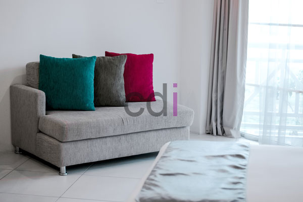

**Tips Memilih Desain Sofa Minimalis Terbaik** - Hai Mitra CDI! Mencari sofa minimalis yang pas untuk ruang keluarga di (not detected)? Wah, pilihan desainnya memang banyak sekali ya! Memilih sofa yang tepat itu penting banget, lho. Selain bikin ruang tamu makin cantik, sofa yang nyaman juga bikin betah kumpul bareng keluarga. Nah, di artikel ini, kami akan berbagi beberapa tips penting supaya Anda nggak salah pilih. Yuk, simak!

*Sofa minimalis*

## Yuk, Pilih Desain Sofa Minimalis yang Tepat!

Memilih desain sofa minimalis itu butuh sedikit perhatian, Mitra. Jangan sampai yang tadinya mau bikin ruang tamu makin keren, malah jadi kurang nyaman atau nggak sesuai dengan ruangan. Perhatikan beberapa hal berikut ini ya, supaya nggak salah pilih:

### 1\. Warna Sofa: Sesuaikan dengan Konsep Rumah Anda

Warna adalah elemen penting dalam desain interior. Untuk sofa minimalis, sebaiknya pilih warna yang netral dan mudah dipadukan dengan warna lain. Pilihan populer antara lain cokelat muda, abu-abu, hitam, atau putih. Jangan lupa pertimbangkan juga warna dinding dan perabot lain di ruang tamu Anda, ya. Kalau punya anak kecil yang aktif, sebaiknya pilih warna yang tidak terlalu mencolok supaya kotornya nggak terlalu kelihatan.

### 2\. Ukuran Sofa: Jangan Sampai Kekecilan atau Kelebihan!

Ukuran sofa harus proporsional dengan luas ruang tamu. Jangan sampai sofa terlalu besar sehingga membuat ruang tamu terasa sempit dan sesak. Sebaliknya, jangan juga memilih sofa yang terlalu kecil sehingga terlihat kurang nyaman. Ukur dulu luas ruang tamu Anda sebelum berbelanja, lalu bandingkan dengan dimensi sofa yang Anda incar.

### 3\. Hindari Sofa dengan Motif yang Terlalu Ramai

Ciri khas sofa minimalis adalah desainnya yang simpel dan elegan. Jadi, sebaiknya hindari sofa dengan motif yang terlalu ramai atau mencolok. Pilihlah sofa dengan warna polos atau motif geometris yang sederhana. Kalau Anda ingin menambahkan sentuhan motif, bisa gunakan bantal-bantal dekoratif dengan motif yang menarik.

### 4\. Kenyamanan adalah Kunci!

Sofa yang cantik memang enak dilihat, tapi yang lebih penting lagi adalah kenyamanannya. Pilih sofa dengan busa yang empuk dan nyaman untuk diduduki. Coba duduk atau bahkan berbaring di atas sofa sebelum membelinya untuk memastikan tingkat kenyamanannya sesuai dengan harapan Anda. Perhatikan juga sandaran punggungnya, apakah cukup nyaman untuk bersandar dalam waktu lama.

### 5\. Bahan Pelapis Sofa: Pilih yang Awet dan Mudah Dibersihkan

Ada banyak pilihan bahan pelapis sofa, seperti katun, linen, rayon, velvet, polyester, dan kulit. Masing-masing bahan memiliki kelebihan dan kekurangan masing-masing. Untuk sofa minimalis, bahan pelapis yang paling populer adalah katun dan polyester karena mudah dibersihkan dan perawatannya relatif mudah. Kalau Anda punya anggaran lebih, kulit juga bisa menjadi pilihan yang menarik.

### 6\. Kekuatan Rangka Sofa: Investasi Jangka Panjang

Rangka sofa adalah bagian penting yang menopang seluruh struktur sofa. Pilihlah sofa dengan rangka yang kuat dan terbuat dari bahan berkualitas, seperti kayu solid atau baja. Jangan ragu untuk bertanya kepada penjual tentang kualitas rangka sofa yang mereka jual. Mintalah garansi sebagai jaminan kualitas produk.

Nah, Mitra, dengan mengikuti tips-tips di atas, kami yakin Anda akan menemukan desain sofa minimalis yang sempurna untuk ruang tamu Anda di (not detected). Jangan ragu untuk berkonsultasi dengan tim desain interior kami untuk mendapatkan saran yang lebih personal. Kami siap membantu Anda menciptakan ruang tamu impian! [Inspirasi Desain Sofa Untuk Rumah Masa Kini](/blog/inspirasi-desain-sofa-untuk-rumah-masa-kini/) bisa jadi referensi tambahan lho!

Untuk informasi lebih lanjut mengenai harga dan ketersediaan produk, silakan hubungi kami melalui tombol Telepon/WhatsApp yang tersedia di halaman ini.