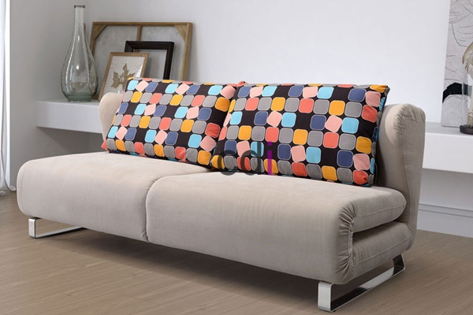

**Tips Memilih Sofa Bed Terbaik Untuk Keluarga** - Hai Mitra CDI! Sedang mencari sofa bed yang nyaman untuk keluarga tercinta? Punya rumah dengan ruang terbatas? Memilih sofa bed yang tepat memang perlu perhatian khusus. Jangan sampai salah pilih, karena sofa bed yang baik bisa jadi solusi sekaligus investasi jangka panjang untuk kenyamanan rumah Anda. Yuk, simak tips berikut ini!

## Panduan Memilih Sofa Bed Terbaik untuk Keluarga di (not detected)

Memilih sofa bed itu tidak sesederhana memilih camilan favorit, lho. Ada beberapa hal penting yang perlu diperhatikan agar Anda puas dengan pilihan Anda. Apalagi kalau tujuannya adalah memberikan kenyamanan maksimal untuk seluruh anggota keluarga. Nah, berikut ini beberapa langkah yang bisa Anda ikuti saat memilih sofa bed yang sempurna, khususnya di (not detected).

### 1. Perhatikan Ukuran Ruangan

Langkah pertama yang paling krusial adalah mengukur ruangan tempat sofa bed akan ditempatkan. Pastikan ukuran sofa bed, baik saat digunakan sebagai sofa maupun saat dibentangkan menjadi tempat tidur, tidak membuat ruangan terasa sempit dan sesak. 

Pertimbangkan juga bentuk ruangan. Apakah sofa bed akan ditempatkan menempel dinding, di tengah ruangan, atau sebagai pemisah area? Ini akan mempengaruhi pilihan ukuran dan model sofa bed yang paling sesuai.

### 2. Pilih Jenis Sofa Bed yang Sesuai Kebutuhan

Ada banyak sekali jenis sofa bed yang tersedia di pasaran. Mulai dari sofa bed dengan desain minimalis, sofa bed dengan fitur penyimpanan, hingga sofa bed karakter yang lucu dan menarik untuk anak-anak. 

*   **Sofa Bed Minimalis:** Cocok untuk Anda yang menyukai desain sederhana dan modern.
*   **Sofa Bed dengan Penyimpanan:** Solusi cerdas untuk menyimpan selimut, bantal, atau barang lainnya.
*   **Sofa Bed Karakter:** Pilihan tepat untuk menciptakan suasana kamar anak yang ceria dan menyenangkan. Terutama populer di (not detected) untuk dekorasi kamar anak.

Dengan mengetahui kebutuhan Anda, Anda bisa mempersempit pilihan dan menemukan sofa bed yang paling ideal.

### 3. Prioritaskan Kenyamanan dan Kekuatan

Selain tampilan, kenyamanan dan kekuatan adalah dua faktor penting yang harus dipertimbangkan. Pastikan sofa bed memiliki busa yang empuk namun tetap menopang tubuh dengan baik. Coba duduki atau bahkan berbaringlah di atasnya untuk menguji kenyamanannya.

Perhatikan juga material rangka dan kain yang digunakan. Rangka yang kuat akan memastikan sofa bed tahan lama dan tidak mudah rusak. Lapisan kain yang berkualitas akan memberikan kenyamanan ekstra dan mudah dibersihkan. Jangan lupa, semakin awet sofa bed tersebut, semakin hemat pengeluaran Anda dalam jangka panjang!

Dengan mempertimbangkan ketiga hal di atas, Anda akan lebih mudah menemukan sofa bed yang tidak hanya indah dipandang, tetapi juga nyaman dan awet digunakan. Jangan ragu untuk mencari referensi desain sofa bed terkini [Desain Sofa Bed Berkarakter [Terbaru]](/blog/desain-sofa-bed-berkarakter-terbaru/) agar interior rumah Anda semakin stylish.

Memilih sofa bed memang membutuhkan sedikit ketelitian, terutama jika Anda menginginkan yang terbaik untuk keluarga. Tapi, dengan tips di atas, Anda pasti bisa menemukan sofa bed yang sempurna untuk mengisi ruang keluarga Anda di (not detected).

Jangan tunda lagi! Segera hubungi kami untuk mendapatkan penawaran terbaik dan konsultasi gratis mengenai pilihan sofa bed yang paling sesuai dengan kebutuhan dan anggaran Anda. Kami siap membantu mewujudkan hunian impian Anda di (not detected)! 