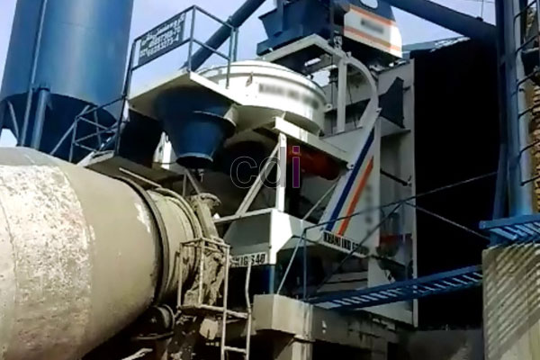

**Cara Pengolahan & Pengecoran Beton Cor** - Halo Mitra CDI! Pernahkah Anda bertanya-tanya, apa kunci sebuah bangunan kokoh dan tahan lama? Jawabannya ada pada kualitas beton cor yang digunakan. Proses pengolahan dan pengecoran beton seringkali dianggap mudah, padahal kenyataannya membutuhkan keterampilan khusus agar menghasilkan beton cor berkualitas. Nah, di artikel ini kami dari CDI akan membagikan panduan lengkap tentang Cara Pengolahan & Pengecoran Beton Cor yang benar, khususnya bagi Anda yang menggunakan Beton Ready Mix. Yuk, simak bersama!

*Memastikan Kualitas Pengecoran Beton*

Berikut adalah langkah-langkah yang perlu diperhatikan agar proses pengolahan dan pengecoran berjalan lancar dan sesuai standar: 

## Utamakan Keselamatan Kerja

Sebelum memulai proses pengolahan beton, keselamatan Anda dan tim adalah prioritas utama. Pastikan seluruh anggota tim mengenakan perlengkapan keselamatan seperti helm, masker debu, pelindung mata, dan sarung tangan. Selain itu, tunjuk satu orang sebagai penanggung jawab yang bertugas mengendalikan tim dan memeriksa kesiapan prasarana sebelum memulai pekerjaan.

## Periksa Ketersediaan Material

Selanjutnya, lakukan pengecekan terhadap ketersediaan bahan-bahan material yang dibutuhkan. Buatlah catatan rinci mengenai volume material yang ada, serta identifikasi kekurangan yang perlu segera dipenuhi. Ini akan membantu Anda dalam mengelola persediaan dan memastikan kelancaran produksi.

## Pengelompokan Material yang Tepat

Setelah mengetahui jumlah material yang dibutuhkan, kelompokkan bahan-bahan tersebut di tempat yang terpisah. Hal ini bertujuan untuk mencegah terjadinya pencampuran yang tidak diinginkan antar material.

## Siapkan Peralatan dengan Cermat

Pastikan semua peralatan yang dibutuhkan berada dalam kondisi baik dan ditempatkan berdekatan dengan mesin mixer. Persiapan ini akan mempercepat proses pengadukan dan meminimalkan waktu yang terbuang percuma.

## Urutan Memasukkan Material ke Mixer

Proses memasukkan material ke dalam mixer tidak boleh dilakukan secara acak. Urutan yang tepat akan sangat mempengaruhi kualitas beton cor yang dihasilkan. Berikut adalah urutan yang direkomendasikan:

- 1\. Pasir (agregat halus).
- 2\. Batu krikil /split (agregat kasar).
- 3\. Air.
- 4\. Fly Ash (jika digunakan).
- 5\. Semen secara bertahap.

Mengapa urutannya harus seperti ini? Menambahkan air terlebih dahulu sebelum semen akan mencegah penggumpalan semen dan memastikan campuran tercampur merata.  Ini penting banget, lho!

## Kontrol Waktu Pengadukan dengan Teliti

Tahap ini mungkin terdengar sepele, tapi sangat krusial. Buatlah *checklist* untuk memastikan tidak ada langkah yang terlewat karena terburu-buru atau hal lainnya. Perhatikan durasi pengadukan yang ideal agar semua material tercampur sempurna.

## Persiapan Tim Pengecoran

Sembari tim pengaduk menyelesaikan 50% proses pengadukan, tim pengecor harus mempersiapkan area pengecoran (bekisting). Lakukan pemeriksaan menyeluruh untuk memastikan bahwa bekisting dalam kondisi siap dan tidak ada kendala yang akan menghambat proses pengecoran.

> _Dengan perencanaan yang matang, tim kerja yang solid, dan penerapan langkah-langkah di atas, Anda akan mendapatkan hasil pengecoran beton yang optimal. Kualitas beton akan menentukan kekuatan dan ketahanan bangunan Anda._

Demikian panduan singkat tentang Cara Pengolahan & Pengecoran Beton Cor dari kami. Semoga informasi ini bermanfaat bagi Anda. Jika Anda membutuhkan jasa pengecoran profesional dengan truk molen (truk mixer) yang handal, jangan ragu untuk menghubungi Creative Design Interior! Silakan hubungi kami melalui layanan email atau telepon yang tersedia di website ini. Terima kasih!  Kami siap membantu mewujudkan bangunan impian Anda di (not detected)! [Analisa Cor Beton K 225: Panduan Lengkap untuk Fondasi Kuat dan Tahan Lama](/blog/analisa-cor-beton-k-225/) — pelajari lebih lanjut tentang mutu beton yang tepat untuk fondasi Anda.