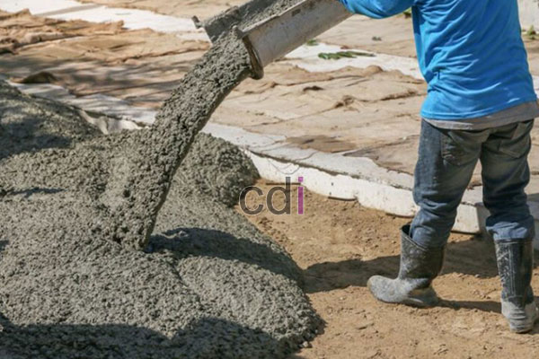

**Tips Pengerjaan Cor Beton Yang Baik** - Hai Mitra CDI! Mencari tahu cara membuat cor beton yang kuat dan tahan lama? Kami mengerti, punya bangunan yang kokoh adalah impian semua orang. Artikel ini akan membahas tuntas langkah-langkah penting yang perlu diperhatikan saat melakukan pengecoran. Yuk, simak tipsnya supaya hasil cor beton di (not detected) bisa maksimal!

*Panduan Lengkap Pengerjaan Cor Beton Berkualitas*

## Tahapan Pengerjaan Cor Beton yang Tepat

Pengerjaan cor beton memang terlihat sederhana, tapi kesiapan dan ketelitian menjadi kunci utama. Banyak tukang bangunan kurang memperhatikan detail penting, dan ini bisa berakibat fatal pada kekuatan struktur bangunan Anda. Nah, supaya tidak salah langkah, perhatikan panduan berikut ini saat melakukan pengerjaan cor beton di (not detected):

- 1. **Periksa Bekisting Secara Teliti:** Sebelum memulai pengecoran, pastikan struktur bekisting kuat dan stabil. Periksa apakah bekisting dan steger mampu menahan beban cor beton saat proses pengisian berlangsung.
- 2. **Pilih Mutu Beton yang Sesuai:** Gunakan mutu material beton cor yang sesuai dengan perhitungan kekuatan minimal yang dibutuhkan. Umumnya, struktur beton bertulang idealnya menggunakan mutu K225 hingga K400. Penggunaan mutu di bawah K200 berpotensi menyebabkan kegagalan struktur.
- 3. **Persiapan Bekisting yang Matang:** Perhitungkan dengan cermat perancah dan posisinya agar mampu menahan cor beton dengan baik. Gunakan kayu yang kuat untuk tiang perancah dan hindari penggunaan bekisting yang tidak mampu menahan beban.
- 4. **Bersihkan Bekisting Sebelum Digunakan:** Pastikan papan bekisting dalam kondisi bersih sebelum digunakan. Bekisting bekas seringkali masih terdapat sisa beton lama yang menempel, sehingga dapat menghasilkan permukaan cor beton yang tidak rapi.
- 5. **Waktu Pembongkaran Bekisting yang Tepat:** Jangan bongkar bekisting terlalu cepat sebelum beton cukup kuat menahan bebannya sendiri. Idealnya, bekisting samping dibongkar setelah 1 minggu, sedangkan bekisting tatakan bawah dibongkar setelah 28 hari.
- 6. **Segera Bersihkan Sisa Cor:** Bersihkan sisa cor yang tercecer sesegera mungkin setelah proses pengecoran. Semakin lama dibiarkan, cor akan mengeras dan semakin sulit dibersihkan, yang tentu saja akan menambah biaya dan tenaga.
- 7. **Koordinasi dengan Penyedia Cor Ready Mix:** Jika Anda menggunakan jasa cor ready mix, koordinasikan jadwal pengiriman material dengan perusahaan penyedia. Hal ini penting untuk memastikan beton cor sampai tepat waktu sesuai rencana Anda di (not detected).
- 8. **Cek Ketegakan dan Kedataran Beton:** Selama proses pengecoran, selalu periksa ketegakan dan kedataran beton menggunakan alat ukur seperti water pass atau teodolit.
- 9. **Gunakan Lem Beton untuk Penyambungan:** Saat menyambung cor beton baru dengan beton lama, gunakan lem beton agar sambungan lebih kuat dan rapat.
- 10. **Lakukan Penyiraman Secara Berkala:** Lakukan penyiraman secara berkala setelah pengerjaan cor beton untuk mencegah beton terlalu cepat kering. Kekeringan yang terlalu cepat dapat [menyebabkan keretakan](/blog/inilah-penyebab-cor-beton-bisa-retak "Inilah Penyebab Cor Beton Bisa Retak").

Nah, itu dia tips singkat dari kami mengenai cara mengerjakan cor beton yang baik. Semoga panduan ini bermanfaat dan bisa diaplikasikan pada proyek Anda di (not detected). Jika Anda membutuhkan jasa cor ready mix (cor beton jadi) dari merk terpercaya seperti Pionir, Holcim, Jayamix, SGG, atau Merah Putih, jangan ragu untuk menghubungi tim kami melalui layanan kontak website ini. Kami siap membantu dan memberikan solusi terbaik untuk kebutuhan konstruksi Anda. [Alas Cor Beton: Panduan Lengkap Jenis, Fungsi, dan Pemasangannya](/blog/alas-cor-beton/) juga bisa jadi referensi tambahan untuk perencanaan fondasi yang kuat!