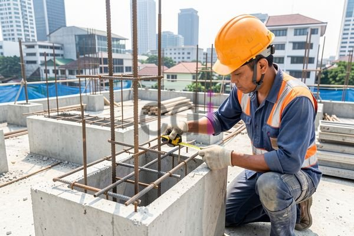

**Ukuran Balok Tarik: Panduan Lengkap untuk Kekuatan Struktur Bangunan Anda** - Hai Mitra CDI! Mencari cara tepat menentukan ukuran balok tarik untuk bangunan Anda? Jangan khawatir, kami punya panduannya! Memilih dimensi yang pas itu krusial, lho. Ini soal kekuatan, kestabilan, dan keamanan bangunan Anda. Yuk, simak selengkapnya!

### Fungsi Balok Tarik: Tulang Punggung Struktur Bangunan
Balok tarik – atau yang sering disebut gelagar – adalah bagian horizontal penting dalam struktur bangunan. Tugas utamanya menahan beban lentur, baik beban mati (berat bangunan itu sendiri) maupun beban hidup (orang, perabot, dan lain-lain). Kekuatan balok tarik ini dipengaruhi oleh material, ukuran, dan jarak antar penyangga. Salah hitung ukurannya? Bisa-bisa bangunan jadi rentan retak atau bahkan ambruk.

Balok tarik ini bertugas menyalurkan beban dari atap atau lantai ke kolom atau dinding. Jadi, ia memegang peranan penting dalam mendistribusikan beban secara merata ke seluruh struktur. Desain yang baik bukan cuma memikirkan kekuatan, tapi juga kekakuan, supaya bangunan tidak mudah melendut. Kami memahami betul betapa pentingnya pemahaman mendalam tentang balok tarik ini bagi kelancaran proyek Anda di (not detected).

### Faktor Penentu Ukuran Balok Tarik: Apa Saja yang Perlu Diperhatikan?
Beberapa hal penting perlu Anda pertimbangkan saat menentukan ukuran balok tarik. Pertama, **jenis material** yang dipakai. Pilihan umumnya beton bertulang, baja, atau kayu. Setiap material punya kekuatan dan fleksibilitas berbeda. Misalnya, beton bertulang kuat tekanannya, tapi butuh tulangan baja untuk menahan gaya tarik.

Kedua, **bentang balok**, yaitu jarak antara dua titik penyangga. Semakin panjang bentangnya, semakin besar beban yang harus ditahan, jadi ukurannya harus lebih besar juga. Ketiga, **beban yang bekerja** pada balok – beban mati dan beban hidup. Hitung beban hidupnya dengan teliti, sesuaikan dengan fungsi bangunan dan potensi beban maksimalnya. Keempat, **standar yang berlaku**. Di Indonesia, perhitungan struktur bangunan wajib merujuk ke SNI (Standar Nasional Indonesia), seperti SNI 03-2891-2002 untuk beton bertulang.

### Menghitung Ukuran Balok Tarik: Panduan Langkah Demi Langkah
Menghitung ukuran balok tarik melibatkan beberapa langkah. Mulai dari menentukan semua beban yang bekerja, lalu hitung momen lentur maksimumnya. Setelah itu, tentukan material dan mutu beton (contoh: K-300, K-400) serta baja (contoh: BJTP-300).

Sebagai ilustrasi, anggap Anda membuat balok beton bertulang bentang 4 meter yang menahan beban mati 10 kN/m dan beban hidup 15 kN/m. Total bebannya 25 kN/m. Momen lentur maksimumnya dihitung dengan rumus: M = (w * L^2) / 8, jadi M = (25 kN/m * (4 m)^2) / 8 = 50 kNm. Dengan asumsi mutu beton K-300 dan baja BJTP-300, serta mengikuti SNI, kami sarankan dimensi minimal 200 mm x 300 mm dengan tulangan baja yang sesuai.

Ingat, ini hanya contoh sederhana. Perhitungan struktur yang akurat butuh analisis lebih mendalam, mempertimbangkan semua faktor relevan. Untuk proyek yang kompleks, serahkan pada insinyur struktur profesional. Jangan ragu, di (not detected) Kami punya jaringan ahli yang siap membantu!

### Biaya Balok Tarik dan Tips Hemat untuk Proyek Anda
Harga pembuatan balok tarik tergantung material, ukuran, dan desain. Umumnya, biaya balok beton bertulang berkisar antara Rp 300.000 hingga Rp 800.000 per meter kubik, termasuk material dan tenaga kerja. Harga ini bisa berubah sewaktu-waktu, jadi silakan cek [tabel harga terbaru](URL_TABEL_HARGA) atau hubungi kami untuk penawaran paling akurat sesuai proyek Anda.

Bagaimana caranya hemat anggaran? Optimalkan desain struktur untuk mengurangi material, pilih material yang sesuai kebutuhan dan budget, serta bandingkan harga dari berbagai vendor. Perencanaan matang dan koordinasi tim juga penting untuk menghindari pemborosan. Jangan lupa, Kami menyediakan solusi material berkualitas dengan harga kompetitif di (not detected).

Butuh bantuan langsung? Klik tombol **WhatsApp** atau **Telepon** di bawah sekarang juga. Tim ahli Kami siap konsultasi gratis dan membantu mewujudkan proyek impian Anda! [Inilah Ukuran Balok Beton Sesuai SNI](/blog/inilah-ukuran-balok-beton-sesuai-sni/) bisa jadi referensi tambahan juga, lho.