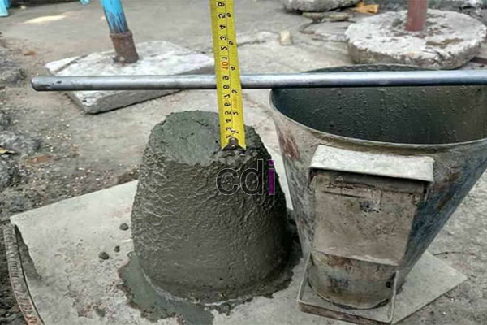

**Ukuran Benda Uji Beton Silinder: Panduan Lengkap Standar SNI dan Aplikasinya** - Hai Mitra CDI! Pernahkah Anda bertanya-tanya, bagaimana memastikan hasil uji kuat tekan beton benar-benar akurat? Nah, salah satu kunci pentingnya terletak pada ukuran benda uji silinder. Kesalahan kecil dalam dimensi benda uji ini bisa berdampak besar pada kualitas bangunan yang sedang Anda kerjakan. Yuk, kita bahas tuntas panduan lengkapnya!

## Standar Ukuran Benda Uji Beton Silinder Berdasarkan SNI

Sesuai Standar Nasional Indonesia (SNI) 03-1999 tentang Tata Cara Pembuatan dan Pengujian Benda Uji Beton, dimensi standar benda uji silinder adalah diameter 15 cm dan tinggi 30 cm. Mengapa ukuran ini begitu penting? Karena ukuran ini memberikan representasi paling akurat dari kekuatan beton yang sebenarnya diterapkan di lapangan. Penting juga untuk diingat, ada toleransi dimensi yang diperbolehkan, yaitu ± 2 mm untuk diameter dan ± 1 mm untuk tinggi benda uji. Ini membantu menjaga konsistensi hasil pengujian.

Ukuran ini bukanlah angka acak, lho. Diameter 15 cm dipilih untuk meminimalkan pengaruh gesekan saat pengujian. Sementara tinggi 30 cm memberikan rasio tinggi terhadap diameter (h/d) yang ideal, yaitu 2:1. Rasio ini memastikan pembentukan kerucut retak yang seragam saat pengujian, sehingga hasil yang diperoleh jauh lebih representatif. Mitra CDI, pastikan setiap pengujian yang dilakukan selalu mengacu pada standar dimensi ini demi data yang valid dan terpercaya.

## Bagaimana Dampak Variasi Ukuran Terhadap Hasil Pengujian?

Jangan remehkan pengaruh variasi ukuran benda uji, ya. Sekecil apapun perbedaannya, bisa memengaruhi hasil uji kuat tekan. Misalnya, jika diameter benda uji lebih kecil dari standar, hasil uji bisa meningkat 5-10%. Sebaliknya, diameter yang lebih besar cenderung menghasilkan hasil uji yang lebih rendah. Tinggi benda uji juga berpengaruh; rasio h/d yang tidak sesuai standar bisa mengubah pola retak dan distribusi tegangan, yang pada akhirnya membuat hasil uji menjadi kurang akurat.

Bayangkan, jika Anda menggunakan benda uji dengan diameter 14 cm (di bawah standar) dan tinggi 30 cm, hasil uji kuat tekannya mungkin lebih tinggi 5-10% daripada benda uji standar. Perbedaan ini mungkin terlihat kecil, tapi bisa sangat berarti dalam menentukan mutu beton dan keamanan struktur bangunan. Jadi, selalu gunakan benda uji dengan dimensi sesuai SNI, ya, Mitra CDI!

## Implementasi Ukuran Benda Uji dalam Proyek Konstruksi di (not detected)

Penerapan standar ini sangat krusial dalam proyek konstruksi di wilayah (not detected), terutama untuk bangunan-bangunan dengan tuntutan mutu beton tinggi seperti gedung bertingkat, jembatan, dan infrastruktur penting lainnya. Pengujian kuat tekan beton secara berkala dengan benda uji standar adalah bagian tak terpisahkan dari pengendalian mutu.

Kami merekomendasikan agar Mitra CDI menggunakan jasa laboratorium pengujian beton terakreditasi. Laboratorium terakreditasi menjamin penggunaan peralatan terkalibrasi dan tenaga ahli yang kompeten. Mengenai biaya, harga pengujian kuat tekan beton silinder bervariasi. Untuk mendapatkan penawaran harga yang paling akurat sesuai kebutuhan proyek Anda, silakan hubungi Kami. Informasi harga terkini juga tersedia melalui tabel .

## Tips Tambahan: Pembuatan dan Perawatan Benda Uji yang Tepat

Selain ukuran, ada hal lain yang perlu diperhatikan: pencampuran beton, pemadatan, dan perawatan (curing). Pastikan pencampuran dilakukan secara homogen agar material terdistribusi merata. Lakukan pemadatan dengan metode yang tepat untuk menghilangkan rongga udara dan meningkatkan kepadatan. Terakhir, lakukan perawatan (curing) dengan menjaga kelembaban benda uji selama minimal 28 hari agar hidrasi semen berjalan optimal dan kekuatan beton berkembang maksimal.

Mitra CDI, perhatikan setiap tahapan dengan cermat. Dengan memastikan semua prosedur dilakukan dengan benar, Anda akan mendapatkan hasil uji kuat tekan yang benar-benar representatif. Creative Design Interior (CDI) siap mendukung Anda dalam mewujudkan kualitas beton terbaik untuk proyek-proyek Anda di (not detected)!

Butuh bantuan lebih lanjut? Jangan sungkan untuk menghubungi Kami melalui tombol **WhatsApp** atau **Telepon** yang tersedia di halaman ini. Kami siap menjawab pertanyaan Anda.

[Inilah Ukuran Balok Beton Sesuai SNI](/blog/inilah-ukuran-balok-beton-sesuai-sni/)