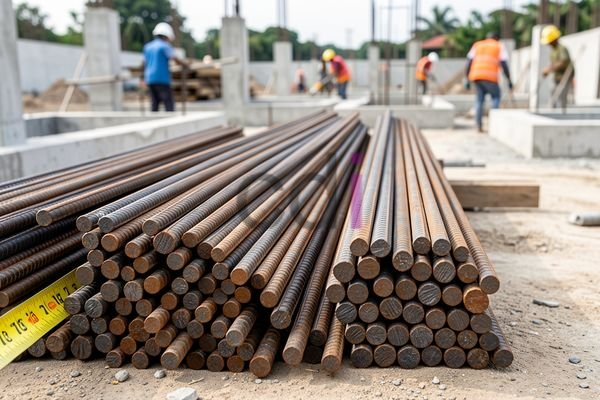

**Ukuran Besi Cor untuk Pondasi: Panduan Lengkap & Estimasi Biaya 2026** - Hai Mitra CDI! Pondasi yang kokoh adalah kunci utama bangunan yang tahan lama. Tahukah Anda, kekuatan tekan besi cor bisa mencapai 220-620 MPa? Sebuah angka yang sangat vital dalam membangun fondasi yang handal. Artikel ini akan memandu Anda memahami ukuran besi cor yang tepat untuk pondasi, faktor-faktor penentuannya, serta perkiraan biaya pengecoran di tahun 2026. Yuk, kita bahas lebih lanjut!

## Mengenal Beragam Ukuran Besi Cor untuk Aplikasi Pondasi

Penting bagi Mitra untuk tahu bahwa besi cor hadir dalam berbagai ukuran, dirancang khusus untuk memenuhi kebutuhan konstruksi yang berbeda. Jangan sampai salah pilih ya! Berikut adalah beberapa ukuran besi cor yang umum digunakan untuk fondasi:

*   **Besi Cor Bulat (Diameter):** Ukuran diameter besi cor bulat yang sering dipakai berkisar antara 12 mm sampai 32 mm. Pilihan diameter ini sangat dipengaruhi oleh beban yang akan ditanggung pondasi. Semakin berat bebannya, semakin besar diameter besi cor yang diperlukan.
*   **Besi Cor Kotak (Sisi):** Besi cor kotak tersedia dengan berbagai ukuran sisi, seperti 25x25 mm, 30x30 mm, hingga 50x50 mm. Penggunaan besi cor kotak seringkali ideal untuk struktur yang membutuhkan daya tarik yang lebih besar.
*   **Besi Cor Plat (Tebal dan Lebar):** Besi cor plat memiliki variasi ketebalan dan lebar, misalnya 8 mm x 100 mm, 12 mm x 150 mm, dan seterusnya. Pilihan ini sangat cocok untuk aplikasi yang membutuhkan area permukaan yang luas.

Pemilihan ukuran besi cor juga perlu disesuaikan dengan jenis pondasi yang digunakan. Untuk pondasi batu kali misalnya, besi cor berdiameter 10-16 mm seringkali sudah memadai. Namun, Kami merekomendasikan penggunaan besi cor minimal 12 mm, bahkan mencapai 32 mm untuk bangunan bertingkat atau dengan beban sangat berat, khususnya untuk pondasi beton bertulang.

## Faktor Penting dalam Menentukan Ukuran Besi Cor yang Tepat

Penentuan ukuran besi cor yang optimal membutuhkan pertimbangan yang matang. Ada beberapa faktor krusial yang perlu Anda perhatikan:

*   **Kondisi Tanah:** Jenis tanah di lokasi pembangunan adalah penentu utama. Tanah lunak atau berpasir tentu membutuhkan fondasi yang lebih kuat, dan akibatnya, besi cor dengan diameter lebih besar.
*   **Beban Bangunan:** Pertimbangkan jumlah lantai, fungsi bangunan (rumah, ruko, gudang), dan material yang digunakan. Semakin berat total bebannya, semakin besar ukuran besi cor yang diperlukan untuk menahan beban tersebut.
*   **Desain Struktur Bangunan:** Desain struktur, termasuk ukuran kolom, balok, dan dinding, memengaruhi bagaimana beban didistribusikan ke fondasi. Perhitungan struktur yang akurat sangat penting untuk menentukan kebutuhan besi cor yang tepat.
*   **Standar Nasional Indonesia (SNI):** Pastikan besi cor yang digunakan memenuhi standar mutu yang berlaku di Indonesia (SNI). Menggunakan besi cor berkualitas rendah bisa membahayakan keamanan bangunan!

## Perkiraan Biaya Pengecoran Besi Cor di (not detected) Tahun 2026

Harga besi cor dan jasa pengecoran di (not detected) pada tahun 2026 akan bervariasi tergantung beberapa faktor. Ukuran besi cor, beratnya, kompleksitas desain, dan lokasi proyek berperan penting dalam penentuan harga. Sebagai referensi, berikut adalah estimasi biaya yang bisa Anda pertimbangkan:

*   **Harga Besi Cor per Kilogram:** Kisaran harga besi cor per kilogram berkisar antara Rp 15.000 hingga Rp 25.000. Perlu diingat, harga ini fluktuatif dan bisa berubah seiring waktu.
*   **Biaya Jasa Pengecoran:** Biaya jasa pengecoran umumnya dihitung per kilogram atau per titik pengecoran. Estimasi biaya jasa berkisar antara Rp 3.000 hingga Rp 7.000 per kilogram atau Rp 500.000 hingga Rp 2.000.000 per titik pengecoran.
*   **Contoh Perhitungan:** Misalnya, Anda membutuhkan 100 kg besi cor. Dengan harga Rp 20.000 per kilogram dan biaya jasa pengecoran Rp 5.000 per kilogram, total biaya yang perlu disiapkan adalah (100 kg x Rp 20.000) + (100 kg x Rp 5.000) = Rp 2.500.000.

**Untuk informasi harga terbaru dan penawaran yang lebih akurat sesuai dengan kebutuhan proyek Anda di (not detected), silakan hubungi Kami.** Tim Kami siap memberikan solusi terbaik!

## Tips Cerdas Memilih Jasa Pengecoran Besi Cor Terpercaya

Memilih jasa pengecoran besi cor yang terpercaya adalah kunci untuk memastikan kualitas dan keamanan pondasi Anda. Berikut beberapa tips yang dapat membantu Anda:

*   **Pengalaman dan Reputasi:** Carilah penyedia jasa yang sudah berpengalaman dan memiliki reputasi baik di industri konstruksi.
*   **Kualifikasi Tenaga Ahli:** Pastikan penyedia jasa memiliki tenaga ahli yang kompeten dan terlatih dalam pengecoran besi cor.
*   **Peralatan dan Teknologi:** Pilih penyedia jasa yang menggunakan peralatan dan teknologi modern untuk hasil pengecoran yang presisi dan berkualitas tinggi.
*   **Garansi dan Layanan Purna Jual:** Pastikan ada garansi untuk hasil pengecoran dan layanan purna jual yang memadai.
*   **Referensi dan Testimoni:** Mintalah referensi dari klien sebelumnya dan baca testimoni untuk mendapatkan gambaran layanan yang ditawarkan.

Mitra CDI, dengan memilih ukuran besi cor yang tepat dan menggunakan jasa pengecoran yang terpercaya, Anda akan mendapatkan fondasi yang kuat, stabil, dan tahan lama untuk bangunan Anda. Creative Design Interior siap menjadi mitra terpercaya Anda dalam mewujudkan bangunan impian dengan desain interior dan solusi konstruksi berkualitas tinggi di (not detected).

Jangan ragu untuk menghubungi Kami melalui tombol **WhatsApp** atau **Telepon** yang tersedia di halaman ini jika ada pertanyaan lebih lanjut. Kami siap membantu! [Besi untuk Pondasi Rumah: Jenis, Ukuran, dan Estimasi Biaya Terbaru 2026](/blog/besi-untuk-pondasi-rumah/) — artikel ini akan membantu memperjelas pilihan material pondasi yang sesuai. [Biaya Pondasi Rumah Ukuran 6x12: Estimasi Lengkap & Tips Hemat 2026](/blog/biaya-pondasi-rumah-ukuran-6x12/) — memberikan gambaran biaya yang lebih spesifik.