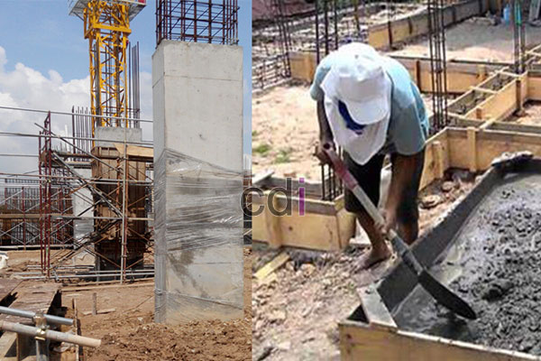

**Ukuran Cor Beton yang Tepat: Panduan Lengkap untuk Fondasi Kuat dan Awet** - Hai Mitra CDI! Pernahkah Anda menghadapi kendala dalam pembangunan terkait kualitas cor beton? Masalah ini sering muncul akibat ukuran cor yang kurang tepat, kualitas material yang dipertanyakan, atau bahkan karena proses pengerjaan yang tidak sesuai standar. Padahal, kesalahan ini bisa memicu masalah serius – mulai dari retakan, penurunan struktur, hingga risiko kegagalan konstruksi yang membahayakan. Mari kita bahas tuntas bagaimana menghindari hal tersebut.

## Memahami Standar Ukuran Cor Beton: Kunci Utama Sesuai Fungsi Struktur

Menentukan ukuran cor beton bukan sekadar tebak-tebakan. Ukuran ini sangat bergantung pada fungsi spesifik struktur yang akan dibangun. Ukuran yang diperlukan untuk fondasi tentu berbeda dengan ukuran ideal untuk kolom atau balok. Untungnya, Standar Nasional Indonesia (SNI) menyediakan acuan yang jelas untuk dimensi minimum berbagai elemen struktur. Secara umum, ketebalan pondasi tapak untuk bangunan dua lantai berkisar antara 15-20 cm, sedangkan lebarnya disesuaikan dengan area beban bangunan. Untuk kolom, diameter minimum yang sering digunakan adalah 20 cm, sementara untuk balok, lebar dan tinggi minimal biasanya 20 cm x 30 cm.

Perlu diingat, angka-angka ini bersifat indikatif. Perhitungan yang lebih akurat harus dilakukan oleh tenaga ahli sipil yang kompeten, dengan mempertimbangkan faktor-faktor seperti jenis tanah, beban hidup, beban mati, dan margin keamanan yang diperlukan. Kami sangat menyarankan untuk selalu berkonsultasi dengan profesional sebelum memulai proyek pengecoran.

## Menentukan Ukuran Cor Beton: Perhitungan dan Pertimbangan Teknis yang Wajib Dipahami

Perhitungan ukuran cor beton melibatkan beberapa parameter yang saling terkait. Luas area yang akan ditopang oleh struktur adalah faktor utama. Semakin besar beban, semakin besar pula ukuran cor beton yang dibutuhkan. Selain itu, karakteristik tanah juga memegang peran penting. Tanah yang kurang padat memerlukan pondasi yang lebih luas dan kokoh dibandingkan dengan tanah yang stabil.

Sebagai ilustrasi, mari kita coba hitung kebutuhan ukuran pondasi tapak untuk bangunan satu lantai dengan beban atap dan dinding sebesar 500 kg/m². Jika luas bangunan adalah 100 m², maka total beban yang ditopang adalah 50.000 kg. Dengan asumsi kuat tekan tanah 100 kPa (kilopascal), luas pondasi yang dibutuhkan sekitar 500 m² (50.000 kg / 100 kPa = 500 m²). Jika pondasi berbentuk persegi dengan panjang sisi yang sama, setiap sisinya harus mencapai sekitar 22,36 meter. Tentu saja, angka ini cenderung tidak praktis dan membutuhkan perhitungan yang lebih mendalam dengan memperhatikan faktor keamanan dan kedalaman pondasi.

## Pemilihan Mutu Beton dan Pengaruhnya Terhadap Ukuran Cor: Ada Hubungannya!

Mutu beton, yang ditandai dengan kode K-xxx (seperti K-250 atau K-300), sangat memengaruhi kekuatan dan umur panjang struktur. Semakin tinggi angka mutu beton, semakin kuat dan awet pula beton tersebut. Mutu beton yang biasa diaplikasikan untuk konstruksi rumah tinggal berkisar antara K-250 hingga K-300. Penting untuk menyesuaikan pilihan mutu beton dengan beban bangunan dan kondisi lingkungan setempat.

Memilih mutu beton yang lebih tinggi bisa memungkinkan Anda mengurangi ukuran cor beton, meski dengan investasi yang sedikit lebih besar. Sementara itu, penggunaan mutu beton yang lebih rendah akan memerlukan ukuran cor yang lebih besar untuk mencapai kekuatan yang setara. Harga beton K-250 per m³ di wilayah (not detected) berkisar antara Rp 800.000 hingga Rp 1.000.000 — angka ini bersifat estimasi saja. Untuk informasi harga terkini dan disesuaikan dengan kebutuhan proyek spesifik Anda, yuk hubungi tim Kami!

## Material Tambahan dan Teknik Pengecoran: Rahasia Kekuatan Cor Beton yang Optimal

Ukuran dan mutu beton saja tidak cukup. Material tambahan seperti besi tulangan juga krusial untuk meningkatkan kemampuan cor beton menahan gaya tarik. Besi tulangan harus dihitung secara cermat oleh tenaga ahli sipil, baik dari segi jumlah, diameter, maupun tata letaknya. Kami selalu merekomendasikan penggunaan besi tulangan yang memenuhi standar SNI demi menjamin keamanan dan kekuatan bangunan Anda di (not detected).

Teknik pengecoran yang tepat juga tak kalah penting. Pastikan campuran beton memiliki proporsi yang sesuai (semen, pasir, kerikil, air) dan diaduk merata. Hindari pengecoran saat hujan deras atau cuaca terlalu panas. Setelah pengecoran selesai, beton perlu dirawat dengan baik – basahi secara berkala selama minimal 7 hari untuk mencegah retak dan memastikan proses pengerasan berlangsung optimal.

Butuh konsultasi lebih lanjut? Jangan ragu! Tim ahli Kami siap membantu. Tekan tombol **Telepon** atau **WhatsApp** di bawah ini untuk bertanya atau mendapatkan penawaran khusus untuk proyek Anda di (not detected).