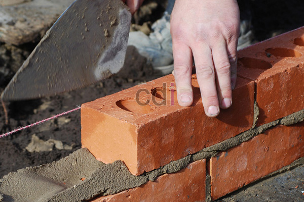

**Upah Tukang Bangunan di Depok 2026: Estimasi Biaya & Tips Pengelolaan** - Hai Mitra CDI! Punya rencana membangun atau merenovasi di Depok? Nah, salah satu hal krusial yang perlu diperhatikan adalah biaya tenaga kerja. Fluktuasi harga material memang sering menjadi perhatian, tapi bagaimana dengan tarif tukang bangunan di Depok 2026? Artikel ini akan membahas estimasi biaya, sistem upah yang umum digunakan, dan tips pengelolaan anggaran agar proyek Mitra CDI berjalan lancar. Yuk, simak informasinya!

## Estimasi Upah Tukang Bangunan Harian di Depok

Menentukan upah tukang bangunan di Depok tidaklah sesederhana menetapkan satu angka. Banyak faktor yang mempengaruhinya, mulai dari tingkat keahlian tukang, jenis pekerjaan, hingga kompleksitas proyek. Sebagai gambaran, berikut perkiraan upah harian di tahun 2026:

*   **Tukang Batu/Keramik:** Kisaran harga berkisar antara Rp 300.000 – Rp 500.000 per hari. Pemasangan keramik motif rumit atau dengan tingkat kesulitan tinggi tentu akan mempengaruhi tarif.
*   **Tukang Kayu:** Bagi yang membutuhkan jasa tukang kayu, siapkan anggaran antara Rp 350.000 – Rp 600.000 per hari. Ini tergantung apakah pekerjaan meliputi pembuatan kusen, rangka atap, atau bahkan furniture custom.
*   **Tukang Besi:** Untuk pekerjaan besi seperti pemasangan rangka baja ringan atau pembuatan besi beton, upah berkisar antara Rp 400.000 – Rp 700.000 per hari.
*   **Tukang Las:** Keahlian khusus tukang las memang dihargai lebih tinggi, dengan tarif sekitar Rp 500.000 – Rp 800.000 per hari, disesuaikan dengan jenis las dan tingkat kerumitan proyek.
*   **Kepala Tukang/Mandor:** Pengalaman dan tanggung jawab yang lebih besar membuat upah kepala tukang atau mandor berkisar antara Rp 600.000 – Rp 1.000.000 per hari.

Perlu diingat, angka-angka ini adalah estimasi lho. Untuk mendapatkan penawaran yang paling akurat dan sesuai kebutuhan proyek Mitra CDI, segera hubungi Kami!

## Sistem Upah Borongan vs. Harian: Pilih Mana?

Selain upah harian, ada juga sistem borongan yang bisa dipertimbangkan. Apa bedanya? Sistem upah borongan membayar tukang berdasarkan volume pekerjaan yang diselesaikan, bukan jumlah hari kerja. Berikut tabel perbandingannya:

| Fitur          | Upah Harian                 | Upah Borongan                |
|-----------------|------------------------------|-----------------------------|
| **Keuntungan** | Lebih mudah dikontrol        | Potensi biaya lebih rendah   |
| **Kekurangan**| Kurang insentif untuk cepat  | Membutuhkan perencanaan detail |
| **Cocok untuk**| Proyek kecil, pekerjaan fleksibel | Proyek besar, pekerjaan standar |

Pertimbangkan jenis proyek dan kemampuan perencanaan yang dimiliki sebelum memutuskan. Sistem borongan ideal untuk proyek besar dengan spesifikasi jelas, sementara upah harian cocok untuk pekerjaan kecil atau fleksibel. Nah, bagaimana menurut Mitra CDI?

## Faktor-Faktor yang Mempengaruhi Biaya Tenaga Kerja

Ada beberapa hal yang bisa memengaruhi besaran upah tukang bangunan di Depok 2026. Memahami faktor-faktor ini penting untuk negosiasi:

*   **Lokasi:** Upah di area padat penduduk atau sulit terjangkau cenderung lebih tinggi.
*   **Ketersediaan Tukang:** Semakin banyak permintaan, semakin tinggi pula upah jika pasokan tukang terbatas.
*   **Jenis Pekerjaan:** Pekerjaan yang memerlukan keahlian khusus pasti akan lebih mahal.
*   **Kondisi Ekonomi:** Inflasi dan kenaikan harga bahan bakar dapat berdampak pada kenaikan upah.
*   **Reputasi Tukang:** Tukang dengan reputasi baik biasanya mematok harga lebih tinggi.

## Tips Jitu Kelola Anggaran Tenaga Kerja Proyek

Pengelolaan anggaran tenaga kerja yang baik sangat krusial untuk keberhasilan proyek. Berikut beberapa tips yang bisa diterapkan:

*   **Buat Rencana Anggaran yang Detail:** Rincikan semua pekerjaan yang membutuhkan tenaga kerja dan estimasikan jumlah jam kerja masing-masing.
*   **Survei Penawaran:** Dapatkan penawaran dari beberapa tukang dan bandingkan harga serta kualifikasi mereka.
*   **Negosiasi:** Jangan ragu bernegosiasi untuk mendapatkan harga terbaik!
*   **Pantau Progres Pekerjaan:** Lakukan pemantauan rutin agar pekerjaan berjalan sesuai jadwal dan anggaran.
*   **Pilih Kontraktor Terpercaya:** Menggunakan jasa kontraktor terpercaya akan mempermudah pengelolaan anggaran dan meminimalkan risiko. [Cara Menghitung Biaya Upah Tukang Bangunan](/blog/menghitung-biaya-upah-tukang-bangunan/) — artikel ini juga bisa menjadi panduan bagi Mitra CDI.

Butuh bantuan untuk memperkirakan atau mengelola biaya proyek Anda? Jangan sungkan! Klik tombol **WhatsApp** atau **Telepon** di bawah untuk konsultasi gratis dengan tim Kami. Kami siap membantu Mitra CDI mewujudkan proyek impian di Depok 2026.