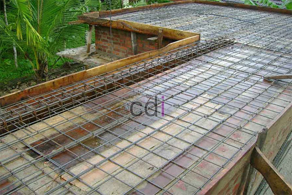

**Waktu yang Tepat Bongkar Bekisting (form work)** - Hai Mitra CDI! Gimana kabarnya hari ini? Nah, ada satu hal penting yang seringkali jadi penentu kualitas bangunan di (not detected): kapan waktu yang tepat untuk membongkar bekisting (form work). Penggunaan material beton berkualitas tinggi saja nggak cukup, lho. Proses pembongkaran bekisting yang nggak tepat waktu juga bisa berakibat fatal. Yuk, kita bahas lebih detail!

*Waktu yang Tepat Bongkar Bekisting (form work)*

Pembongkaran bekisting (form work) itu nggak bisa sembarangan, Mitra. Bekisting nggak boleh dilepas sebelum beton benar-benar mengeras dan mampu menahan beratnya sendiri serta beban-beban lain yang bekerja padanya. Jangka waktu pengerasan beton itu bervariasi, tergantung jenis semen yang dipakai dan desain bekistingnya. Secara umum, kayu sisi bekisting sebaiknya nggak dibongkar sebelum 7 hari, sedangkan kayu penyangganya perlu menunggu hingga 28 hari setelah pengecoran. Kondisi suhu dan proporsi campuran semen-agregat juga berpengaruh besar pada proses pengeringan beton, jadi perlu diperhatikan juga, ya. Kalau memungkinkan, ada baiknya bekisting dibiarkan lebih lama dari waktu standar—biar lebih aman.

## Menentukan Waktu yang Tepat Bongkar Bekisting (form work)

Berikut ini adalah panduan waktu pembongkaran bekisting untuk berbagai jenis konstruksi, dengan asumsi kondisi suhu normal (di atas 20°C):

- Bekisting dinding, kolom, dan sisi vertikal balok: bisa dibongkar setelah 24 sampai 48 jam.

- Bekisting lantai sistem slab: pembongkaran bisa dilakukan dalam waktu kurang dari 3 hari setelah pengecoran. 

- Bekisting lantai sistem beam: pembongkaran bisa dilakukan dalam waktu kurang dari 7 hari.

- Pembongkaran bekisting lantai sistem slab dengan bentang hingga 4,5 m: 7 hari.

- Pembongkaran bekisting lantai sistem slab dengan bentang lebih dari 4,5 m: 14 hari.

- Pembongkaran bekisting lantai sistem beam dan lengkungan dengan bentang hingga 6 m: 14 hari.

- Pembongkaran bekisting lantai sistem beam dan lengkungan dengan bentang lebih dari 6 m: 21 hari.

## Cara Pembongkaran Bekisting yang Tepat

Proses pembongkaran bekisting (form work) harus dilakukan secara hati-hati dan oleh tenaga yang sudah berpengalaman. Untuk bekisting lantai sistem slab dan beam, berikut langkah-langkah yang bisa diikuti:

- Mulai bongkar dari bagian yang paling mudah, yaitu sisi sudut panel/plywood slab yang terhubung dengan *sideform* (balok penyangga).

- Pembongkaran dilakukan per panel atau per lembar plywood.

- Perhatikan kondisi *pipe support* secara berkala. Jika ada yang melengkung berlebihan, segera tambahkan *shoring* atau *pipe support*.

- Lakukan penyiraman air secara rutin setidaknya selama 5 hari setelah pembongkaran. Ini penting untuk mencegah beton kehilangan air terlalu cepat akibat penguapan.

Intinya, waktu yang tepat bongkar bekisting adalah ketika semua bekisting dibongkar sesuai jadwal tanpa menyebabkan guncangan atau getaran yang bisa menurunkan kualitas beton.

Semoga panduan Waktu yang Tepat Bongkar Bekisting dari kami ini bermanfaat ya, Mitra! Untuk informasi lebih lanjut tentang material dan jasa konstruksi berkualitas di (not detected), jangan ragu untuk menghubungi tim CDI.  Kami siap membantu proyek Anda sukses! [Apa Itu Bekisting Beton? Panduan Lengkap untuk Fondasi Kokoh](/blog/apa-itu-bekisting-beton/)