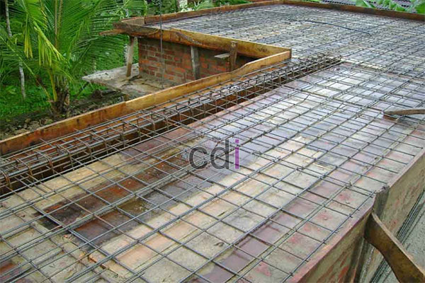

**Yang Dilakukan Setelah Pengecoran** - Hai Mitra CDI! Bangunan kokoh dan tahan lama, siapa yang tak menginginkannya? Pengecoran adalah fondasi penting, tapi bukan berarti selesai begitu saja setelah adonan dituangkan. Proses setelah pengecoran justru krusial lho! Artikel ini akan memandu Anda, terutama yang baru pertama kali membangun di (not detected), agar pengecoran Anda berjalan sempurna dan bebas masalah. Yuk, simak baik-baik!

*Panduan Lengkap Setelah Pengecoran*

## Fondasi Perhitungan Matang: Kunci Utama Sebelum Pengecoran

Banyak yang mengira pengecoran selesai setelah adukan mengeras. Salah besar! Sebenarnya, pengecoran membutuhkan perencanaan dan perhitungan yang cermat sejak awal. Rasio semen, split, pasir, dan air harus pas sesuai standar kualitas yang diinginkan. Selain itu, pastikan proses pengecoran dilakukan dengan teliti, dengan fokus utama pada kepadatan hasil cor. Hindari kontaminasi material lain seperti kayu, plastik, atau sampah lainnya. Bayangkan saja, campuran asing ini tidak akan menyatu dengan beton, dan justru jadi biang kerok kebocoran atau retakan di kemudian hari. [Penyebab cor beton retak](https://www.cdi.co.id/blog/inilah-penyebab-cor-beton-bisa-retak "Inilah Penyebab Cor Beton Bisa Retak") adalah hal yang perlu Anda waspadai.

## Langkah-Langkah Penting Setelah Pengecoran Selesai

Setelah proses perhitungan campuran, pengadukan, dan pengecoran berjalan lancar, jangan langsung bernapas lega! Justru di sinilah pekerjaan sebenarnya dimulai. Tahap pasca-pengecoran sangat menentukan kekuatan dan ketahanan bangunan Anda. Salah satu caranya adalah dengan melakukan penyiraman air secara rutin, minimal dua kali sehari selama tujuh hari berturut-turut. Amati dengan seksama. Jika muncul buih-buih air, itu menandakan adanya udara terperangkap di dalam cor. Ini adalah indikasi bahwa coran belum padat dan berpotensi menimbulkan kebocoran di masa depan.

Berikut adalah daftar langkah-langkah yang wajib Anda lakukan setelah proses pengecoran:

- 1. Lindungi area coran yang masih basah dengan pagar atau pembatas lainnya untuk mencegah kerusakan akibat terinjak.
- 2. Tutupi permukaan coran yang masih basah dengan karung goni basah atau kain lembab untuk menjaga kelembapannya.
- 3. Lakukan penyiraman air secara rutin, minimal dua kali sehari (pagi dan sore), untuk mempercepat proses hidrasi dan mencegah retak.
- 4. Periksa kondisi bekisting secara berkala dan pastikan tidak ada pergeseran yang dapat mempengaruhi struktur coran.
- 5. Jika muncul tanda-tanda keretakan kecil, segera taburi dengan semen kering dan ratakan menggunakan kuas.
- 6. Jika retakan sudah cukup besar dan beton sudah mengering, gunakan *aqua sheel* untuk merapikannya (penggunaan semen tidak disarankan).
- 7. Bekisting samping dapat dibongkar setelah coran berumur satu minggu, sementara bekisting penyangga bawah baru boleh dibongkar setelah 28 hari.

Mitra CDI, tips dari kami ini semoga bermanfaat, terutama bagi Anda yang baru memulai proyek pembangunan di (not detected). Jangan ragu untuk berkonsultasi lebih lanjut dengan tim ahli CDI jika Anda membutuhkan panduan lebih detail. Kami juga menyediakan layanan cor curah *instant* (Ready Mix) berkualitas tinggi yang siap mendukung kelancaran proyek Anda. Hubungi kami untuk informasi lebih lanjut! Terima kasih.