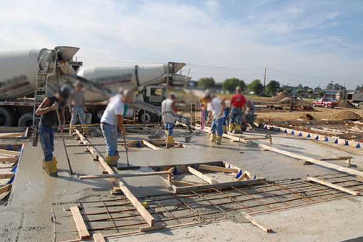

**Yang Harus Dilakukan Saat Pengecoran** - Hai Mitra CDI! Gimana kabarnya? Pembangunan rumah atau gedung baru? Nah, pengecoran adalah momen krusial yang menentukan kekuatan struktur bangunan Anda. Proses ini memang penuh pertimbangan dan perhitungan. Artikel ini hadir untuk memberikan panduan praktis mengenai tahapan pengecoran yang biasa dilakukan para profesional. Yuk, simak ulasan tentang “**Yang Harus Dilakukan Saat Pengecoran**” ini agar Anda semakin paham dan siap menghadapi proyek pembangunan di (not detected)!

*Pengecoran Beton: Langkah-Langkah Penting*

Pengecoran yang berkualitas adalah fondasi bangunan yang kokoh. Proses ini nggak bisa asal-asalan, lho! Kualitas bangunan sangat bergantung pada kualitas adonan cor beton dan proses pengerjaannya. Sebelum mulai, pastikan Anda menyiapkan material-material berikut yang akan menentukan kualitas campuran cor beton Anda:

## Semen

Semen di Indonesia sudah dikenal dengan kualitasnya yang baik – sebagian bahkan diekspor ke luar negeri! Jangan remehkan kualitas semen, ya. Pilih merek yang teruji meskipun harganya sedikit lebih tinggi. Investasi awal yang baik akan terbayar lunas dengan bangunan yang lebih kuat dan awet.

## Pasir (Agregat Halus)

Pasir adalah material penting lainnya yang wajib diperhatikan. Mudah didapatkan di berbagai toko bangunan dan hasil penambangan pasir kini semakin banyak ditemui. Pastikan Anda membeli pasir dari sumber yang legal, ya. Karena sayangnya, masih banyak penambangan pasir ilegal yang beroperasi.

## Kerikil / Split (Agregat Kasar)

Krikil atau split juga punya peran penting dalam menentukan kekokohan konstruksi beton. Semakin tinggi mutu beton yang Anda inginkan, semakin banyak komposisi krikil yang dibutuhkan. Ukuran kerikil yang umum digunakan untuk cor adalah 1-2 dan 2-3.

## Air

Air sebagai bagian dari adukan beton juga berpengaruh signifikan. Tanpa air, adukan beton tidak akan terbentuk. Namun, komposisi air harus sesuai dengan porsi per kubik, disesuaikan dengan nilai slump (kekentalan) beton yang diinginkan.

## Proses Pengadukan & Pengecoran

Pengadukan adalah tahap penting yang menentukan hasil akhir. Pastikan pengadukan dilakukan dengan benar dan merata. Setelah adukan siap, cor bangunan Anda dengan hati-hati dan terperinci. Hindari adanya rongga di dalam cor beton agar tidak menimbulkan masalah kebocoran di kemudian hari. Untuk meminimalkan rongga-rongga tersebut, gunakan mesin vibrator sebagai alat pemadatnya. Tertarik? Anda bisa menemukan [VIBRATOR BETON](/product/vibrator-cor) di katalog produk kami.

Nah, itulah beberapa hal penting yang harus dilakukan saat pengecoran. Jika Anda membutuhkan pasokan Ready Mix Beton berkualitas untuk proyek Anda di (not detected), jangan ragu untuk menghubungi kami. Dapatkan penawaran terbaik dan layanan konsultasi gratis dari tim ahli kami. Untuk informasi lebih lanjut, hubungi kami melalui tombol Telepon/WhatsApp yang tersedia di halaman ini! Kami siap membantu mewujudkan bangunan impian Anda di (not detected).