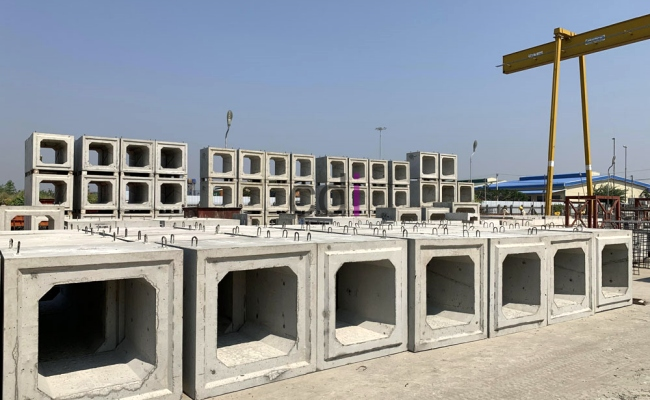

**Jual Box Culvert Precast di Babelan Bekasi** – Halo Mitra CDI! Apakah Anda sedang merencanakan sistem drainase yang handal di Babelan Bekasi? Kami punya solusinya! Produk Box Culvert Precast kami dirancang khusus untuk menjawab kebutuhan infrastruktur drainase modern, memberikan performa optimal dan ketahanan yang teruji.

Drainase yang baik adalah vital bagi kenyamanan dan keamanan lingkungan. Sistem drainase yang buruk dapat menyebabkan genangan air, kerusakan jalan, bahkan risiko kesehatan. Nah, Box Culvert Precast hadir sebagai solusi cerdas dan efisien untuk mengatasi masalah drainase di Babelan Bekasi dan sekitarnya. Produk beton pracetak ini dirancang untuk mengalirkan air hujan dan limbah dengan lancar, mencegah banjir, dan menjaga kelestarian lingkungan.



## Spesifikasi Box Culvert Precast di Babelan Bekasi yang Kami Tawarkan

Kami menyediakan berbagai ukuran Box Culvert Precast untuk memenuhi kebutuhan proyek Anda di Babelan Bekasi, termasuk:

*   **Ukuran:** Tersedia dalam berbagai dimensi, mulai dari 30x30 cm hingga 200x200 cm.
*   **Panjang:** Panjang standar 2 meter, namun kami juga menerima pesanan custom sesuai kebutuhan proyek Anda.
*   **Ketebalan:** Pilihan ketebalan dinding 10 cm, 12 cm, dan 15 cm untuk menyesuaikan dengan beban yang akan ditanggung.
*   **Kualitas Beton:** Menggunakan campuran beton mutu tinggi (K-250, K-300, K-350) yang kuat dan tahan lama.
*   **Reinforcement:** Dilengkapi dengan besi tulangan berkualitas tinggi sesuai standar SNI.

## Mengapa Memilih Box Culvert Precast dari CDI di Babelan Bekasi?

Berikut beberapa keunggulan Box Culvert Precast yang kami jual di Babelan Bekasi:

*   **Harga Bersaing:** Kami menawarkan harga yang kompetitif dan terjangkau tanpa mengorbankan kualitas.
*   **Kualitas Terjamin:** Produk kami diproduksi dengan standar mutu tinggi, memastikan kekuatan dan ketahanan yang optimal.
*   **Pemasangan Mudah:** Desain presisi memudahkan dan mempercepat proses pemasangan, menghemat waktu dan biaya tenaga kerja.
*   **Awet dan Tahan Lama:** Material berkualitas tinggi dan proses pembuatan yang teliti menjamin umur pakai yang panjang.
*   **Fleksibilitas Desain:** Tersedia dalam berbagai ukuran dan bentuk untuk menyesuaikan dengan kebutuhan proyek Anda.

## Aplikasi Box Culvert Precast: Solusi Drainase Serbaguna di Babelan Bekasi

Box Culvert Precast adalah solusi ideal untuk berbagai aplikasi drainase di Babelan Bekasi, antara lain:

*   **Drainase Jalan Raya:** Mampu menampung volume air yang besar dan menahan beban lalu lintas berat.
*   **Drainase Perumahan:** Mencegah genangan air dan menjaga lingkungan perumahan tetap kering dan nyaman.
*   **Gorong-gorong:** Solusi efektif untuk mengalirkan air di bawah jalan atau bangunan.
*   **Drainase Industri:** Dirancang untuk menahan beban berat dan lingkungan yang keras di area industri.
*   **Irigasi:** Dapat digunakan untuk mengalirkan air irigasi ke lahan pertanian.

## Harga Box Culvert Precast di Babelan Bekasi (Per Buah)



Catatan: Untuk informasi harga terbaru dan penawaran khusus, silakan hubungi tim kami.

## Keunggulan Box Culvert Precast vs. Drainase Konvensional di Babelan Bekasi

Berikut perbandingan antara Box Culvert Precast dan sistem drainase konvensional:

*   **Efisiensi Biaya:** Box Culvert Precast umumnya lebih ekonomis dibandingkan pembangunan drainase konvensional yang memakan waktu dan tenaga kerja lebih banyak.
*   **Kualitas & Daya Tahan:** Box Culvert Precast menawarkan kualitas dan daya tahan yang lebih tinggi karena diproduksi di lingkungan terkendali.
*   **Kecepatan Pemasangan:** Pemasangan Box Culvert Precast lebih cepat dan efisien, meminimalkan gangguan lalu lintas atau aktivitas konstruksi.
*   **Minim Perawatan:** Box Culvert Precast memerlukan perawatan minimal dibandingkan sistem drainase konvensional.

## Cara Mudah Memesan Box Culvert Precast di Babelan Bekasi

Pesan Box Culvert Precast dari kami sangat mudah! Ikuti langkah-langkah berikut:

1.  **Hubungi Kami:** Kirimkan detail proyek dan kebutuhan Anda ke customercdi@gmail.com. Sertakan informasi seperti dimensi yang dibutuhkan, jumlah, lokasi proyek di Babelan Bekasi, dan informasi kontak Anda.
2.  **Penawaran Harga:** Tim kami akan segera merespons dengan penawaran harga terbaik dan detail pengiriman.
3.  **Konfirmasi & Pembayaran:** Setelah menyetujui penawaran, lakukan pembayaran sesuai instruksi yang diberikan.
4.  **Pengiriman:** Kami akan mengirimkan Box Culvert Precast ke lokasi proyek Anda di Babelan Bekasi tepat waktu.

## Tips Penting Sebelum Memesan Box Culvert Precast di Babelan Bekasi

*   **Perencanaan Matang:** Pastikan Anda telah melakukan perencanaan yang matang dan pengukuran yang akurat sebelum memesan.
*   **Konsultasi Ahli:** Konsultasikan kebutuhan Anda dengan tim teknis kami untuk mendapatkan solusi terbaik.
*   **Persiapan Material Pendukung:** Siapkan material pendukung seperti pasir, semen, dan besi beton jika diperlukan.
*   **Pemasangan Profesional:** Percayakan pemasangan Box Culvert Precast kepada tenaga ahli untuk hasil yang optimal.

<table class="table">
  <caption>Spesifikasi Ukuran Box Culvert Precast</caption>
  <thead>
    <tr><th>Ukuran (cm)</th><th>Panjang (m)</th><th>Ketebalan Dinding (cm)</th><th>Berat (kg)</th></tr>
  </thead>
  <tbody>
    <tr><td>30x30</td><td>2</td><td>10</td><td>250</td></tr>
    <tr><td>40x40</td><td>2</td><td>12</td><td>400</td></tr>
    <tr><td>50x50</td><td>2</td><td>15</td><td>600</td></tr>
  </tbody>
</table>

Mitra CDI, jangan tunda lagi! Segera wujudkan sistem drainase yang handal di Babelan Bekasi dengan Box Culvert Precast dari kami. Hubungi kami sekarang untuk konsultasi dan penawaran terbaik! [Jual Box Culvert Precast di Abadijaya Depok](/box-culvert/jual-box-culvert-precast-di-abadijaya-depok/) — yuk, lihat juga artikel tentang produk serupa di Abadijaya Depok biar makin yakin!