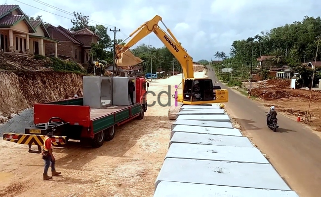

**Jual Box Culvert Precast di Baktijaya Depok** – Halo Mitra CDI! Apakah Anda sedang mencari solusi drainase yang handal dan tahan lama di Baktijaya Depok? Kami punya jawabannya! Sistem drainase yang baik adalah fondasi penting untuk lingkungan yang sehat dan nyaman. Nah, salah satu cara paling efektif untuk memastikan pengelolaan air yang optimal adalah dengan menggunakan Box Culvert Precast.

Apa sebenarnya Box Culvert Precast itu? Sederhananya, ini adalah struktur beton pracetak yang dirancang khusus untuk mengalirkan air hujan dan limbah dengan lancar. Di Creative Design Interior (CDI), kami menyediakan berbagai pilihan Box Culvert Precast berkualitas tinggi yang siap memenuhi kebutuhan proyek Anda di Baktijaya Depok, mulai dari skala kecil hingga besar.



Berikut adalah spesifikasi Box Culvert Precast yang tersedia di Baktijaya Depok:

*   **Ukuran:** Tersedia dalam berbagai dimensi internal, mulai dari 30x30 cm, 40x40 cm, 60x60 cm, hingga 80x80 cm. Kami juga menerima custom order sesuai kebutuhan spesifik proyek Anda.
*   **Panjang:** Setiap unit Box Culvert memiliki panjang standar 2 meter, namun kami bisa menyediakan panjang lain sesuai permintaan.
*   **Ketebalan Dinding:** Pilihan ketebalan dinding mulai dari 10 cm, 12 cm, hingga 15 cm, disesuaikan dengan beban yang akan ditanggung.
*   **Kualitas Beton:** Menggunakan beton mutu tinggi (K-250, K-300, K-350) dengan campuran material pilihan untuk kekuatan dan durabilitas optimal.
*   **Sistem Penguncian:** Dilengkapi dengan sistem penguncian yang presisi untuk pemasangan yang cepat, mudah, dan stabil.

### Keunggulan Menggunakan Box Culvert Precast CDI di Baktijaya Depok

## Apa Saja Kelebihan Box Culvert Precast yang Kami Tawarkan di Baktijaya Depok?

*   **Hemat Biaya:** Dibandingkan dengan metode drainase konvensional, Box Culvert Precast menawarkan solusi yang lebih ekonomis. Anda mendapatkan produk berkualitas dengan biaya yang lebih efisien.
*   **Kualitas Terjamin:** Produk kami diproduksi dengan standar kualitas yang ketat, menggunakan material terbaik, dan melalui proses quality control yang menyeluruh.
*   **Pemasangan Cepat & Mudah:** Desain Box Culvert Precast kami memungkinkan pemasangan yang cepat dan efisien, menghemat waktu dan biaya tenaga kerja.
*   **Tahan Lama:** Dengan kekuatan dan ketahanan yang superior, Box Culvert Precast kami memiliki umur pakai yang panjang dan minim perawatan.
*   **Fleksibilitas Desain:** Tersedia dalam berbagai ukuran dan bentuk, memungkinkan penyesuaian yang optimal dengan kebutuhan proyek drainase Anda di Baktijaya Depok.

## Aplikasi Box Culvert Precast di Baktijaya Depok untuk Berbagai Jenis Proyek:

\- **Proyek Perkotaan:** Cocok untuk saluran drainase perkotaan yang membutuhkan kapasitas tinggi dan ketahanan terhadap beban lalu lintas.
\- **Konstruksi Jalan:** Ideal untuk drainase jalan raya dan jalan tol, mampu menahan beban kendaraan berat dan memastikan aliran air yang lancar.
\- **Kawasan Industri:** Solusi drainase yang andal untuk kawasan industri dan pabrik, mampu mengatasi volume air limbah yang besar dan menjaga kebersihan lingkungan.
\- **Pembangunan Komersial:** Cocok untuk drainase mall, perkantoran, dan pusat perbelanjaan, memberikan perlindungan dari banjir dan genangan air.
\- **Proyek Infrastruktur:** Digunakan dalam pembangunan bandara, pelabuhan, dan proyek infrastruktur lainnya yang membutuhkan sistem drainase yang tangguh.

## Daftar Harga Box Culvert Precast di Baktijaya Depok (Per Unit):



Catatan: Informasi harga terbaru dan detail penawaran dapat dilihat pada tabel di atas.

## Mengapa Memilih Box Culvert Precast Dibandingkan Sistem Drainase Konvensional di Baktijaya Depok?

\- **Efisiensi Biaya:** Box Culvert Precast kami menawarkan harga yang lebih kompetitif dibandingkan biaya pembuatan drainase konvensional menggunakan beton cor di tempat.
\- **Kualitas Unggul:** Box Culvert Precast memiliki kekuatan dan durabilitas yang lebih baik dibandingkan drainase konvensional, memastikan umur pakai yang lebih panjang.
\- **Kecepatan Pelaksanaan:** Pemasangan Box Culvert Precast jauh lebih cepat dan efisien dibandingkan pembuatan drainase konvensional, mengurangi waktu penyelesaian proyek.
\- **Minim Perawatan:** Box Culvert Precast kami membutuhkan perawatan yang minimal, mengurangi biaya operasional jangka panjang.

## Cara Pemesanan Box Culvert Precast di Baktijaya Depok?

*   **Langkah 1: Konsultasi & Pengajuan Penawaran:** Kirimkan detail proyek Anda (jenis proyek, lokasi, ukuran yang dibutuhkan) ke email customercdi@gmail.com.
*   **Langkah 2: Penawaran Harga:** Tim kami akan segera memproses permintaan Anda dan memberikan penawaran harga yang terbaik.
*   **Langkah 3: Konfirmasi & Pemesanan:** Setelah menyetujui penawaran, konfirmasikan pesanan Anda dan lakukan pembayaran.
*   **Langkah 4: Pengiriman:** Kami akan mengatur pengiriman Box Culvert Precast ke lokasi proyek Anda di Baktijaya Depok dengan aman dan tepat waktu.

## Tips Penting Sebelum Membeli Box Culvert Precast di Baktijaya Depok:

*   **Ukur dengan Akurat:** Pastikan Anda mengukur kebutuhan Box Culvert dengan tepat untuk menghindari pemesanan yang berlebihan atau kurang.
*   **Cek Stok:** Hubungi kami untuk memastikan ketersediaan produk sebelum melakukan pemesanan.
*   **Verifikasi Alamat Pengiriman:** Pastikan alamat pengiriman yang Anda berikan sudah benar dan lengkap.
*   **Jangan Ragu Bertanya:** Jika Anda memiliki pertanyaan atau membutuhkan bantuan, jangan ragu untuk menghubungi tim kami. Kami siap melayani Anda!

Investasi pada sistem drainase yang baik sangat penting untuk masa depan Baktijaya Depok. Dengan Box Culvert Precast berkualitas dari CDI, Anda mendapatkan solusi drainase yang handal, tahan lama, dan ekonomis. Yuk, wujudkan lingkungan Baktijaya Depok yang lebih bersih dan nyaman! Jangan tunda lagi, hubungi kami sekarang juga dan dapatkan penawaran terbaik! [Hubungi Kami](URL Telepon/WhatsApp) untuk informasi lebih lanjut dan pemesanan.