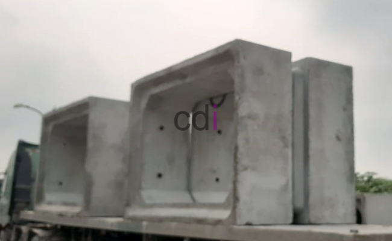

**Jual Box Culvert Precast di Bali Mester Jakarta** – Halo Mitra CDI! Apakah Anda sedang mencari solusi drainase yang efektif dan tahan lama di Bali Mester Jakarta? Nah, kami dari CDI hadir untuk menawarkan Box Culvert Precast berkualitas tinggi yang siap menjawab kebutuhan proyek Anda. Produk ini bukan sekadar beton pracetak biasa, lho. Ini investasi cerdas untuk infrastruktur yang andal. Sistem drainase yang baik adalah kunci mencegah masalah banjir dan memastikan kelancaran arus air, terutama di area padat seperti Bali Mester Jakarta.



Berikut adalah spesifikasi Box Culvert Precast yang kami sediakan di Bali Mester Jakarta:

### Variasi Mutu Box Culvert Precast di Bali Mester Jakarta yang Kami Sediakan

Kami menawarkan berbagai pilihan mutu Box Culvert Precast, disesuaikan dengan kebutuhan kekuatan dan beban proyek Anda:

*   K225
*   K250
*   K300
*   K350

## Mengapa Memilih Box Culvert Precast dari CDI di Bali Mester Jakarta?

Dengan memilih produk kami, Anda mendapatkan lebih dari sekadar material bangunan. Berikut ini beberapa keunggulan yang akan Anda rasakan:

*   **Kualitas Terjamin:** Box culvert precast yang kami tawarkan memiliki kualitas unggul, dengan mutu K225, K250, K300, dan K350. Standar ini menjamin daya tahan dan ketahanan produk, sehingga ideal untuk aplikasi drainase dan gorong-gorong yang memerlukan kekuatan tinggi. Produk kami juga sudah melalui uji laboratorium dan memenuhi standar SNI.
*   **Pilihan Ukuran Lengkap:** Kami menyediakan box culvert precast dengan beragam ukuran, mulai dari yang kecil hingga besar. Fleksibilitas ini memudahkan penyesuaian dengan kebutuhan spesifik proyek drainase dan gorong-gorong Anda. Kami siap memberikan solusi terbaik, apapun ukuran yang Anda butuhkan.
*   **Konstruksi Kuat dan Tahan Lama:** Produk kami dirancang dengan struktur yang kuat dan tahan lama. Bahan berkualitas tinggi serta proses pembuatan yang teliti memastikan box culvert precast kami dapat bertahan lama, bahkan mampu menahan beban berat. Anda tidak perlu khawatir akan kerusakan atau kebocoran pada sistem drainase Anda.
*   **Pemasangan Mudah dan Efisien:** Box culvert precast kami dirancang untuk pemasangan yang cepat dan mudah. Kami menyediakan panduan lengkap yang mudah dipahami, sehingga kontraktor atau pelanggan dapat melakukan instalasi dengan lancar. Ini akan menghemat waktu dan tenaga Anda.
*   **Harga Kompetitif:** Meskipun menawarkan mutu unggul, kami tetap berkomitmen untuk memberikan harga yang bersaing. Dengan begitu, Anda mendapatkan produk berkualitas tinggi dengan *budget* yang terjangkau.

## Aplikasi Box Culvert Precast di Berbagai Proyek di Bali Mester Jakarta:

Box Culvert Precast dari CDI sangat serbaguna dan dapat digunakan dalam berbagai proyek:

*   **Proyek Jalan Raya:** Ideal untuk menampung aliran air hujan di sepanjang jalan, mencegah genangan air dan banjir.
*   **Proyek Perumahan:** Cocok digunakan sebagai saluran drainase untuk mengalirkan air hujan dari halaman rumah ke saluran utama.
*   **Proyek Terowongan Bawah Tanah:** Dapat digunakan sebagai saluran drainase untuk mengalirkan air dan menjaga stabilitas struktur terowongan.
*   **Proyek Irigasi:** Membantu mengalirkan air ke area pertanian, memastikan pasokan air yang memadai untuk pertumbuhan tanaman.

## Daftar Harga Box Culvert Precast di Bali Mester Jakarta (Per Buah):



Catatan: Harga di atas adalah harga per buah Box Culvert Precast di Bali Mester Jakarta, dalam Rupiah.

## Perbandingan: Box Culvert Precast vs. Drainase Konvensional di Bali Mester Jakarta

Mau tahu kenapa memilih box culvert precast lebih unggul? Cek perbandingannya dengan drainase konvensional:

*   **Biaya:** Harga box culvert precast kami umumnya lebih ekonomis dibandingkan biaya pembuatan drainase konvensional yang membutuhkan banyak tenaga kerja manual dan material terpisah.
*   **Kualitas:** Mutu box culvert precast kami lebih baik daripada drainase konvensional yang seringkali menggunakan bahan seperti beton cor, menawarkan daya tahan yang lebih lama.
*   **Efisiensi:** Pemasangan box culvert precast lebih efisien dan cepat dibandingkan drainase konvensional yang memakan waktu dan biaya lebih banyak.
*   **Perawatan:** Box culvert precast memerlukan perawatan minimal, sementara drainase konvensional seringkali butuh perbaikan dan pemeliharaan berkala.

## Cara Mudah Memesan Box Culvert Precast di Bali Mester Jakarta

Yuk, segera pesan Box Culvert Precast dari CDI! Prosesnya mudah:

1.  Kirimkan data lengkap Anda (nama, alamat, dan jumlah box culvert yang dibutuhkan) melalui email ke customercdi@gmail.com.
2.  Tim kami akan segera memproses pesanan Anda dan menentukan harga yang sesuai dengan kebutuhan Anda.
3.  Kami akan mengirimkan penawaran resmi melalui email. Silakan periksa dan konfirmasi jika setuju.

## Hal Penting yang Perlu Diperhatikan Sebelum Memesan

Sebelum Anda memesan Box Culvert Precast di Bali Mester Jakarta, ada beberapa hal yang perlu diperhatikan:

*   Pastikan Anda telah melakukan pengukuran dan perencanaan yang akurat untuk memastikan kebutuhan drainase Anda terpenuhi.
*   Siapkan bahan tambahan seperti besi beton, pasir, dan semen untuk proses instalasi.
*   Konsultasikan dengan tim teknis kami untuk memastikan Box Culvert Precast yang Anda pesan sesuai dengan kualitas dan kriteria yang diperlukan.
*   Periksa kembali harga, jumlah, dan rincian lainnya pada penawaran resmi sebelum melakukan pembayaran.

Pemasangan box culvert precast yang tepat adalah kunci drainase yang optimal. Hindari kesalahan seperti pemasangan yang kurang rapi, pergeseran, penumpukan material, dan penggunaan bahan yang tidak sesuai. Pastikan perhitungan jumlah dan kualitas material sangat tepat. Jika Anda membutuhkan informasi lebih lanjut tentang produk Box Culvert Precast di Bali Mester Jakarta, segera hubungi kami. [Jual Box Culvert Precast di Angke Jakarta](/box-culvert/jual-box-culvert-precast-di-angke-jakarta/) adalah salah satu area layanan kami lainnya. Jangan ragu untuk berkonsultasi!