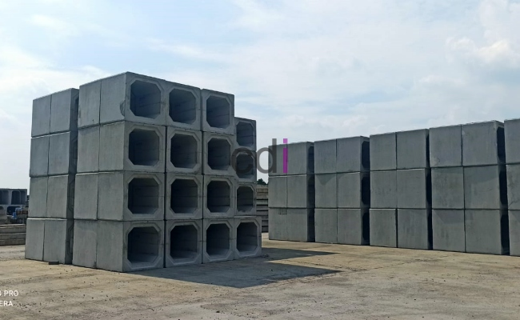

**Jual Box Culvert Precast di Bambu Apus Jakarta** – Hai Mitra CDI! Mencari solusi drainase terbaik di Bambu Apus Jakarta? Kami punya jawabannya! Produk Box Culvert Precast kami dirancang untuk mengatasi masalah banjir dan memastikan infrastruktur Anda tahan lama. Dengan berbagai ukuran dan mutu tinggi, kami siap mendukung proyek drainase dan gorong-gorong Anda dengan material berkualitas dan terpercaya. Yuk, simak detail lengkapnya di artikel ini!



Berikut adalah detail ukuran panjang, diameter, dan ketebalan untuk setiap jenis Box Culvert Precast yang tersedia: 

## Keunggulan Memilih Box Culvert Precast dari CDI di Bambu Apus Jakarta:

\- **Kualitas Terjamin:** Box culvert precast kami dibuat dengan mutu beton K225, K250, K300, dan K350, menjamin kekuatan dan ketahanan yang optimal. Produk kami telah melalui uji laboratorium dan memenuhi standar SNI, sehingga Anda bisa yakin dengan kualitasnya.

\- **Pilihan Dimensi Variatif:** Kami menyediakan beragam dimensi, mulai dari ukuran kecil hingga besar, agar sesuai dengan kebutuhan spesifik proyek drainase dan gorong-gorong Anda. Fleksibilitas ini memungkinkan penyesuaian sempurna untuk berbagai aplikasi.

\- **Desain Kuat dan Awet:** Produk kami dirancang untuk tahan lama dan mampu menahan beban berat. Digabungkan dengan material berkualitas tinggi dan proses produksi yang teliti, box culvert precast kami memberikan solusi jangka panjang tanpa khawatir kerusakan atau kebocoran.

\- **Pemasangan Praktis:** Kami memahami pentingnya efisiensi waktu. Oleh karena itu, box culvert precast kami didesain untuk pemasangan yang mudah dan cepat. Panduan detail yang jelas disertakan untuk memudahkan kontraktor atau tim Anda.

\- **Harga Kompetitif:** Kami menawarkan harga yang bersaing tanpa mengorbankan kualitas. Dapatkan produk berkualitas prima dengan investasi yang sesuai anggaran Anda.

## Aplikasi Box Culvert Precast di Bambu Apus Jakarta untuk Sistem Drainase dan Gorong-Gorong yang Andal:

*   Drainase jalan utama: Ideal untuk mengelola aliran air di jalan-jalan besar dengan lalu lintas padat, berkat ketahanan terhadap beban berat.
*   Drainase perumahan: Mencegah genangan air dan memastikan lingkungan perumahan tetap kering dan nyaman, bahkan saat musim hujan.
*   Ruas jalan: Solusi efektif untuk pembuatan gorong-gorong yang tahan lama dan minim perawatan.
*   Drainase industri: Jaringan drainase yang kuat dan tahan terhadap beban berat sangat penting di area industri – Box Culvert Precast kami adalah jawabannya.

## Daftar Harga Box Culvert Precast di Bambu Apus Jakarta Per Buah:



Keterangan: Harga di atas adalah harga per unit Box Culvert Precast di Bambu Apus Jakarta dalam Rupiah.

## Mengapa Memilih Box Culvert Precast? Perbandingan dengan Sistem Drainase Konvensional di Bambu Apus Jakarta:

\- **Efisiensi Biaya:** Biaya box culvert precast seringkali lebih terjangkau dibandingkan dengan pembangunan drainase konvensional yang memakan waktu dan tenaga kerja yang lebih banyak.

\- **Kualitas Unggul:** Mutu beton precast kami lebih tinggi daripada beton cor konvensional, menjamin kekuatan dan umur pakai yang lebih panjang.

\- **Kemudahan dan Kecepatan Pemasangan:** Pemasangan box culvert precast jauh lebih cepat dan efisien dibandingkan dengan metode konvensional yang kompleks.

\- **Minim Perawatan:** Box culvert precast tahan lama dan tidak memerlukan perawatan rutin seperti drainase konvensional, sehingga menghemat biaya jangka panjang.

## Cara Mudah Memesan Box Culvert Precast di Bambu Apus Jakarta dari CDI:

1.  Sampaikan kebutuhan Anda: Kirimkan detail order Anda melalui email ke customercdi@gmail.com. Sertakan nama lengkap, alamat, dan jumlah Box Culvert yang Anda butuhkan.
2.  Dapatkan penawaran: Tim kami akan segera membalas email Anda dengan informasi mengenai ketersediaan stok, harga terkini, dan estimasi waktu pengiriman.
3.  Lakukan pembayaran: Selesaikan pembayaran melalui transfer bank atau metode pembayaran lain yang telah disepakati.
4.  Terima pesanan Anda: Kami akan mengirimkan Box Culvert Precast langsung ke lokasi Anda setelah pembayaran dikonfirmasi.
5.  Periksa dan nikmati: Pastikan pesanan Anda sesuai dengan yang dipesan saat diterima. Hubungi kami jika ada kendala, dan kami akan segera menyelesaikannya.

## Tips Penting Sebelum Membeli Box Culvert Precast di Bambu Apus Jakarta:

*   **Perhitungan yang Tepat:** Pastikan Anda sudah menghitung dengan akurat dimensi dan jumlah Box Culvert yang dibutuhkan untuk menghindari kekurangan atau kelebihan pesanan.
*   **Cek Stok:** Selalu periksa ketersediaan stok sebelum melakukan pemesanan untuk memastikan kelancaran proyek Anda.
*   **Alamat yang Jelas:** Berikan alamat pengiriman yang lengkap dan akurat agar pesanan Anda sampai tepat waktu.
*   **Jangan Ragu Bertanya:** Jika Anda memiliki pertanyaan atau membutuhkan bantuan, jangan ragu untuk menghubungi tim kami. Kami siap melayani Anda.

Pemasangan yang benar adalah kunci untuk memastikan sistem drainase berfungsi optimal. Hindari kesalahan pemasangan seperti ketidakrataan, pergeseran, atau penumpukan material di sekitar box culvert. Gunakan material berkualitas dan pastikan perhitungan jumlah box culvert akurat. Butuh konsultasi lebih lanjut mengenai produk Box Culvert Precast di Bambu Apus Jakarta? Jangan sungkan untuk menghubungi kami! [Jual Box Culvert Precast di Angke Jakarta](/box-culvert/jual-box-culvert-precast-di-angke-jakarta/) mungkin juga bisa jadi referensi tambahan.