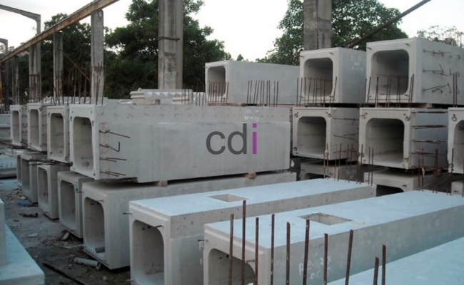

**Jual Box Culvert Precast di Bangka Jakarta** – Hai Mitra CDI! Apakah Anda sedang mencari solusi drainase yang efisien dan tahan lama di Bangka Jakarta? Kami hadir sebagai penyedia Box Culvert Precast berkualitas tinggi, dirancang untuk menangani berbagai kebutuhan infrastruktur drainase di wilayah Bangka Jakarta dan sekitarnya. Box Culvert Precast ini adalah solusi ideal untuk mengalirkan air dengan lancar di bawah tanah, menawarkan kemudahan instalasi dan kekuatan struktural yang terjamin.



**Beragam Pilihan Mutu Box Culvert Precast di Bangka Jakarta**

Kami menyediakan Box Culvert Precast dalam empat jenis mutu berbeda untuk menyesuaikan dengan skala dan kebutuhan proyek Anda di Bangka Jakarta. Masing-masing mutu menawarkan karakteristik unik, sehingga Anda dapat memilih yang paling sesuai dengan aplikasi yang diinginkan. Berikut detailnya:

**1\. Mutu K225:** Cocok untuk proyek drainase skala kecil hingga menengah di Bangka Jakarta. Dengan perkiraan berat 500 kg dan dimensi 1m x 1m x 1m, mutu ini menawarkan kombinasi ideal antara kekuatan dan efisiensi biaya.
**2\. Mutu K250:** Pilihan tepat jika proyek Anda membutuhkan daya tahan lebih tinggi. Box Culvert mutu K250 memiliki bobot sekitar 800 kg dan dimensi 1.5m x 1.5m x 1.5m, menjadikannya ideal untuk menahan beban yang lebih besar.
**3\. Mutu K300:** Untuk proyek drainase yang membutuhkan dukungan maksimal, mutu K300 adalah jawabannya. Dengan bobot sekitar 1200 kg dan ukuran 2m x 2m x 2m, Box Culvert ini memberikan stabilitas dan kekuatan yang luar biasa. 
**4\. Mutu K350:** Menawarkan daya dukung tertinggi, Box Culvert mutu K350 sangat ideal untuk aplikasi yang paling menantang. Dengan bobot sekitar 1600 kg dan dimensi 2.5m x 2.5m x 2.5m, mutu ini dirancang untuk menahan beban ekstrem.

### Kapasitas Beban Box Culvert Precast di Bangka Jakarta

Setiap jenis mutu Box Culvert Precast yang tersedia di Bangka Jakarta memiliki batas kemampuan menahan beban yang berbeda-beda. Berikut adalah rincian kapasitas beban maksimum untuk masing-masing mutu: [Pelajari lebih lanjut tentang kapasitas beban Box Culvert Precast di sini](URL INTERNAL LINK - jika relevan dengan artikel terkait tentang kapasitas beban).

## Keunggulan Memilih Box Culvert Precast dari Kami di Bangka Jakarta:

*   **Harga Kompetitif:** Kami menawarkan harga yang bersaing untuk Box Culvert Precast di Bangka Jakarta, memberikan nilai terbaik untuk investasi Anda. Dengan demikian, Anda bisa mendapatkan produk berkualitas tanpa menguras anggaran.
*   **Kualitas Terjamin:** Box Culvert Precast kami diproduksi dengan standar mutu tinggi dan menggunakan material terbaik. Produk ini menjamin ketahanan terhadap beban berat dan kondisi lingkungan yang keras.
*   **Pemasangan Mudah:** Desain Box Culvert Precast kami memudahkan dan mempercepat proses pemasangan. Hal ini akan menghemat waktu dan biaya tenaga kerja Anda.
*   **Daya Tahan Lama:** Produk kami dirancang untuk tahan lama dan tahan terhadap korosi serta cuaca buruk. Anda tidak perlu khawatir akan biaya perawatan yang mahal di masa mendatang.
*   **Fleksibilitas Desain:** Tersedia dalam berbagai ukuran dan bentuk, Box Culvert Precast kami dapat disesuaikan dengan kebutuhan spesifik proyek drainase Anda di Bangka Jakarta.

## Aplikasi Box Culvert Precast di Bangka Jakarta: Berbagai Jenis Proyek yang Tepat

Box Culvert Precast yang kami jual di Bangka Jakarta sangat serbaguna dan cocok digunakan dalam berbagai jenis proyek:

*   **Proyek Saluran Perkotaan:** Ideal untuk saluran air di perkotaan yang memerlukan struktur kuat dan tahan lama.
*   **Konstruksi Jalan Raya dan Jalan Tol:** Memberikan drainase yang handal dan tahan terhadap beban kendaraan berat. 
*   **Pembangunan Zona Industri dan Pusat Perbelanjaan:** Memastikan sistem drainase yang efektif dan awet di area komersial.
*   **Proyek Infrastruktur (Jembatan, Tol, Bandara):** Menawarkan solusi drainase yang kuat dan tahan lama untuk proyek infrastruktur berskala besar di Bangka Jakarta.

## Daftar Harga Box Culvert Precast di Bangka Jakarta



**_\*Catatan Penting:_**

*   \- Harga belum termasuk PPN 10%
*   \- Harga dapat berubah sewaktu-waktu tanpa pemberitahuan. Untuk harga terkini silahkan hubungi tim kami.

## Analisis Perbandingan: Box Culvert Precast vs. Drainase Konvensional di Bangka Jakarta

Berikut perbandingan antara Box Culvert Precast dan sistem drainase konvensional, untuk membantu Anda dalam menentukan pilihan terbaik untuk proyek Anda di Bangka Jakarta:

*   **Biaya:** Meskipun harga awal Box Culvert Precast mungkin sedikit lebih tinggi, biaya pemasangan dan perawatan jangka panjangnya lebih rendah. Ini menjadikan opsi ini lebih hemat biaya dalam jangka panjang.
*   **Kualitas:** Box Culvert Precast dibuat dengan material beton berkualitas tinggi sehingga menawarkan kualitas dan daya tahan yang unggul dibandingkan drainase konvensional.
*   **Efisiensi:** Box Culvert Precast meningkatkan aliran air secara efektif dan lebih mudah dipelihara, memastikan sistem drainase yang optimal.
*   **Waktu:** Proses pemasangan Box Culvert Precast lebih cepat daripada drainase konvensional, mempercepat penyelesaian proyek Anda.

## Cara Mudah Memesan Box Culvert Precast di Bangka Jakarta

Ingin memesan Box Culvert Precast untuk proyek Anda di Bangka Jakarta? Ikuti langkah-langkah berikut:

*   **Langkah 1: Kirimkan Detail Proyek Anda:** Hubungi kami melalui email di customercdi@gmail.com dengan menyertakan nama lengkap, alamat, dan jumlah Box Culvert yang Anda perlukan.
*   **Langkah 2: Dapatkan Penawaran:** Tim kami akan segera menghubungi Anda dengan penawaran harga terbaik, perkiraan waktu pengiriman, dan opsi pembayaran yang tersedia.
*   **Langkah 3: Lakukan Pembayaran:** Setelah menyetujui penawaran, lakukan pembayaran sesuai dengan instruksi yang diberikan. 

Kami menyediakan berbagai metode pembayaran untuk kemudahan Anda. Setelah pembayaran diterima, order Anda akan segera diproses dan dikirimkan sesuai jadwal yang disepakati.

## Hal Penting yang Perlu Diperhatikan Sebelum Memesan Box Culvert Precast di Bangka Jakarta

Sebelum melakukan pemesanan, pastikan Anda mempertimbangkan hal-hal berikut:

*   **Kebutuhan Proyek:** Hitung secara akurat jumlah Box Culvert yang dibutuhkan berdasarkan dimensi dan spesifikasi proyek Anda.  
*   **Mutu Produk:** Pilih mutu Box Culvert yang sesuai dengan beban dan kondisi lingkungan proyek Anda.
*   **Harga dan Jadwal Pengiriman:** Periksa kembali harga dan jadwal pengiriman yang tertera dalam penawaran.
*   **Ketentuan Transaksi:** Pastikan Anda memahami dan menyetujui semua ketentuan transaksi sebelum melakukan pembayaran.

Pemasangan Box Culvert Precast yang tepat sangat penting untuk efektivitas sistem drainase. Hindari kesalahan pemasangan yang dapat menyebabkan masalah di kemudian hari. Jangan ragu untuk menghubungi kami jika Anda membutuhkan informasi lebih lanjut atau bantuan dalam memilih produk yang tepat untuk proyek Anda di Bangka Jakarta. Kami siap membantu mewujudkan sistem drainase yang handal dan tahan lama untuk Anda! [Jelajahi solusi drainase lengkap kami di sini](URL INTERNAL LINK - jika relevan dengan halaman solusi drainase CDI).