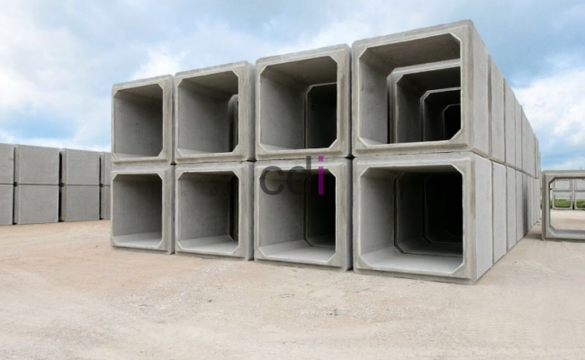

**Jual Box Culvert Precast di Bantar Gebang Bekasi** – Halo Mitra CDI! Apakah Anda sedang mencari solusi drainase yang handal dan tahan lama di Bantar Gebang Bekasi? Nah, CDI hadir untuk memberikan penawaran terbaik: Box Culvert Precast! Produk ini memang dirancang khusus untuk menjawab tantangan sistem drainase modern, terutama di area seperti Bantar Gebang Bekasi yang membutuhkan pengelolaan air yang efektif. Dengan Box Culvert Precast, Anda bisa mengurangi risiko genangan dan memastikan kelancaran aliran air.



Berikut detail dimensi panjang, diameter, dan tebal dari tiap tipe Box Culvert Precast yang tersedia:

**1\. Box Culvert A:** Dimensi panjang 1m, diameter 1m, dan tebal 1m.
**2\. Box Culvert B:** Dimensi panjang 1.5m, diameter 1.5m, dan tebal 1.5m.
**3\. Box Culvert C:** Memiliki dimensi panjang 2m, diameter 2m, dan ketebalan 2m.
**4\. Box Culvert D:** Mempunyai dimensi panjang 2.5m, diameter 2.5m, dan tebal 2.5m.

### Mengetahui Kapasitas Box Culvert Precast di Bantar Gebang Bekasi

Berat adalah faktor penting dalam perencanaan proyek drainase. Berikut rincian berat masing-masing dimensi Box Culvert Precast di Bantar Gebang Bekasi:

**1\. Box Culvert A:** Bobot per unit Box Culvert A sekitar 500 kg.
**2\. Box Culvert B:** Setiap Box Culvert B memiliki bobot sekitar 800 kg.
**3\. Box Culvert C:** Bobot Box Culvert C adalah sekitar 1200 kg per buah.
**4\. Box Culvert D:** Bobot Box Culvert D kira-kira mencapai 1600 kg per buah.

## Apa Saja Keunggulan Box Culvert Precast yang Kami Pasarkan di Bantar Gebang Bekasi?

*   Harga bersaing: Kami menawarkan Box Culvert Precast dengan harga yang kompetitif di pasaran. Anda bisa mendapatkan produk berkualitas tanpa menguras anggaran proyek Anda.
*   Kualitas terjamin: Box Culvert Precast kami diproduksi dengan standar tinggi menggunakan material terbaik. Daya tahannya terhadap beban dan tekanan sangat baik.
*   Pemasangan mudah: Desain yang presisi membuat Box Culvert Precast kami mudah dipasang, menghemat waktu dan biaya tenaga kerja.
*   Awet dan tahan lama: Produk kami memiliki umur pakai panjang dan tahan terhadap karat serta kerusakan akibat cuaca ekstrem. Anda tidak perlu khawatir dengan biaya perawatan yang mahal.
*   Fleksibilitas desain: Tersedia dalam berbagai ukuran dan bentuk, Box Culvert Precast kami dapat disesuaikan dengan kebutuhan proyek drainase Anda.

## Aplikasi Box Culvert Precast di Bantar Gebang Bekasi Untuk Drainase dan Gorong-gorong yang Tahan Lama

\- **Proyek Saluran Perkotaan:** Ideal untuk saluran air di perkotaan yang membutuhkan kekuatan dan ketahanan terhadap korosi. Box culvert precast kami mampu mengalirkan volume air besar dan bertahan lama.

\- **Konstruksi Jalan Raya/Tol:** Digunakan untuk drainase di sepanjang jalan yang sering terbebani lalu lintas berat. Produk kami didesain kuat menahan beban dan memastikan aliran air lancar.

\- **Pembangunan Zona Industri/Pusat Perbelanjaan:** Solusi drainase efektif untuk area dengan volume air tinggi, menjamin sistem drainase optimal dan mencegah genangan.

\- **Proyek Infrastruktur Besar:** Cocok untuk pembangunan jalan tol, jembatan, atau bandara yang membutuhkan saluran drainase dan gorong-gorong kokoh dan tahan lama. Produk kami telah teruji ketahanannya di lingkungan ekstrem.

## Informasi Daftar Harga Box Culvert Precast di Bantar Gebang Bekasi:



**_\*Catatan:_**

*   \- Harga belum termasuk PPN 10%
*   \- Harga sewaktu-waktu dapat berubah tanpa pemberitahuan.

## Perbandingan Box Culvert Precast di Bantar Gebang Bekasi dengan Sistem Drainase Konvensional:

*   **1. Investasi:** Meskipun investasi awal Box Culvert Precast sedikit lebih tinggi, biaya pemasangan dan perawatan jangka panjangnya lebih rendah, menjadikannya solusi yang lebih hemat biaya secara keseluruhan.
*   **2. Ketahanan:** Box Culvert Precast memiliki kualitas dan daya tahan yang lebih baik daripada drainase konvensional. Dibuat dari beton berkualitas tinggi, produk kami tahan terhadap cuaca dan tekanan yang lebih ekstrim.
*   **3. Efisiensi:** Box Culvert Precast meningkatkan efisiensi aliran air dibandingkan drainase konvensional dan lebih mudah dirawat, menjamin fungsi drainase yang optimal berkelanjutan.
*   **4. Kecepatan:** Pemasangan Box Culvert Precast lebih cepat daripada drainase konvensional. Proses produksi standar dan pemasangan mudah menghemat waktu dan biaya proyek.

## Bagaimana Cara Memesan Box Culvert Precast di Bantar Gebang Bekasi dari CDI?

1\.  Sampaikan kebutuhan Anda melalui email ke customercdi@gmail.com, cantumkan nama lengkap, alamat, dan jumlah yang dibutuhkan.

2\.  Dapatkan penawaran dari kami via email. Kami akan memberikan informasi ketersediaan produk, harga, dan perkiraan waktu pengiriman.

3\.  Lakukan transaksi sesuai instruksi yang kami berikan. Metode pembayaran bisa melalui transfer bank atau opsi lain yang tersedia.

4\.  Setelah pembayaran terkonfirmasi, kami akan segera mengirimkan Box Culvert Precast pesanan Anda ke lokasi yang Anda tentukan.

5\.  Periksa barang saat diterima. Jika ada kendala atau ketidaksesuaian, segera hubungi kami untuk solusi terbaik.

## Hal-hal Penting Sebelum Memesan Box Culvert Precast di Bantar Gebang Bekasi

*   **Kebutuhan Proyek Anda:** Pastikan Anda telah menghitung dengan tepat jumlah Box Culvert yang dibutuhkan. Pertimbangkan ukuran, kuantitas, dan spesifikasi lainnya yang relevan. Dengan begitu, kami dapat membantu Anda menemukan solusi optimal.
*   **Kualitas Produk:** Kami hanya menyediakan Box Culvert Precast dengan bahan berkualitas tinggi dan proses produksi yang ketat. Tersedia sertifikat mutu untuk memastikan standar kualitas.
*   **Harga dan Jadwal Pengiriman:** Periksa harga dan jadwal pengiriman dalam konfirmasi pesanan. Pastikan Anda setuju dengan harga dan waktu pengiriman yang disepakati.
*   **Proses Pembayaran:** Lakukan pembayaran sesuai instruksi yang kami berikan. Jika ada pertanyaan, jangan ragu untuk menghubungi tim kami.

Pemasangan yang benar sangat penting untuk memastikan drainase yang efisien dan mencegah masalah. Hindari kesalahan umum seperti pemasangan yang tidak rapi, pergeseran struktur, penumpukan material di sekitar area pemasangan, dan penggunaan bahan yang tidak sesuai standar. Kami di CDI siap membantu Anda memastikan pemasangan Box Culvert Precast di Bantar Gebang Bekasi berjalan lancar dan efektif. Untuk informasi lebih lanjut, jangan ragu untuk menghubungi kami. [Jual Box Culvert Precast di Anyar Serang](/box-culvert/jual-box-culvert-precast-di-anyar-serang/) adalah salah satu referensi yang bisa Anda pertimbangkan untuk informasi tambahan.