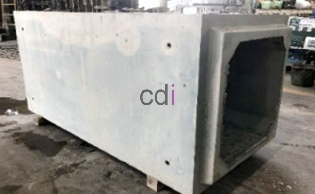

**Jual Box Culvert Precast di Banyusari Karawang** – Halo Mitra CDI! Mencari solusi drainase yang handal dan tahan lama di Banyusari Karawang? Kami punya jawabannya! Produk Box Culvert Precast kami dirancang khusus untuk menjawab kebutuhan infrastruktur Anda. Dari perencanaan hingga pemasangan, kami menyediakan solusi lengkap dengan kualitas terjamin. Dengan berbagai ukuran dan standar mutu, Anda bisa mendapatkan produk yang pas untuk proyek drainase dan gorong-gorong di Banyusari Karawang. Yuk, simak detailnya!



**Mengapa Memilih Box Culvert Precast dari CDI di Banyusari Karawang?**

## Keunggulan Box Culvert Precast di Banyusari Karawang yang Kami Tawarkan:

\- Mutu Terjamin: Box culvert precast kami diproduksi dengan mutu unggul, memenuhi standar K225, K250, K300, dan K350. Standar ini menjamin kekuatan dan ketahanan yang tinggi, ideal untuk proyek drainase dan gorong-gorong yang membutuhkan keandalan maksimal. Produk kami juga telah melalui uji laboratorium dan memenuhi standar SNI.

\- Ukuran Variatif: Kami menyediakan berbagai ukuran Box Culvert Precast, mulai dari yang kecil hingga besar. Fleksibilitas ini mempermudah penyesuaian dengan kebutuhan spesifik proyek drainase dan gorong-gorong Anda. Dengan pilihan dimensi yang lengkap, kami siap menjadi solusi terbaik untuk setiap proyek.

\- Konstruksi Kokoh & Awet: Produk kami dirancang dengan struktur yang kokoh dan tahan lama. Bahan berkualitas tinggi dan proses produksi yang cermat memastikan Box Culvert Precast kami mampu bertahan lama serta menahan beban berat. Anda tidak perlu khawatir tentang kerusakan atau kebocoran pada sistem drainase Anda.

\- Pemasangan Mudah & Efisien: Box culvert precast kami dilengkapi dengan panduan instalasi yang lengkap dan mudah dipahami. Ini mempermudah kontraktor atau pelanggan dalam proses pemasangan, mengurangi waktu dan tenaga, sehingga proyek dapat diselesaikan dengan lebih efisien.

\- Harga Kompetitif: Kami menawarkan harga Box Culvert Precast yang sangat kompetitif. Walaupun kualitasnya terbaik, kami tetap menjaga harga yang terjangkau untuk memberikan nilai tambah bagi pelanggan kami di Banyusari Karawang.

## Aplikasi Box Culvert Precast di Banyusari Karawang untuk Sistem Drainase yang Andal:

*   Drainase Jalan Raya: Box Culvert Precast ideal untuk drainase jalan raya karena daya tahannya terhadap beban kendaraan berat.
*   Drainase Perumahan: Sangat cocok untuk pengembangan drainase perumahan, mampu menangani curah hujan tinggi dan mencegah banjir.
*   Pembuatan Gorong-Gorong: Menjadi pilihan efisien dan kuat untuk proyek pembuatan gorong-gorong di Banyusari Karawang.
*   Drainase Industri: Area industri membutuhkan sistem drainase yang kuat dan tahan terhadap beban berat. Box Culvert Precast kami menjamin kebutuhan tersebut terpenuhi.

## Daftar Harga Box Culvert Precast di Banyusari Karawang:



**_\*Catatan Penting:_**

*   Harga belum termasuk PPN 10%.
*   Harga dapat berubah sewaktu-waktu tanpa pemberitahuan.

## Mengapa Box Culvert Precast Lebih Unggul Dibanding Drainase Konvensional di Banyusari Karawang?

*   **Efisiensi Biaya:** Walaupun investasi awal mungkin sedikit lebih tinggi, biaya pemasangan dan perawatan Box Culvert Precast lebih rendah dalam jangka panjang, sehingga menjadikannya pilihan yang lebih ekonomis.
*   **Kualitas Terpercaya:** Kualitas Box Culvert Precast jauh lebih baik dan tahan lama dibandingkan drainase konvensional. Material beton berkualitas tinggi memberikan ketahanan superior terhadap cuaca dan tekanan.
*   **Performa Drainase Optimal:** Box Culvert Precast meningkatkan aliran air secara lebih efisien dibandingkan drainase konvensional. Selain itu, perawatannya lebih mudah dan pembersihannya lebih praktis, menjaga fungsi drainase tetap optimal.
*   **Waktu Pengerjaan Lebih Singkat:** Pemasangan Box Culvert Precast lebih cepat karena proses produksi yang terstandarisasi dan sistem pemasangan yang sederhana, menghemat waktu dan biaya proyek.

## Cara Mudah Order Box Culvert Precast di Banyusari Karawang:

*   Kirimkan data lengkap Anda ke email customercdi@gmail.com. Sertakan nama lengkap, alamat pengiriman di Banyusari Karawang, dan jumlah Box Culvert Precast yang dibutuhkan.
*   Tim kami akan segera memproses pesanan Anda dan memberikan perhitungan harga yang akurat sesuai dengan kebutuhan Anda.
*   Setelah mendapatkan penawaran resmi melalui email, silakan periksa detailnya. Jika sudah sesuai, Anda bisa melanjutkan ke tahap pembayaran dan konfirmasi pesanan.

## Tips Penting Sebelum Membeli Box Culvert Precast di Banyusari Karawang:

*   **Ukur dengan Akurat:** Pastikan Anda mengukur ukuran dan jumlah Box Culvert yang diperlukan dengan teliti untuk menghindari kesalahan pemesanan.
*   **Cek Ketersediaan Stok:** Selalu lakukan pengecekan ketersediaan stok Box Culvert sebelum melakukan pemesanan.
*   **Konfirmasi Alamat Pengiriman:** Pastikan alamat pengiriman yang Anda berikan sudah benar dan lengkap agar pesanan sampai tepat waktu.
*   **Jangan Ragu Bertanya:** Jika Anda memiliki pertanyaan atau membutuhkan bantuan, jangan ragu untuk menghubungi tim kami. Kami siap membantu Anda dengan senang hati.

Pemasangan Box Culvert Precast yang tepat akan memastikan sistem drainase yang efisien dan mencegah masalah seperti genangan air. Hindari kesalahan umum seperti pemasangan yang tidak rapi, pergeseran posisi, penumpukan material, dan penggunaan material yang tidak sesuai. Gunakan material berkualitas dan perhitungan yang tepat. Butuh informasi lebih lanjut tentang Box Culvert Precast di Banyusari Karawang? [Hubungi kami sekarang juga!](https://www.creative-designinterior.com/contact/) atau klik tombol telepon/WhatsApp di halaman ini. Kami siap membantu mewujudkan sistem drainase yang handal untuk proyek Anda. [Jual Box Culvert Precast di Anyar Serang](/box-culvert/jual-box-culvert-precast-di-anyar-serang/) juga tersedia jika Anda memiliki proyek di area tersebut.