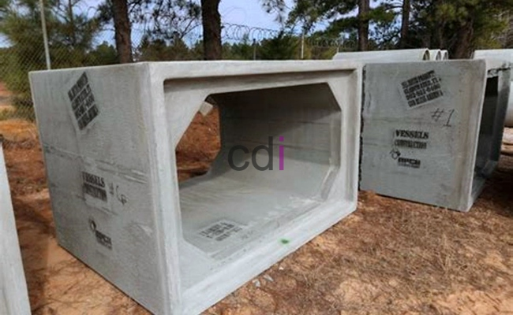

**Jual Box Culvert Precast di Batujaya Karawang** – Hai Mitra CDI! Apakah Anda sedang mencari solusi drainase yang kuat dan efisien untuk proyek di Batujaya Karawang? Kami dari Creative Design Interior (CDI) hadir sebagai penyedia Box Culvert Precast berkualitas tinggi. Produk ini adalah fondasi penting untuk sistem drainase yang handal, khususnya di area seperti Batujaya Karawang yang membutuhkan pengelolaan air yang tepat. Dengan Box Culvert Precast, Anda dapat memastikan aliran air tetap lancar dan meminimalkan risiko genangan.



## Detail Spesifikasi Box Culvert Precast yang Tersedia di Batujaya Karawang

Kami menyediakan Box Culvert Precast dengan berbagai spesifikasi untuk memenuhi kebutuhan proyek Anda di Batujaya Karawang. Berikut adalah beberapa detail yang perlu Anda ketahui:

*   **Ukuran:** Tersedia dalam berbagai dimensi internal, mulai dari 30x30 cm hingga 200x200 cm.
*   **Panjang:** Panjang standar per unit adalah 2 meter, namun kami juga menerima pesanan dengan panjang custom sesuai kebutuhan.
*   **Ketebalan Dinding:** Pilihan ketebalan dinding mulai dari 10 cm hingga 30 cm, disesuaikan dengan beban yang akan ditanggung.
*   **Kekuatan Beton:** Kami menggunakan beton berkualitas tinggi dengan kekuatan tekan minimal K250.
*   **Reinforcement:** Dilengkapi dengan tulangan baja mutu tinggi sesuai standar SNI untuk kekuatan maksimal.
*   **Jointing System:** Tersedia dengan sistem sambungan male-female untuk pemasangan yang presisi dan kedap air.

## Mengapa Memilih Box Culvert Precast dari CDI di Batujaya Karawang?

Ada banyak keunggulan yang membuat Box Culvert Precast dari CDI menjadi pilihan terbaik untuk proyek Anda di Batujaya Karawang. Ini dia beberapa di antaranya:

*   **Daya Tahan Luar Biasa:** Terbuat dari material beton berkualitas tinggi, produk kami tahan terhadap tekanan, cuaca ekstrem, dan korosi. Ini menjamin umur pakai yang panjang dan mengurangi biaya perawatan.
*   **Pemasangan Cepat dan Mudah:** Desain precast memungkinkan pemasangan yang lebih cepat dibandingkan metode konvensional. Menghemat waktu dan biaya tenaga kerja.
*   **Fleksibilitas Dimensi:** Kami menawarkan berbagai ukuran dan bentuk yang dapat disesuaikan dengan kebutuhan spesifik proyek Anda.
*   **Struktur Kokoh dan Stabil:** Konstruksi yang kuat memastikan Box Culvert Precast mampu menahan beban berat dan menjaga integritas sistem drainase Anda.
*   **Percepatan Penyelesaian Proyek:** Dengan waktu pemasangan yang lebih singkat, Anda dapat mempercepat penyelesaian proyek dan mengoptimalkan efisiensi.

## Aplikasi Box Culvert Precast di Berbagai Jenis Proyek di Batujaya Karawang

Box Culvert Precast yang kami sediakan sangat ideal untuk berbagai aplikasi, termasuk:

*   **Proyek Drainase Perkotaan:** Mengatasi aliran air hujan dan limbah di lingkungan perkotaan Batujaya Karawang.
*   **Konstruksi Jalan dan Jembatan:** Menyediakan saluran drainase yang handal di bawah jalan dan jembatan.
*   **Pembangunan Kawasan Industri:** Mengelola aliran air di area industri yang padat.
*   **Proyek Perumahan dan Komersial:** Memastikan sistem drainase yang efektif untuk perumahan dan kompleks komersial.
*   **Infrastruktur Pertanian:** Membangun saluran irigasi dan drainase untuk lahan pertanian.

## Daftar Harga Box Culvert Precast di Batujaya Karawang



Catatan: Harga Box Culvert Precast di Batujaya Karawang bervariasi tergantung pada ukuran, ketebalan, dan jumlah pesanan.

## Membandingkan Box Culvert Precast dengan Sistem Drainase Konvensional di Batujaya Karawang

Berikut adalah perbandingan antara Box Culvert Precast dan sistem drainase konvensional:

*   **Biaya:** Box Culvert Precast seringkali lebih ekonomis dalam jangka panjang karena mengurangi biaya perawatan dan penggantian.
*   **Kualitas:** Produk kami memiliki kualitas yang terjamin karena diproduksi dengan standar tinggi dan material unggulan.
*   **Fungsionalitas:** Box Culvert Precast dirancang khusus untuk drainase yang efisien dan handal.
*   **Kecepatan:** Pemasangan Box Culvert Precast jauh lebih cepat dibandingkan konstruksi drainase konvensional.

## Cara Mudah Memesan Box Culvert Precast di Batujaya Karawang

Untuk memesan Box Culvert Precast dari CDI di Batujaya Karawang, ikuti langkah-langkah berikut:

*   **Langkah 1: Kirimkan Permintaan:** Hubungi kami melalui email di customercdi@gmail.com. Sertakan detail proyek Anda, termasuk dimensi yang dibutuhkan, jumlah unit, dan lokasi pengiriman.
*   **Langkah 2: Dapatkan Penawaran:** Tim kami akan segera merespons permintaan Anda dengan penawaran harga yang kompetitif.
*   **Langkah 3: Konfirmasi Pesanan:** Setelah menyetujui penawaran, lakukan pembayaran sesuai instruksi yang diberikan.

## Tips Penting Sebelum Memesan Box Culvert Precast di CDI Batujaya Karawang

*   **Perhitungan Kebutuhan:** Pastikan Anda telah menghitung dengan tepat jumlah Box Culvert Precast yang dibutuhkan untuk proyek Anda.
*   **Cek Ketersediaan Stok:** Hubungi kami untuk memastikan stok tersedia sebelum melakukan pemesanan.
*   **Detail Alamat Pengiriman:** Berikan alamat pengiriman yang lengkap dan akurat.
*   **Konsultasi dengan Ahli:** Jangan ragu untuk berkonsultasi dengan tim ahli kami untuk mendapatkan saran terbaik.

Dengan pemasangan yang tepat, Box Culvert Precast dapat meningkatkan efisiensi drainase dan mengurangi risiko banjir di Batujaya Karawang. Jadi, tunggu apa lagi? Hubungi kami sekarang juga untuk mendapatkan penawaran terbaik dan solusi drainase yang andal! [Jual Box Culvert Precast di Anyar Serang](/box-culvert/jual-box-culvert-precast-di-anyar-serang/) bisa menjadi referensi tambahan untuk sistem drainase yang berkualitas.