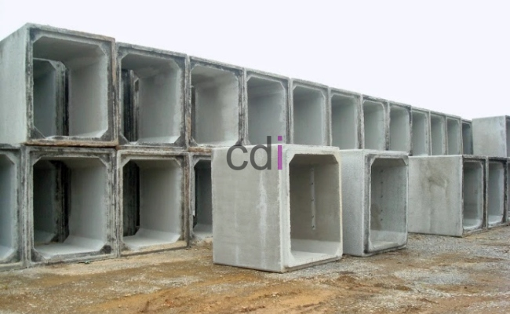

**Jual Box Culvert Precast di Bidara Cina Jakarta** – Halo Mitra CDI! Apakah Anda sedang mencari solusi drainase efektif di Bidara Cina Jakarta? Kami dari Creative Design Interior (CDI) hadir dengan produk Box Culvert Precast yang andal dan berkualitas tinggi. Produk ini krusial untuk membangun sistem drainase yang handal, mencegah genangan air, dan mendukung infrastruktur yang kokoh. Yuk, simak informasi lengkapnya!



**Detail Box Culvert Precast di Bidara Cina Jakarta yang Kami Tawarkan**

## Mengapa Memilih Box Culvert Precast dari CDI di Bidara Cina Jakarta?

Ada beberapa alasan kenapa produk kami layak menjadi pertimbangan utama untuk proyek Anda:

*   **Kualitas Terjamin:** Kami hanya menggunakan material berkualitas dengan standar mutu K225, K250, K300, dan K350. Ini memastikan kekuatan dan daya tahan produk, ideal untuk proyek drainase dan gorong-gorong yang menuntut keandalan tinggi. Produk kami juga sudah melalui uji laboratorium dan memenuhi standar SNI.
*   **Pilihan Ukuran Variatif:** Kami menyediakan beragam ukuran, dari yang kecil hingga besar, untuk memudahkan penyesuaian dengan kebutuhan proyek drainase dan gorong-gorong Anda. Kami siap memberikan solusi terbaik dan paling sesuai.
*   **Konstruksi Kokoh & Tahan Lama:** Produk kami dirancang dengan struktur yang kuat dan awet. Material unggul serta proses produksi yang cermat membuat Box Culvert Precast kami mampu bertahan lama dan menahan beban berat.
*   **Instalasi Mudah & Efisien:** Kami menyediakan panduan instalasi yang lengkap dan detail. Ini mempermudah kontraktor atau tim Anda dalam proses pemasangan, menghemat waktu dan tenaga.
*   **Harga Kompetitif:** Kami menawarkan harga yang bersaing tanpa mengorbankan kualitas. Dapatkan produk berkualitas dengan biaya yang terjangkau.

## Aplikasi Box Culvert Precast di Bidara Cina Jakarta: Solusi Drainase Serbaguna

Berikut adalah beberapa aplikasi Box Culvert Precast yang umum:

*   Drainase jalan raya: Cocok untuk drainase jalan besar karena tahan terhadap tekanan kendaraan berat.
*   Drainase perumahan: Ampuh mengatasi air hujan dan mencegah banjir di area perumahan.
*   Ruas jalan: Solusi efektif dan tahan lama untuk pembuatan gorong-gorong.
*   Drainase industri: Ideal untuk area industri yang membutuhkan sistem drainase kuat dan tahan beban.

## Informasi Harga Box Culvert Precast di Bidara Cina Jakarta



Keterangan Tabel: Harga Box Culvert Precast di Bidara Cina Jakarta bervariasi tergantung pada tipe produk, mutu, dan dimensi.

## Box Culvert Precast vs. Drainase Konvensional: Manfaat Jelas

Dibandingkan drainase konvensional, Box Culvert Precast menawarkan keunggulan signifikan:

*   **Efisiensi Biaya:** Biaya lebih efektif dibandingkan sistem drainase tradisional, sehingga membantu menghemat anggaran proyek Anda.
*   **Kualitas Unggul:** Dibuat dengan teknologi modern dan material berkualitas, memastikan mutu yang lebih baik.
*   **Fungsi Optimal:** Didesain khusus untuk aliran air yang lancar, menjaga kelancaran drainase.
*   **Waktu Pemasangan Lebih Cepat:** Instalasi lebih efisien dan cepat, menghemat waktu konstruksi.

## Bagaimana Cara Memesan Box Culvert Precast di Bidara Cina Jakarta?

Yuk, langsung pesan sekarang! Begini langkah-langkahnya:

*   Kirimkan informasi lengkap Anda (nama lengkap, alamat lengkap, dan jumlah Box Culvert Precast yang dibutuhkan) ke email customercdi@gmail.com.
*   Tim kami akan segera memproses pesanan Anda dan menghitung total biaya.
*   Setelah biaya disepakati, kami akan mengirimkan penawaran resmi melalui email. Silakan periksa dan konfirmasi jika setuju.

## Tips Penting Sebelum Order Box Culvert Precast di Bidara Cina Jakarta

Sebelum melakukan pemesanan, beberapa hal perlu diperhatikan:

*   **Perencanaan Akurat:** Pastikan Anda sudah melakukan perhitungan dan perencanaan ukuran yang tepat untuk kebutuhan drainase Anda.
*   **Persiapan Material Tambahan:** Siapkan material tambahan seperti besi beton, pasir, dan semen untuk proses instalasi.
*   **Konsultasi Teknis:** Diskusikan kebutuhan Anda dengan tim teknis kami untuk memastikan produk yang Anda pesan sesuai dengan kriteria yang Anda butuhkan.
*   **Verifikasi Penawaran:** Periksa kembali harga, jumlah, dan detail lain dalam penawaran resmi sebelum melakukan pembayaran. Jangan ragu untuk menanyakan jika ada yang kurang jelas.

Dengan pemasangan yang tepat, Box Culvert Precast akan berfungsi optimal dan memberikan sistem drainase yang berkualitas di Bidara Cina Jakarta. Pastikan untuk menghindari kesalahan umum dalam pemasangan dan mengikuti prosedur yang benar. Kami di CDI siap membantu Anda mewujudkan sistem drainase yang handal dan efisien. Jangan ragu untuk [hubungi kami](URL) untuk info lebih lanjut dan penawaran terbaik! Atau, lihat juga [Jual Box Culvert Precast di Angke Jakarta](/box-culvert/jual-box-culvert-precast-di-angke-jakarta/) untuk referensi tambahan!