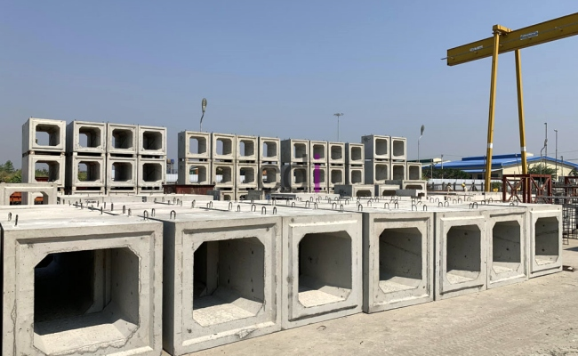

**Jual Box Culvert Precast di Bintaro Jakarta** – Halo, Mitra CDI! Apakah Anda sedang mencari solusi drainase yang handal dan efisien di Bintaro Jakarta? Kami hadir dengan Box Culvert Precast berkualitas tinggi, dirancang khusus untuk menjawab tantangan sistem drainase di area perkotaan seperti Bintaro Jakarta. Produk ini adalah investasi cerdas untuk meminimalkan risiko banjir, melindungi infrastruktur, dan menciptakan lingkungan yang lebih aman dan nyaman. Yuk, simak detail lengkapnya!



**Spesifikasi Box Culvert Precast di Bintaro Jakarta yang Kami Tawarkan**

## Mengapa Memilih Box Culvert Precast dari Kami di Bintaro Jakarta?

Dibandingkan solusi drainase lainnya, Box Culvert Precast menawarkan keunggulan yang signifikan. Ini dia beberapa alasannya:

*   **Harga Bersaing:** Kami menawarkan Box Culvert Precast dengan harga yang sangat kompetitif di Bintaro Jakarta. Hemat anggaran, kualitas tetap terjaga!
*   **Kualitas Terjamin:** Produk kami dibuat melalui proses produksi yang ketat dengan material berkualitas tinggi, menjamin kekuatan dan daya tahan yang superior.
*   **Pemasangan Mudah dan Cepat:** Desain presisi Box Culvert Precast memungkinkan proses instalasi yang lebih cepat dan efisien, menghemat waktu dan biaya tenaga kerja.
*   **Tahan Lama dan Perawatan Minimal:** Material yang digunakan sangat tahan terhadap korosi dan cuaca ekstrem, meminimalkan kebutuhan perawatan dan biaya jangka panjang.
*   **Fleksibilitas Desain:** Tersedia dalam berbagai ukuran dan bentuk, Box Culvert Precast dapat disesuaikan dengan kebutuhan spesifik proyek drainase Anda di Bintaro Jakarta.

## Aplikasi Box Culvert Precast di Bintaro Jakarta: Solusi Drainase Multifungsi

Box Culvert Precast kami sangat cocok untuk berbagai aplikasi, termasuk:

*   **Proyek Jalan Raya:** Mencegah genangan air di jalan raya, memastikan kelancaran lalu lintas dan keamanan pengguna jalan di sekitar Bintaro Jakarta.
*   **Perumahan dan Komplek:** Saluran drainase efektif untuk mengalirkan air hujan dari halaman rumah, mencegah banjir lokal.
*   **Terowongan Bawah Tanah:** Menjaga kestabilan struktur terowongan dengan mengalirkan air secara efisien.
*   **Irigasi Pertanian:** Menyediakan saluran air yang teratur untuk area pertanian, mendukung pertumbuhan tanaman optimal.

## Daftar Harga Box Culvert Precast di Bintaro Jakarta



Catatan: Harga Box Culvert Precast di Bintaro Jakarta dapat bervariasi tergantung jenis, kualitas, dan dimensi produk. Silakan lihat detail harga terbaru di atas.

## Mengapa Box Culvert Precast Lebih Unggul Dibanding Drainase Konvensional?

Mari kita bandingkan:

*   **Biaya:** Box Culvert Precast seringkali lebih hemat biaya dibandingkan konstruksi drainase konvensional.
*   **Kualitas:** Material berkualitas tinggi dan proses produksi modern menjamin kualitas yang lebih baik.
*   **Efisiensi:** Dirancang khusus untuk drainase yang optimal, memastikan aliran air lancar dan mencegah penyumbatan.
*   **Kecepatan Pemasangan:** Instalasi lebih cepat dibandingkan metode konvensional, menghemat waktu proyek Anda di Bintaro Jakarta.

## Cara Mudah Memesan Box Culvert Precast di Bintaro Jakarta

Siap untuk meningkatkan sistem drainase Anda? Berikut langkah-langkah pemesanannya:

1.  **Hubungi Kami:** Kirimkan detail proyek Anda (nama, alamat lengkap di Bintaro Jakarta, jumlah yang dibutuhkan) melalui email ke customercdi@gmail.com.
2.  **Dapatkan Penawaran:** Tim kami akan segera menghubungi Anda dengan penawaran terbaik, termasuk informasi stok dan estimasi waktu pengiriman.
3.  **Konfirmasi Pesanan:** Lakukan pembayaran sesuai petunjuk yang kami berikan. Kami menerima berbagai metode pembayaran yang aman dan terpercaya.
4.  **Pengiriman Cepat ke Lokasi Anda:** Kami akan mengirimkan Box Culvert Precast langsung ke lokasi proyek Anda di Bintaro Jakarta.
5.  **Periksa dan Terima:** Pastikan produk sesuai dengan pesanan Anda. Jika ada kendala, segera hubungi kami untuk solusi terbaik.

## Tips Penting Sebelum Membeli Box Culvert Precast di Bintaro Jakarta

*   **Ukur dengan Tepat:** Pastikan Anda sudah mengukur area yang membutuhkan drainase dengan akurat.
*   **Cek Ketersediaan Stok:** Konfirmasikan ketersediaan stok produk dengan tim kami sebelum melakukan pemesanan.
*   **Alamat Pengiriman yang Jelas:** Berikan alamat pengiriman yang lengkap dan mudah ditemukan.
*   **Jangan Ragu Bertanya:** Jika Anda memiliki pertanyaan atau membutuhkan bantuan, jangan sungkan untuk menghubungi kami. Kami selalu siap membantu Anda!

Pemasangan Box Culvert Precast yang benar sangat krusial untuk memastikan sistem drainase berfungsi optimal. Perencanaan yang matang dan penggunaan material berkualitas adalah kunci keberhasilan.  Bagi Anda yang berlokasi di Bintaro Jakarta dan membutuhkan solusi drainase yang handal, jangan ragu untuk menghubungi kami. Kami akan membantu Anda memilih dan menggunakan produk yang tepat untuk kebutuhan Anda. [Jual Box Culvert Precast di Angke Jakarta](/box-culvert/jual-box-culvert-precast-di-angke-jakarta/) menawarkan solusi serupa untuk area Jakarta lainnya. Segera hubungi tim kami untuk konsultasi gratis!