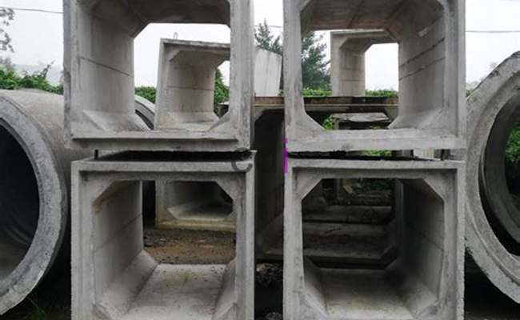

**Jual Box Culvert Precast di Binuang Serang** – Halo Mitra CDI! Mencari solusi drainase andalan di Binuang Serang? Kami punya jawabannya! CDI hadir sebagai penyedia Box Culvert Precast berkualitas tinggi yang siap menjawab kebutuhan proyek Anda. Produk ini sangat krusial untuk memastikan sistem drainase berfungsi optimal, mencegah genangan, dan memperlancar aliran air. Yuk, simak detailnya!



Berikut adalah informasi mengenai dimensi, diameter, dan ketebalan dari tiap tipe Box Culvert Precast yang tersedia: 

## Mengapa Memilih Box Culvert Precast CDI di Binuang Serang?

\- **Mutu Terjamin:** Box culvert precast kami dibuat dengan standar mutu K225, K250, K300, dan K350. Standar ini menjamin kekuatan dan daya tahan yang optimal, sangat cocok untuk proyek drainase dan gorong-gorong yang membutuhkan ketahanan tinggi. Produk kami juga sudah melalui uji laboratorium dan memenuhi standar SNI.

\- **Ukuran Variatif:** Kami menyediakan beragam ukuran, dari yang kecil hingga besar. Ini memberikan Anda fleksibilitas dalam menyesuaikan dengan kebutuhan spesifik proyek drainase dan gorong-gorong di Binuang Serang. Dengan pilihan dimensi yang lengkap, kami bisa memberikan solusi terbaik untuk semua jenis proyek.

\- **Konstruksi Kokoh & Awet:** Produk kami dirancang agar tahan lama dan kuat. Material berkualitas dan proses produksi yang teliti memastikan box culvert precast kami mampu menahan beban berat dan menahan kerusakan seiring waktu. Anda tidak perlu khawatir akan retak atau kerusakan dini pada sistem drainase Anda.

\- **Instalasi Mudah & Efisien:** Kami memahami pentingnya efisiensi waktu. Box culvert precast kami didesain untuk pemasangan yang mudah dan cepat. Kami sediakan panduan instalasi detail agar kontraktor atau pelanggan dapat memasang dengan tepat.

\- **Harga Kompetitif:** Kualitas terbaik tidak harus mahal! Kami menawarkan harga yang sangat bersaing untuk box culvert precast, sehingga Anda mendapatkan nilai terbaik untuk investasi Anda. Dengan begitu, Anda bisa mendapatkan produk berkualitas dengan harga yang ramah di kantong.

## Aplikasi Box Culvert Precast di Binuang Serang: Solusi Drainase & Gorong-Gorong Tahan Lama

*   **Drainase Jalan Raya:** Ideal untuk drainase jalan utama karena memiliki ketahanan yang tinggi terhadap beban lalu lintas berat di Binuang Serang.
*   **Drainase Perumahan:** Sangat cocok untuk mengembangkan sistem drainase perumahan, efektif mengatasi curah hujan tinggi dan mencegah genangan air.
*   **Gorong-Gorong:** Merupakan solusi efisien dan tahan lama untuk proyek pembangunan gorong-gorong.
*   **Drainase Zona Industri:** Area industri membutuhkan sistem drainase yang kuat dan tahan beban. Box Culvert Precast kami memenuhi kebutuhan tersebut dengan sempurna.

## Daftar Harga Box Culvert Precast di Binuang Serang per Buah:



Catatan: Harga Box Culvert Precast di Binuang Serang per unit bervariasi tergantung jenis produk, mutu, dan dimensi.

## Mengapa Box Culvert Precast Lebih Unggul Dibanding Drainase Konvensional?

*   **Efisiensi Biaya:** Box Culvert Precast kami memiliki harga yang lebih kompetitif dibandingkan konstruksi drainase konvensional, membantu Anda menghemat anggaran proyek.
*   **Kualitas Terjamin:** Produk kami menawarkan mutu yang lebih baik karena diproduksi dengan teknologi modern dan bahan berkualitas tinggi.
*   **Fungsi Optimal:** Didesain khusus untuk drainase yang efektif, memastikan sirkulasi air berjalan lancar dan mencegah masalah penyumbatan.
*   **Kecepatan Pemasangan:** Instalasi Box Culvert Precast lebih cepat dibandingkan drainase konvensional, mempercepat penyelesaian proyek Anda.

[Jual Box Culvert Precast di Anyar Serang](/box-culvert/jual-box-culvert-precast-di-anyar-serang/) – Jika Anda berencana pembangunan sistem drainase di wilayah Anyar Serang, produk kami adalah pilihan yang tepat!

## Cara Mudah Memesan Box Culvert Precast di Binuang Serang dari CDI

Untuk melakukan pemesanan Box Culvert Precast di Binuang Serang, ikuti langkah-langkah berikut:

1.  Kirimkan detail pesanan Anda melalui email ke customercdi@gmail.com. Sertakan nama Anda, alamat lengkap, dan jumlah kebutuhan.
2.  Tunggu konfirmasi dari tim kami melalui email. Kami akan menginformasikan ketersediaan stok, harga, dan estimasi waktu pengiriman.
3.  Lakukan pembayaran sesuai dengan instruksi yang kami berikan. Kami menerima pembayaran melalui transfer bank dan metode pembayaran lainnya.
4.  Setelah pembayaran terkonfirmasi, kami akan segera mengirimkan Box Culvert Precast pesanan Anda ke alamat yang Anda berikan di Binuang Serang.
5.  Periksa kondisi barang saat diterima. Jika ada kerusakan atau ketidaksesuaian, segera hubungi kami untuk solusi terbaik.

## Tips Penting Sebelum Memesan Box Culvert Precast di Binuang Serang

*   **Ukur dengan Akurat:** Pastikan Anda telah mengukur dengan cermat ukuran dan jumlah Box Culvert yang Anda butuhkan. Ini penting untuk menghindari kesalahan pemesanan.
*   **Cek Ketersediaan Stok:** Hubungi kami untuk memastikan ketersediaan stok Box Culvert sebelum melakukan pemesanan.
*   **Verifikasi Alamat Pengiriman:** Pastikan alamat pengiriman yang Anda berikan sudah benar dan lengkap agar barang sampai tepat waktu.
*   **Jangan Ragu Bertanya:** Hubungi kami jika Anda memiliki pertanyaan atau membutuhkan bantuan selama proses pemesanan. Kami siap membantu Anda!

Pemasangan Box Culvert Precast di Binuang Serang membutuhkan ketelitian dan pertimbangan berbagai faktor agar sistem drainase berfungsi maksimal. Hindari kesalahan pemasangan yang dapat mengganggu aliran air dan menyebabkan kerusakan. Perhitungan kebutuhan yang tepat dan pemilihan material yang berkualitas adalah kunci untuk memastikan keberlangsungan saluran drainase Anda. Jika Anda membutuhkan informasi lebih lanjut mengenai produk Box Culvert Precast di Binuang Serang, jangan ragu untuk menghubungi kami. Kami siap membantu Anda memilih dan menggunakan produk yang tepat untuk kebutuhan drainase Anda! [Jual Box Culvert Precast di Babelan Bekasi](/box-culvert/jual-box-culvert-precast-di-babelan-bekasi/) – Selain Binuang Serang, kami juga melayani pembelian Box Culvert Precast di Babelan Bekasi! Silakan cek halaman tersebut untuk info lebih lanjut. Hubungi kami sekarang juga untuk penawaran terbaik!