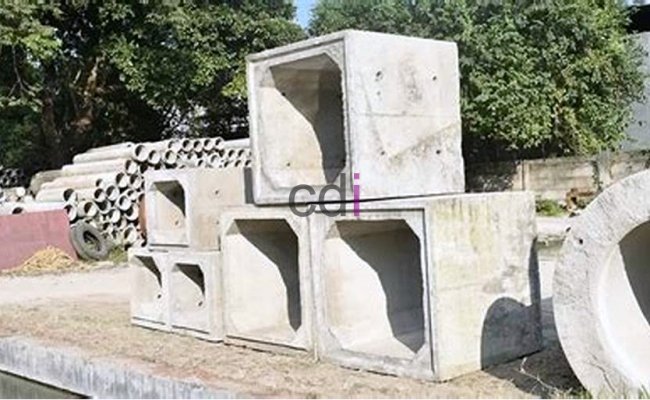

**Jual Box Culvert Precast di Bojonegara Serang** – Halo Mitra CDI! Apakah Anda sedang mencari solusi drainase yang andal dan efisien di Bojonegara Serang? Kami hadir dengan Box Culvert Precast berkualitas tinggi, dirancang untuk menjawab tantangan sistem drainase modern. Box Culvert Precast ini adalah struktur beton pracetak yang dirancang khusus untuk mengalirkan air di bawah tanah, ideal untuk berbagai proyek konstruksi. Kualitas, kecepatan pemasangan, dan daya tahan adalah keunggulan utama yang kami tawarkan.



## Lebih Dalam Mengenai Box Culvert Precast yang Kami Sediakan di Bojonegara Serang

Produk Box Culvert Precast dari CDI bukan sekadar beton; ini adalah investasi jangka panjang untuk infrastruktur Anda. Dengan desain yang presisi dan material berkualitas, produk kami memastikan kinerja drainase yang optimal dan biaya perawatan yang minimal. Kami memahami betul kebutuhan proyek di Bojonegara Serang, sehingga kami menyediakan solusi yang sesuai dengan standar kualitas tertinggi.

## Keunggulan Memilih Box Culvert Precast dari CDI di Bojonegara Serang:

\- **Mutu Terjamin:** Box culvert precast yang kami pasarkan memenuhi standar mutu K225, K250, K300, dan K350. Mutu ini menjamin kekuatan dan ketahanan yang tinggi, sangat cocok untuk aplikasi drainase dan gorong-gorong yang krusial. Produk kami juga telah melalui uji laboratorium yang ketat dan bersertifikasi SNI.

\- **Dimensi Variatif:** Kami menyediakan berbagai dimensi box culvert precast, dari ukuran kecil hingga besar, sehingga dapat disesuaikan dengan kebutuhan spesifik proyek drainase dan gorong-gorong Anda. Fleksibilitas ini memastikan solusi yang pas untuk setiap tantangan.

\- **Konstruksi Kokoh & Tahan Lama:** Didesain dengan struktur yang kuat dan material pilihan, box culvert precast kami mampu bertahan dalam jangka waktu lama dan menahan beban berat. Anda tidak perlu khawatir akan kerusakan atau kebocoran pada sistem drainase Anda.

\- **Instalasi Praktis:** Kami mempermudah proses instalasi dengan menyediakan panduan yang komprehensif dan mudah dipahami. Ini menghemat waktu dan tenaga Anda, sehingga proyek dapat selesai lebih cepat dan efisien.

\- **Harga Kompetitif:** Kami menawarkan harga yang sangat kompetitif untuk box culvert precast berkualitas tinggi. Kami percaya bahwa kualitas tidak harus mahal, dan kami siap menghadirkan solusi terbaik dengan anggaran yang optimal.

## Aplikasi Box Culvert Precast di Bojonegara Serang untuk Berbagai Jenis Proyek:

\- **Saluran Kota:** Ideal untuk proyek saluran kota yang membutuhkan sistem drainase yang kuat dan berumur panjang. Box culvert precast kami dapat mengalirkan volume air yang besar dengan efektif.

\- **Konstruksi Jalan Raya:** Cocok untuk drainase jalan raya atau jalan besar yang harus menahan beban kendaraan berat dan aliran air deras. Produk kami dirancang untuk memenuhi tuntutan ini.

\- **Zona Industri & Komersial:** Solusi drainase andal untuk pembangunan zona industri atau mal dengan kebutuhan drainase yang besar dan berkelanjutan.

\- **Infrastruktur Kritis:** Dapat diandalkan untuk proyek infrastruktur seperti jalan tol, jembatan, dan bandara yang membutuhkan saluran drainase yang kokoh dan tahan lama.

## Informasi Harga Box Culvert Precast di Bojonegara Serang:



**_\*Catatan Penting:_**

*   Harga belum termasuk PPN 10%
*   Harga dapat berubah sewaktu-waktu tanpa pemberitahuan. Untuk informasi harga terkini, silakan hubungi tim kami.

## Box Culvert Precast: Pilihan Lebih Baik Dibanding Drainase Konvensional di Bojonegara Serang?

Mari kita bandingkan keuntungan Box Culvert Precast dengan sistem drainase tradisional:

*   **Biaya:** Walaupun investasi awal sedikit lebih tinggi, Box Culvert Precast menawarkan penghematan jangka panjang karena biaya perawatan yang lebih rendah.
*   **Kualitas:** Material beton berkualitas tinggi memastikan daya tahan dan umur pakai yang lebih lama dibandingkan drainase konvensional.
*   **Efisiensi:** Desain Box Culvert Precast memaksimalkan aliran air, mencegah genangan, dan mengurangi risiko banjir.
*   **Kecepatan:** Pemasangan yang cepat mengurangi waktu proyek dan biaya tenaga kerja.

## Cara Mudah Memesan Box Culvert Precast di Bojonegara Serang:

1.  Kirimkan detail proyek Anda (nama, alamat, jumlah yang dibutuhkan) ke email customercdi@gmail.com.
2.  Tim ahli kami akan segera memproses pesanan Anda dan memberikan penawaran harga yang terperinci.
3.  Setelah Anda menyetujui penawaran, kami akan mengatur pengiriman produk ke lokasi proyek Anda di Bojonegara Serang.

<table class="table">
  <caption>Spesifikasi Lengkap Box Culvert Precast</caption>
  <thead>
    <tr><th>Ukuran (PxLxT)</th><th>Ketebalan Dinding</th><th>Mutu Beton</th><th>Berat (Estimasi)</th></tr>
  </thead>
  <tbody>
    <tr><td>1m x 1m x 1m</td><td>10 cm</td><td>K300</td><td>1.2 Ton</td></tr>
    <tr><td>1m x 1m x 0.5m</td><td>10 cm</td><td>K250</td><td>600 kg</td></tr>
    <tr><td>2m x 1m x 1m</td><td>15 cm</td><td>K350</td><td>2.5 Ton</td></tr>
  </tbody>
</table>

## Tips Penting Sebelum Membeli Box Culvert Precast di Bojonegara Serang

*   **Perhitungan Akurat:** Hitung dengan cermat kebutuhan Box Culvert Anda untuk menghindari kekurangan atau kelebihan pemesanan.
*   **Cek Ketersediaan:** Pastikan produk tersedia sebelum melakukan pemesanan, terutama untuk proyek dengan tenggat waktu yang ketat.
*   **Alamat Pengiriman:** Berikan alamat pengiriman yang lengkap dan benar untuk memastikan pengiriman yang lancar.
*   **Konsultasi Gratis:** Jangan ragu untuk menghubungi kami jika Anda memiliki pertanyaan atau memerlukan bantuan dalam memilih produk yang tepat.

Pemasangan Box Culvert Precast yang benar sangat penting untuk memastikan sistem drainase berfungsi dengan optimal. Hindari kesalahan yang dapat mengganggu aliran air dan menyebabkan kerusakan. Jika Anda membutuhkan bantuan dalam proses instalasi, kami siap memberikan solusi terbaik. Jangan ragu untuk menghubungi kami untuk informasi lebih lanjut mengenai produk Box Culvert Precast di Bojonegara Serang. Kami siap membantu Anda mewujudkan sistem drainase yang handal dan efisien! [Jual Box Culvert Precast di Anyar Serang](/box-culvert/jual-box-culvert-precast-di-anyar-serang/) dapat menjadi referensi tambahan jika Anda sedang mencari solusi drainase di area sekitar Bojonegara Serang.