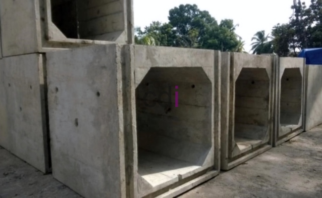

**Jual Box Culvert Precast di Bojong Genteng Sukabumi** – Hai Mitra CDI! Apakah Anda sedang merencanakan proyek drainase di Bojong Genteng Sukabumi? Kami dari Creative Design Interior (CDI) hadir untuk menawarkan solusi terbaik: Box Culvert Precast berkualitas tinggi. Produk ini adalah kunci untuk sistem drainase yang andal dan tahan lama, khususnya di area seperti Bojong Genteng Sukabumi. Investasi cerdas ini akan meminimalkan risiko banjir dan memastikan kelancaran aliran air.



## Spesifikasi Box Culvert Precast yang Tersedia di Bojong Genteng Sukabumi

Produk Box Culvert Precast yang kami suplai di Bojong Genteng Sukabumi dibuat dengan standar mutu tinggi dan spesifikasi yang beragam. Ini memastikan Anda mendapatkan solusi yang pas untuk kebutuhan proyek Anda. Berikut rincian spesifikasinya:

*   **Mutu Beton:** K225, K250, K300, dan K350 – pilihan mutu yang bisa disesuaikan dengan beban dan kondisi lingkungan.
*   **Ukuran:** Tersedia dalam berbagai dimensi internal, termasuk:
    *   Lebar: 30cm, 40cm, 60cm, 80cm, 100cm, 120cm
    *   Tinggi: 30cm, 40cm, 50cm, 60cm
    *   Panjang: Standar 2 meter, dengan opsi custom sesuai permintaan.
*   **Ketebalan Dinding:** 10cm - 15cm (tergantung ukuran dan mutu beton).
*   **Sistem Sambungan:** Menggunakan sistem tongue and groove untuk pemasangan yang presisi dan kedap air.
*   **Reinforcement:** Menggunakan besi beton berkualitas tinggi sesuai standar SNI.

## Keunggulan Memilih Box Culvert Precast CDI di Bojong Genteng Sukabumi

Mungkin Anda bertanya-tanya, apa yang membuat Box Culvert Precast dari CDI istimewa? Nah, berikut ini adalah beberapa keunggulannya yang perlu Anda ketahui:

*   **Kualitas Terjamin:** Produk kami dibuat dari material pilihan dengan mutu K225, K250, K300, dan K350, menjamin kekuatan dan daya tahan optimal. Lebih dari itu, produk kami telah melalui uji laboratorium dan memenuhi standar SNI.
*   **Fleksibilitas Ukuran:** Kami menyediakan variasi ukuran yang lengkap, mulai dari yang kecil hingga besar, sehingga mudah disesuaikan dengan kebutuhan proyek drainase dan gorong-gorong Anda di Bojong Genteng Sukabumi.
*   **Konstruksi Kokoh & Awet:** Dirancang dengan struktur yang solid dan material berkualitas, Box Culvert Precast kami tahan lama dan mampu menahan beban berat. Ini berarti Anda tak perlu khawatir akan kerusakan atau kebocoran dalam jangka waktu lama.
*   **Instalasi Mudah & Cepat:** Kami menyediakan panduan pemasangan yang jelas dan lengkap, memudahkan kontraktor atau pelanggan untuk melakukan instalasi dengan cepat dan efisien.
*   **Harga Kompetitif:** Kualitas unggul tidak harus mahal! Kami menawarkan harga yang bersaing tanpa mengorbankan mutu.

## Aplikasi Box Culvert Precast di Bojong Genteng Sukabumi: Solusi Drainase yang Serbaguna

Box Culvert Precast yang kami jual di Bojong Genteng Sukabumi sangat fleksibel dan dapat digunakan dalam berbagai aplikasi:

*   **Drainase Jalan Utama:** Cocok untuk mengalirkan air dari jalan raya, karena tahan terhadap beban lalu lintas berat.
*   **Drainase Perumahan:** Ideal untuk sistem drainase perumahan, mampu menampung curah hujan tinggi dan mencegah genangan air.
*   **Gorong-gorong:** Merupakan solusi efektif dan tahan lama untuk proyek pembangunan gorong-gorong.
*   **Drainase Industri:** Memenuhi kebutuhan sistem drainase yang kuat dan tahan beban berat di area industri.

## Daftar Harga Box Culvert Precast di Bojong Genteng Sukabumi (Per Buah)



*Catatan: Harga di atas adalah harga per unit Box Culvert Precast di Bojong Genteng Sukabumi dalam Rupiah. Harga dapat bervariasi tergantung ukuran dan mutu beton.*

## Mengapa Memilih Box Culvert Precast? Perbandingan dengan Drainase Konvensional

Pertimbangkan perbandingan berikut untuk melihat keunggulan Box Culvert Precast dibandingkan drainase konvensional:

*   **Efisiensi Biaya:** Biaya pemasangan Box Culvert Precast lebih hemat dibandingkan pembuatan drainase konvensional yang memerlukan tenaga kerja manual dan material terpisah.
*   **Kualitas Unggul:** Produk kami menawarkan mutu yang lebih baik dibandingkan drainase konvensional berbahan beton cor, dengan daya tahan dan kekuatan yang terjamin.
*   **Efisiensi Waktu:** Pemasangan lebih cepat dan praktis dibandingkan drainase konvensional yang memakan waktu dan biaya lebih besar.
*   **Perawatan Minimal:** Box Culvert Precast tahan lama dan tidak memerlukan perawatan berkala, menghemat biaya jangka panjang.

## Cara Mudah Memesan Box Culvert Precast di Bojong Genteng Sukabumi

Berikut adalah langkah-langkah untuk memesan Box Culvert Precast dari CDI di Bojong Genteng Sukabumi:

1.  **Kirimkan Permintaan:** Kirimkan informasi lengkap Anda (nama, alamat, jumlah Box Culvert yang dibutuhkan) melalui email ke customercdi@gmail.com.
2.  **Tunggu Konfirmasi:** Tim kami akan segera memproses pesanan Anda dan mengirimkan konfirmasi berisi detail harga, jadwal pengiriman, dan metode pembayaran.
3.  **Lakukan Pembayaran:** Bayar pesanan sesuai dengan instruksi yang diberikan. Kami menyediakan berbagai opsi pembayaran yang mudah.

## Tips Penting Sebelum Memesan Box Culvert Precast di Bojong Genteng Sukabumi

Agar proses pemesanan Anda berjalan lancar, perhatikan hal-hal berikut:

*   **Ukur dengan Cermat:** Pastikan Anda telah mengukur dengan akurat dimensi dan kebutuhan Box Culvert Anda.
*   **Cek Ketersediaan:** Hubungi kami untuk memastikan ketersediaan stok sebelum melakukan pemesanan.
*   **Alamat yang Jelas:** Berikan alamat yang lengkap dan benar agar pesanan Anda sampai tepat waktu.
*   **Jangan Ragu Bertanya:** Jangan sungkan untuk menghubungi kami jika Anda memiliki pertanyaan atau membutuhkan bantuan.

Pemasangan yang benar dan perhitungan kebutuhan box culvert yang akurat akan sangat menentukan kinerja sistem drainase di Bojong Genteng Sukabumi. Jadi, tunggu apa lagi? Hubungi kami sekarang juga di CDI untuk mendapatkan penawaran terbaik dan solusi drainase yang optimal! [Jual Box Culvert Precast di Anyar Serang](/box-culvert/jual-box-culvert-precast-di-anyar-serang/) — pelajari juga solusi drainase yang kami tawarkan di Anyar Serang.