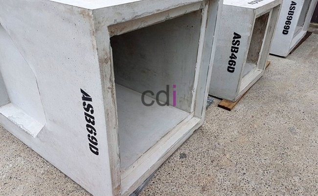

**Jual Box Culvert Precast di Bojong Purwakarta** – Halo Mitra CDI! Apakah Anda sedang mencari solusi drainase yang handal dan efisien di Bojong Purwakarta? Kami dari Creative Design Interior (CDI) hadir dengan produk Box Culvert Precast berkualitas tinggi. Produk ini bukan sekadar material bangunan, melainkan investasi jangka panjang untuk infrastruktur yang lebih baik. Dengan Box Culvert Precast, masalah banjir dan genangan air di Bojong Purwakarta bisa diatasi dengan optimal.



Berikut adalah informasi tentang dimensi panjang, diameter, dan ketebalan dari setiap tipe Box Culvert Precast: 

## Mengapa Memilih Box Culvert Precast dari CDI di Bojong Purwakarta?

*   **Ketahanan Luar Biasa:** Box Culvert Precast yang kami tawarkan dibuat dari material beton berkualitas premium. Ini menjamin daya tahan terhadap cuaca ekstrem dan tekanan berat, memastikan investasi Anda awet bertahun-tahun. 
*   **Pemasangan Mudah & Cepat:** Desain precast memungkinkan pemasangan yang lebih ringkas dan praktis. Dibandingkan metode konvensional, prosesnya lebih cepat dan hemat biaya tenaga kerja.
*   **Pilihan Dimensi Lengkap:** Kami menyediakan beragam ukuran Box Culvert Precast. Anda bisa memilih yang paling sesuai dengan kebutuhan proyek drainase atau gorong-gorong di Bojong Purwakarta Anda.
*   **Struktur Kokoh & Stabil:** Produk kami dirancang dengan struktur yang kuat dan stabil, mampu menahan beban berat tanpa bergeser. Ini menjaga fungsi drainase tetap optimal.
*   **Efisiensi Waktu Proyek:** Penggunaan Box Culvert Precast mempercepat penyelesaian proyek. Proses produksi standar dan pemasangan mudah berarti Anda bisa menghemat waktu dan biaya operasional.

## Aplikasi Box Culvert Precast di Bojong Purwakarta: Solusi Drainase untuk Berbagai Kebutuhan

Box Culvert Precast kami sangat fleksibel dan bisa digunakan untuk berbagai kebutuhan drainase di Bojong Purwakarta, di antaranya:

*   **Drainase Jalan Utama:** Ideal untuk mengelola air hujan di jalan raya, dengan daya tahan tinggi terhadap beban lalu lintas.
*   **Drainase Perumahan:** Solusi efektif untuk mengatasi genangan air di area perumahan, menjaga lingkungan tetap kering dan nyaman.
*   **Gorong-Gorong:** Pilihan tepat dalam pembangunan gorong-gorong yang awet dan tahan lama.
*   **Drainase Zona Industri:** Sesuai untuk area industri yang membutuhkan sistem drainase kuat dan tahan terhadap beban berat. 

## Daftar Harga Box Culvert Precast di Bojong Purwakarta (Per Buah)



Keterangan: Harga tersebut adalah biaya per unit Box Culvert Precast di Bojong Purwakarta dalam Rupiah. Untuk detail lebih lanjut, silakan lihat tabel harga di atas.

## Mengapa Box Culvert Precast Lebih Unggul Dibanding Drainase Konvensional di Bojong Purwakarta?

Mari kita bandingkan keunggulan Box Culvert Precast dengan metode drainase tradisional:

\- **Efisiensi Biaya:** Investasi pada Box Culvert Precast kami lebih kompetitif dibandingkan biaya pembuatan drainase konvensional yang memakan banyak tenaga kerja dan material.
\- **Kualitas Terjamin:** Produk kami unggul dalam kualitas, dirancang untuk tahan lama dan memberikan kinerja drainase optimal.
\- **Kemudahan Pemasangan:** Pemasangan Box Culvert Precast jauh lebih cepat dan sederhana daripada drainase konvensional yang rumit.
\- **Minim Perawatan:** Produk kami tidak memerlukan perawatan berkala yang lebih intensif dibandingkan drainase konvensional yang seringkali memerlukan perbaikan dan pemeliharaan. 

## Cara Mudah Memesan Box Culvert Precast di Bojong Purwakarta dari CDI

Ingin segera mendapatkan Box Culvert Precast untuk proyek Anda di Bojong Purwakarta? Ikuti langkah-langkah berikut:

1.  Sampaikan informasi lengkap Anda (nama, alamat lengkap, jumlah yang dibutuhkan) melalui email ke customercdi@gmail.com.
2.  Tunggu respons dari tim kami. Kami akan mengirimkan informasi mengenai ketersediaan produk, biaya, dan estimasi waktu pengiriman.
3.  Lakukan pembayaran sesuai dengan instruksi yang kami berikan.
4.  Setelah pembayaran terkonfirmasi, Box Culvert Precast akan segera kami kirimkan ke lokasi Anda.
5.  Periksa barang saat diterima. Jika ada kerusakan atau ketidaksesuaian, segera hubungi kami agar bisa menemukan solusi terbaik.

## Tips Penting Sebelum Membeli Box Culvert Precast di Bojong Purwakarta

*   **Perencanaan Matang:** Pastikan Anda sudah melakukan pengukuran dan perhitungan yang akurat agar Box Culvert Precast yang Anda beli sesuai dengan kebutuhan proyek.
*   **Persiapkan Material Pendukung:** Siapkan material tambahan seperti besi, pasir, dan semen untuk proses pemasangan.
*   **Konsultasi Ahli:** Jangan ragu berkonsultasi dengan tim teknis kami untuk memastikan produk yang Anda pilih memenuhi standar kualitas dan spesifikasi yang dibutuhkan.
*   **Teliti Detail Pesanan:** Sebelum melakukan pembayaran, pastikan Anda sudah mengecek semua detail dalam penawaran (harga, jumlah, spesifikasi). Jika ada pertanyaan, segera hubungi kami.

Pemasangan Box Culvert Precast yang tepat sangat penting untuk memastikan sistem drainase berfungsi optimal. Hindari kesalahan umum seperti pemasangan yang tidak rapi, pergeseran posisi, penumpukan material, dan penggunaan bahan yang tidak sesuai. Gunakan material berkualitas tinggi dan lakukan perhitungan kebutuhan dengan cermat. Jika Anda membutuhkan informasi lebih lanjut mengenai produk Box Culvert Precast di Bojong Purwakarta, jangan ragu untuk menghubungi kami. [Jual Box Culvert Precast di Abadijaya Depok](/box-culvert/jual-box-culvert-precast-di-abadijaya-depok/) dapat menjadi referensi tambahan untuk memahami keunggulannya. Kami siap membantu!