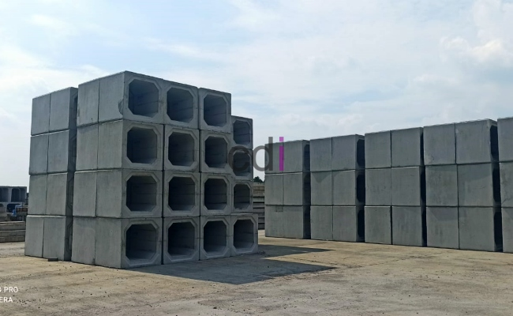

**Jual Box Culvert Precast di Bojongmangu Bekasi** – Hai Mitra CDI! Apakah Anda sedang mencari solusi drainase yang handal dan efisien di Bojongmangu Bekasi? Kami punya jawabannya! Produk Box Culvert Precast kami dirancang untuk memberikan performa terbaik dalam mengelola aliran air, sekaligus memastikan ketahanan jangka panjang. Yuk, simak informasi lengkapnya di artikel ini!

Sebagai bagian dari upaya pembangunan infrastruktur yang berkelanjutan, drainase yang baik menjadi fondasi utama. Di Bojongmangu Bekasi, kebutuhan akan sistem drainase yang optimal semakin meningkat seiring dengan perkembangan wilayah. Box Culvert Precast hadir sebagai solusi praktis dan efektif untuk menjawab tantangan tersebut. Apa sih Box Culvert Precast itu? Singkatnya, ini adalah struktur beton pracetak yang dirancang khusus untuk mengalirkan air hujan dan limbah dengan lancar. Kami di CDI menyediakan beragam pilihan Box Culvert Precast dengan kualitas terjamin.



Berikut adalah spesifikasi dimensi, diameter, dan ketebalan yang tersedia untuk setiap tipe Box Culvert Precast:

## Mengapa Memilih Box Culvert Precast dari CDI di Bojongmangu Bekasi?

*   **Harga Bersaing:** Kami menawarkan Box Culvert Precast dengan harga yang sangat kompetitif di Bojongmangu Bekasi, tanpa mengorbankan kualitas. Anda mendapatkan solusi drainase terbaik dengan anggaran yang efisien.
*   **Kualitas Terjamin:** Produk kami diproduksi dengan standar kualitas tinggi, menggunakan material pilihan dan proses yang ketat. Ini memastikan Box Culvert Precast tahan lama dan kuat menghadapi beban berat.
*   **Pemasangan Mudah & Cepat:** Desain Box Culvert Precast kami dirancang untuk memudahkan proses pemasangan. Ini menghemat waktu dan biaya tenaga kerja Anda.
*   **Awet & Tahan Lama:** Dibangun untuk tahan terhadap korosi dan cuaca ekstrem, Box Culvert Precast kami memberikan solusi drainase jangka panjang tanpa memerlukan perawatan intensif.
*   **Fleksibilitas Desain:** Tersedia dalam berbagai ukuran dan bentuk, Box Culvert Precast kami dapat menyesuaikan dengan kebutuhan spesifik proyek drainase Anda di Bojongmangu Bekasi.

## Aplikasi Box Culvert Precast di Proyek-proyek Anda

Box Culvert Precast yang kami sediakan di Bojongmangu Bekasi sangat ideal untuk berbagai jenis proyek:

\- **Proyek Saluran Perkotaan:** Cocok untuk saluran drainase perkotaan yang membutuhkan kekuatan dan ketahanan tinggi terhadap volume air yang besar.

\- **Konstruksi Jalan & Tol:** Mendukung pembangunan jalan dan tol dengan sistem drainase yang handal, mampu menahan beban lalu lintas berat dan memastikan aliran air yang lancar.

\- **Kawasan Industri & Komersial:** Solusi drainase efektif untuk kawasan industri, pusat perbelanjaan, atau area komersial yang memerlukan pengelolaan air limbah dan hujan yang optimal.

\- **Infrastruktur Publik:** Ideal untuk proyek infrastruktur besar seperti pembangunan bandara, jembatan, atau jalur kereta api yang membutuhkan saluran air yang kokoh dan tahan lama.

## Daftar Harga Box Culvert Precast di Bojongmangu Bekasi (Per Buah)



Catatan: Harga di atas adalah estimasi biaya per buah Box Culvert Precast di Bojongmangu Bekasi dalam Rupiah.

## Box Culvert Precast vs. Drainase Konvensional: Mana yang Lebih Unggul?

Mari bandingkan Box Culvert Precast dengan sistem drainase konvensional:

\- **Biaya:** Investasi Box Culvert Precast kami umumnya lebih efisien dibandingkan pembuatan drainase konvensional yang memakan banyak tenaga kerja dan material.

\- **Kualitas:** Box Culvert Precast menawarkan mutu yang lebih unggul dibandingkan drainase konvensional yang seringkali menggunakan material kurang tahan lama.

\- **Efisiensi:** Pemasangan Box Culvert Precast lebih cepat dan praktis, mengurangi waktu dan biaya proyek secara keseluruhan.

\- **Perawatan:** Box Culvert Precast membutuhkan perawatan minimal, sementara drainase konvensional cenderung memerlukan perbaikan rutin.

## Cara Mudah Memesan Box Culvert Precast di Bojongmangu Bekasi

Untuk memesan Box Culvert Precast dari CDI, ikuti langkah sederhana berikut:

1.  Sampaikan kebutuhan Anda: Kirimkan detail proyek Anda (nama, alamat, jumlah yang dibutuhkan) ke email kami di customercdi@gmail.com.
2.  Konfirmasi Penawaran: Tim kami akan memberikan konfirmasi melalui email, termasuk detail produk, harga, dan estimasi waktu pengiriman.
3.  Lakukan Pembayaran: Lakukan pembayaran sesuai instruksi yang kami berikan melalui transfer bank atau metode pembayaran lainnya.
4.  Pengiriman Cepat: Setelah pembayaran terverifikasi, kami akan segera mengirimkan pesanan Anda ke lokasi proyek di Bojongmangu Bekasi.
5.  Pemeriksaan Produk: Pastikan untuk memeriksa kondisi produk saat diterima. Jika ada kendala, segera hubungi kami untuk solusi terbaik.

## Tips Penting Sebelum Membeli Box Culvert Precast

*   **Perencanaan Matang:** Pastikan Anda telah merencanakan kebutuhan drainase proyek dengan cermat untuk menentukan jumlah dan ukuran Box Culvert Precast yang tepat.
*   **Material Pendukung:** Siapkan material tambahan seperti besi beton, pasir, dan semen untuk proses pemasangan yang lancar.
*   **Konsultasi Ahli:** Diskusikan kebutuhan Anda dengan tim teknis kami untuk memastikan Box Culvert Precast yang Anda pilih sesuai dengan spesifikasi proyek.
*   **Periksa Detail Penawaran:** Sebelum melakukan pembayaran, periksa kembali semua detail dalam penawaran resmi kami untuk menghindari kesalahan.

Dengan Box Culvert Precast dari CDI, Anda mendapatkan solusi drainase yang andal, efisien, dan tahan lama di Bojongmangu Bekasi. Jangan ragu untuk menghubungi kami untuk konsultasi dan penawaran spesial! Kami siap mendukung kesuksesan proyek Anda.