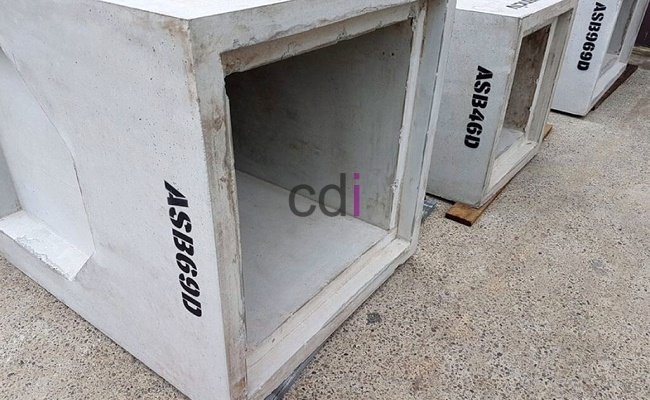

**Jual Box Culvert Precast di Bojongsari Baru Depok** – Halo Mitra CDI! Apakah Anda sedang merencanakan sistem drainase yang handal di Bojongsari Baru Depok? Kami punya solusinya! Produk Box Culvert Precast dari CDI dirancang khusus untuk kebutuhan infrastruktur Anda. Mengapa memilih Box Culvert Precast? Karena produk ini sangat vital dalam menciptakan sistem drainase yang efisien, menjaga kelancaran arus air, dan mencegah potensi banjir di daerah Bojongsari Baru Depok.



## Mengenal Lebih Dekat Box Culvert Precast di Bojongsari Baru Depok

Box Culvert Precast adalah elemen penting dalam pembangunan infrastruktur drainase modern. Terbuat dari beton berkualitas tinggi, produk ini menawarkan solusi yang kuat, tahan lama, dan efisien untuk mengelola aliran air.  Di Bojongsari Baru Depok, di mana pembangunan terus berkembang, memiliki sistem drainase yang baik adalah kunci untuk mencegah masalah banjir dan memastikan lingkungan yang nyaman dan aman.

## Keunggulan Menggunakan Box Culvert Precast dari CDI di Bojongsari Baru Depok:

*   **Daya Tahan Superior:**  Box Culvert Precast yang kami sediakan dibuat dari material beton premium, menawarkan ketahanan luar biasa terhadap cuaca ekstrem dan tekanan berat. Ini menjamin umur pakai yang panjang tanpa memerlukan perbaikan berulang.
*   **Pemasangan Cepat dan Mudah:** Produk kami dirancang siap pasang, mempercepat proses konstruksi secara signifikan. Tidak perlu membuang waktu untuk proses pengecoran di lokasi, cukup langsung pasang dan lanjutkan proyek Anda.
*   **Pilihan Dimensi yang Fleksibel:** Kami menyediakan beragam ukuran Box Culvert Precast, mulai dari yang kecil hingga besar, memungkinkan Anda memilih yang paling sesuai dengan kebutuhan spesifik proyek drainase di Bojongsari Baru Depok.
*   **Struktur yang Kuat dan Stabil:**  Box Culvert Precast kami dirancang dengan struktur yang kokoh dan stabil, mampu menahan beban berat dan mencegah pergeseran, sehingga menjaga keberlangsungan fungsi drainase.
*   **Efisiensi Waktu dan Biaya:**  Pemasangan yang cepat dan mudah berkontribusi pada penyelesaian proyek yang lebih cepat, menghemat waktu dan biaya konstruksi secara keseluruhan.

## Aplikasi Box Culvert Precast: Solusi Drainase untuk Berbagai Kebutuhan di Bojongsari Baru Depok

Box Culvert Precast dari CDI sangat serbaguna dan dapat diaplikasikan di berbagai proyek:

*   **Proyek Jalan Raya:** Ideal untuk menangani aliran air hujan di sepanjang jalan, mencegah genangan dan banjir yang dapat mengganggu lalu lintas.
*   **Proyek Perumahan:** Digunakan sebagai saluran drainase untuk mengalirkan air hujan dari area perumahan, menjaga lingkungan tetap kering dan nyaman.
*   **Proyek Terowongan Bawah Tanah:** Mencegah akumulasi air yang dapat membahayakan struktur terowongan dengan menyediakan saluran drainase yang efektif.
*   **Sistem Irigasi:** Memastikan penyediaan air yang cukup untuk pertanian dengan mengalirkan air secara efisien ke lahan pertanian.

## Daftar Harga Box Culvert Precast di Bojongsari Baru Depok per Buah:



Catatan:  Harga Box Culvert Precast di Bojongsari Baru Depok bervariasi tergantung pada tipe, kualitas, dan dimensi produk.

## Mengapa Memilih CDI untuk Box Culvert Precast di Bojongsari Baru Depok?

Dibandingkan dengan metode drainase konvensional, Box Culvert Precast menawarkan sejumlah keunggulan:

*   **Efisiensi Biaya:**  Investasi yang lebih ekonomis dibandingkan konstruksi drainase tradisional.
*   **Kualitas Terjamin:** Dibuat dengan teknologi modern dan material terbaik, memastikan kinerja yang handal dan tahan lama.
*   **Fungsi Optimal:** Dirancang untuk menyediakan saluran drainase yang efisien, menjaga aliran air tetap lancar.
*   **Proses Pemasangan Lebih Cepat:** Mempercepat penyelesaian proyek Anda, menghemat waktu dan biaya tenaga kerja.

## Cara Mudah Memesan Box Culvert Precast di Bojongsari Baru Depok

Berikut langkah-langkah pemesanan yang mudah:

*   **Hubungi Kami:** Kirimkan detail proyek Anda melalui email ke customercdi@gmail.com. Sertakan nama lengkap, alamat, dan jumlah Box Culvert Precast yang dibutuhkan.
*   **Penawaran Harga:** Tim kami akan memproses pesanan Anda dan memberikan penawaran harga yang sesuai dengan kebutuhan proyek Anda.
*   **Konfirmasi dan Pengiriman:** Setelah Anda menyetujui penawaran, kami akan segera mengirimkan proposal resmi. Kami akan mengatur pengiriman setelah pembayaran diterima.

## Hal Penting Sebelum Memesan Box Culvert Precast di Bojongsari Baru Depok

Agar pemesanan Anda berjalan lancar, perhatikan hal-hal berikut:

*   **Tentukan Kebutuhan dengan Tepat:** Pastikan Anda mengetahui dengan pasti jumlah Box Culvert yang dibutuhkan, termasuk ukuran dan spesifikasi lainnya.
*   **Prioritaskan Kualitas Produk:** Pastikan Anda memilih produk yang berkualitas tinggi dengan sertifikasi yang jelas.  Kami di CDI menjamin kualitas produk dan memberikan sertifikat mutu untuk setiap pembelian.
*   **Perhatikan Biaya dan Jadwal Pengiriman:** Pahami dengan jelas biaya yang tertera dan waktu pengiriman yang dijanjikan.
*   **Selesaikan Transaksi dengan Aman:** Ikuti instruksi pembayaran yang kami berikan dan jangan ragu untuk menghubungi kami jika Anda memiliki pertanyaan.

Pemasangan yang benar sangat krusial untuk memastikan Box Culvert Precast berfungsi optimal di Bojongsari Baru Depok. Dengan menghindari kesalahan umum saat pemasangan, Anda dapat memperpanjang umur pakai dan efisiensi sistem drainase Anda.  Jangan tunda lagi! Segera hubungi kami di CDI untuk mendapatkan penawaran terbaik untuk Box Culvert Precast di Bojongsari Baru Depok dan pastikan sistem drainase Anda berjalan lancar dan efisien. [Jual Box Culvert Precast di Abadijaya Depok](/box-culvert/jual-box-culvert-precast-di-abadijaya-depok/) — Temukan solusi drainase terbaik untuk proyek Anda di Abadijaya.