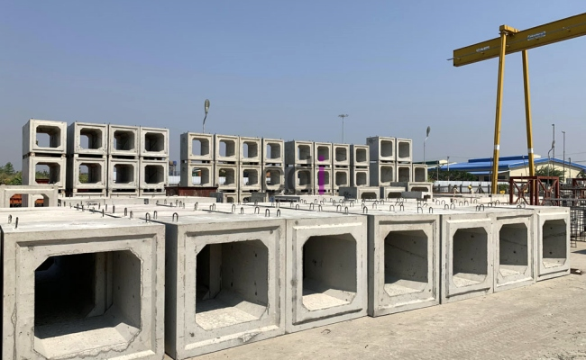

**Jual Box Culvert Precast di Bubulak Bogor** – Halo Mitra CDI! Apakah Anda sedang mencari solusi drainase yang handal dan efisien di Bubulak Bogor? Kami punya jawabannya! Produk Box Culvert Precast kami dirancang khusus untuk menjawab kebutuhan infrastruktur drainase di wilayah Bubulak Bogor dan sekitarnya. 

Drainase yang baik adalah kunci utama untuk mencegah masalah banjir dan kerusakan lingkungan. Box Culvert Precast adalah salah satu solusi terbaik untuk mengelola aliran air secara efektif. Apa itu Box Culvert Precast? Secara sederhana, ini adalah struktur beton pracetak berbentuk kotak yang berfungsi menyalurkan air hujan dan limbah. Nah, di CDI, kami menyediakan berbagai pilihan Box Culvert Precast dengan kualitas terjamin dan harga yang kompetitif di Bubulak Bogor.



Berikut adalah spesifikasi Box Culvert Precast yang kami tawarkan di wilayah Bubulak Bogor:

## Keunggulan Memilih Box Culvert Precast dari CDI Bubulak Bogor:

*   **Hemat Biaya:** Harga Box Culvert Precast kami sangat terjangkau, memberikan solusi ekonomis untuk kebutuhan drainase Anda dibandingkan opsi lain di pasaran.
*   **Kualitas Terpercaya:** Produk kami diproduksi dengan standar kualitas tinggi, menggunakan material pilihan yang menjamin kekuatan dan daya tahan.
*   **Pemasangan Mudah dan Cepat:** Desain modular Box Culvert Precast kami memungkinkan pemasangan yang lebih cepat dan efisien, menghemat waktu dan biaya tenaga kerja.
*   **Tahan Lama:** Box Culvert Precast kami dirancang untuk tahan terhadap berbagai kondisi cuaca ekstrem dan memiliki umur pakai yang panjang.
*   **Fleksibilitas Desain:** Tersedia dalam berbagai ukuran dan bentuk, memungkinkan penyesuaian dengan kebutuhan spesifik proyek Anda. 

## Aplikasi Box Culvert Precast di Bubulak Bogor: Solusi Drainase untuk Berbagai Kebutuhan

Box Culvert Precast yang kami sediakan di Bubulak Bogor sangat cocok untuk berbagai aplikasi, termasuk:

*   **Drainase Jalan Raya:** Ideal untuk mengelola aliran air di jalan-jalan utama, dengan kemampuan menahan beban lalu lintas berat.
*   **Drainase Perumahan:** Mencegah genangan air di lingkungan perumahan, menjaga kenyamanan dan kesehatan warga Bubulak Bogor.
*   **Gorong-Gorong:** Solusi efektif untuk pembuatan gorong-gorong yang kuat dan tahan lama.
*   **Drainase Kawasan Industri:** Mampu menangani volume air yang besar dan limbah industri, menjamin sistem drainase yang handal. 

## Daftar Harga Box Culvert Precast di Bubulak Bogor (Per Buah):



**Catatan:** Harga Box Culvert Precast di Bubulak Bogor bervariasi tergantung pada tipe, mutu, dan dimensi produk. Silakan lihat tabel di atas atau hubungi kami untuk mendapatkan penawaran harga terkini.

## Mengapa Box Culvert Precast Lebih Unggul daripada Sistem Drainase Konvensional?

*   **Efisiensi Biaya:** Investasi awal yang lebih rendah dan biaya perawatan yang minimal menjadikan Box Culvert Precast pilihan yang lebih ekonomis dalam jangka panjang.
*   **Kualitas Terjamin:** Dibuat dengan teknologi modern dan material berkualitas, memastikan kekuatan dan daya tahan yang optimal.
*   **Performa Unggul:** Desain yang presisi dan efisien memastikan aliran air yang lancar dan mencegah penyumbatan.
*   **Kecepatan Pemasangan:** Proses instalasi yang cepat mengurangi waktu proyek dan menghemat biaya tenaga kerja.

## Cara Mudah Membeli Box Culvert Precast di Bubulak Bogor dari CDI:

Yuk, ikuti langkah-langkah praktis berikut untuk mendapatkan Box Culvert Precast berkualitas dari kami:

*   **Langkah 1: Kirimkan Informasi Anda:** Hubungi kami melalui email di customercdi@gmail.com dengan detail lengkap: nama Anda, alamat proyek di Bubulak Bogor, dan jumlah Box Culvert yang dibutuhkan.
*   **Langkah 2: Dapatkan Konfirmasi:** Tim kami akan segera memproses permintaan Anda dan mengirimkan konfirmasi yang berisi detail biaya, jadwal pengiriman, dan metode pembayaran yang tersedia.
*   **Langkah 3: Lakukan Pembayaran:** Setelah menerima konfirmasi, segera lakukan pembayaran sesuai instruksi yang diberikan. 

## Tips Penting Sebelum Memesan Box Culvert Precast di Bubulak Bogor:

*   **Ukur dengan Akurat:** Pastikan Anda sudah mengukur dimensi dan jumlah Box Culvert yang dibutuhkan secara tepat untuk menghindari pemesanan yang kurang atau berlebihan.
*   **Cek Ketersediaan Stok:** Hubungi kami terlebih dahulu untuk memastikan ketersediaan produk yang Anda inginkan.
*   **Verifikasi Alamat:** Pastikan alamat pengiriman yang Anda berikan sudah benar dan lengkap untuk kelancaran pengiriman.
*   **Jangan Ragu Bertanya:** Jika Anda memiliki pertanyaan atau membutuhkan bantuan, jangan ragu untuk menghubungi tim kami. Kami siap melayani Anda dengan senang hati!

Pemasangan yang tepat adalah kunci keberhasilan sistem drainase Anda di Bubulak Bogor. Kami sarankan untuk mengikuti panduan pemasangan yang benar dan memastikan semua langkah dilakukan dengan hati-hati. Selain itu, perhitungan yang akurat mengenai jumlah Box Culvert Precast yang dibutuhkan akan membantu Anda mengoptimalkan efisiensi drainase. Jadi, tunggu apa lagi? Hubungi kami sekarang juga untuk mendapatkan Box Culvert Precast berkualitas dari CDI dan rasakan manfaatnya bagi proyek Anda di Bubulak Bogor! [Jual Box Culvert Precast di Babakan Bogor](/box-culvert/jual-box-culvert-precast-di-babakan-bogor/) [Jual Box Culvert Precast di Babelan Bekasi](/box-culvert/jual-box-culvert-precast-di-babelan-bekasi/)