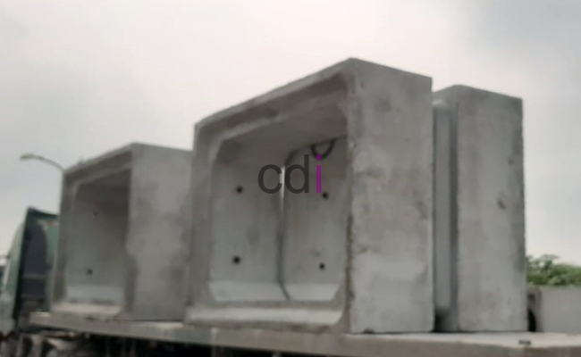

**Jual Box Culvert Precast di Cakung Jakarta** – Halo Mitra CDI! Apakah Anda sedang mencari solusi drainase yang andal dan efisien di Cakung Jakarta? Kami hadir dengan produk Box Culvert Precast berkualitas tinggi, siap mendukung proyek-proyek konstruksi Anda.

Drainase yang baik merupakan fondasi penting bagi keberlangsungan lingkungan dan infrastruktur. Nah, Box Culvert Precast adalah salah satu solusi terbaik untuk memastikan sistem drainase berfungsi optimal. Apa sih sebenarnya Box Culvert Precast itu? Sederhananya, ini adalah struktur beton pracetak yang dirancang khusus untuk mengalirkan air hujan dan limbah secara efektif. Di CDI, kami menyediakan beragam pilihan Box Culvert Precast yang bisa Anda sesuaikan dengan kebutuhan proyek Anda di Cakung Jakarta.



## Spesifikasi Box Culvert Precast Tersedia di Cakung Jakarta

Berikut ini adalah spesifikasi Box Culvert Precast yang kami sediakan:

*   **Ukuran:** Tersedia dalam berbagai ukuran standar, mulai dari 30x30 cm, 40x40 cm, 60x60 cm, 80x80 cm, hingga ukuran custom sesuai permintaan.
*   **Panjang:** Panjang standar per unit adalah 2 meter, tetapi kami juga dapat menyediakan panjang lain sesuai kebutuhan proyek Anda.
*   **Ketebalan Dinding:** Pilihan ketebalan dinding bervariasi, mulai dari 10 cm hingga 20 cm, tergantung pada beban yang akan ditanggung.
*   **Kekuatan Beton:** Kami hanya menggunakan beton mutu tinggi (minimal K250) untuk memastikan kekuatan dan ketahanan Box Culvert Precast.
*   **Reinforcement (Tulangan):** Menggunakan besi tulangan berkualitas tinggi sesuai standar SNI.

## Keuntungan Memilih Box Culvert Precast dari CDI di Cakung Jakarta:

*   **Investasi Cerdas:** Harga yang kompetitif memungkinkan Anda mendapatkan solusi drainase berkualitas tanpa menguras anggaran proyek di Cakung Jakarta.
*   **Kualitas Teruji:** Produk kami dibuat dengan standar kualitas tinggi, menggunakan bahan baku terbaik dan proses kontrol yang ketat. Box Culvert Precast kami dirancang untuk bertahan lama dan tahan terhadap tekanan berat.
*   **Pemasangan Mudah & Cepat:** Desain yang presisi dan ringan memudahkan proses pemasangan, menghemat waktu dan biaya tenaga kerja.
*   **Daya Tahan Tinggi:** Tahan terhadap korosi, cuaca ekstrem, dan kerusakan fisik, sehingga minim perawatan dan biaya perbaikan.
*   **Fleksibilitas Desain:** Tersedia dalam berbagai ukuran dan bentuk, memungkinkan Anda menyesuaikannya dengan desain proyek Anda.

## Aplikasi Box Culvert Precast di Cakung Jakarta untuk Beragam Kebutuhan:

*   **Drainase Jalan Raya:** Sangat ideal untuk mengalirkan air hujan dari jalan-jalan utama di Cakung Jakarta, terutama di area yang rawan banjir.
*   **Drainase Perumahan:** Membantu mencegah genangan air di lingkungan perumahan Cakung Jakarta, menciptakan lingkungan yang lebih nyaman dan aman.
*   **Gorong-Gorong:** Solusi efektif dan tahan lama untuk pembuatan gorong-gorong di berbagai proyek konstruksi.
*   **Drainase Kawasan Industri:** Cocok untuk mengatasi volume air yang besar di kawasan industri Cakung Jakarta, yang seringkali memerlukan sistem drainase yang sangat kuat.

## Daftar Harga Box Culvert Precast di Cakung Jakarta:



**_\*Catatan Penting:_**

*   Harga yang tertera belum termasuk PPN 10%.
*   Harga dapat berubah sewaktu-waktu tanpa pemberitahuan. Untuk informasi harga terkini, silakan hubungi tim kami.

## Mengapa Box Culvert Precast Lebih Unggul daripada Sistem Drainase Konvensional di Cakung Jakarta?

*   **Efisiensi Biaya:** Walaupun investasi awal mungkin sedikit lebih tinggi, Box Culvert Precast menawarkan biaya perawatan yang lebih rendah dan umur pakai yang lebih panjang, memberikan penghematan dalam jangka panjang.
*   **Kualitas Terjamin:** Dibandingkan dengan drainase konvensional, Box Culvert Precast memiliki kekuatan dan ketahanan yang lebih baik karena terbuat dari beton berkualitas tinggi.
*   **Performa Drainase Optimal:** Dirancang untuk mengalirkan air dengan lebih efisien, mengurangi risiko genangan dan banjir.
*   **Kecepatan Pemasangan:** Proses pemasangan yang cepat dan mudah menghemat waktu dan biaya proyek Anda di Cakung Jakarta.

## Cara Mudah Memesan Box Culvert Precast di Cakung Jakarta:

1.  **Hubungi Kami:** Sampaikan kebutuhan Anda melalui email ke customercdi@gmail.com. Sertakan detail proyek, ukuran Box Culvert yang dibutuhkan, dan jumlah unit yang Anda pesan.
2.  **Dapatkan Penawaran:** Tim kami akan segera menghubungi Anda untuk memberikan penawaran harga terbaik dan informasi lengkap mengenai produk.
3.  **Konfirmasi Pesanan & Pembayaran:** Setelah menyetujui penawaran, lakukan pembayaran sesuai dengan metode yang tersedia.
4.  **Pengiriman Cepat:** Kami akan segera mengirimkan pesanan Anda ke lokasi proyek di Cakung Jakarta.

## Tips Penting Sebelum Membeli Box Culvert Precast di Cakung Jakarta:

*   **Hitung Kebutuhan dengan Akurat:** Pastikan Anda menghitung kebutuhan Box Culvert Precast dengan tepat untuk menghindari kekurangan atau kelebihan material.
*   **Cek Ketersediaan Stok:** Hubungi kami terlebih dahulu untuk memastikan stok produk yang Anda inginkan tersedia.
*   **Verifikasi Alamat Pengiriman:** Pastikan alamat pengiriman yang Anda berikan sudah benar dan lengkap.
*   **Jangan Ragu Bertanya:** Jika Anda memiliki pertanyaan atau membutuhkan bantuan, jangan ragu untuk menghubungi tim kami. Kami siap membantu Anda menemukan solusi drainase terbaik untuk proyek Anda di Cakung Jakarta.

Pemasangan Box Culvert Precast yang tepat membutuhkan perencanaan yang matang dan perhitungan yang akurat. Kami siap memberikan konsultasi gratis untuk membantu Anda memastikan sistem drainase berfungsi dengan optimal dan tahan lama. Jangan ragu untuk menghubungi kami! [Jual Box Culvert Precast di Angke Jakarta](/box-culvert/jual-box-culvert-precast-di-angke-jakarta/) bisa jadi referensi Anda dalam memilih solusi drainase terbaik. Jika Anda memiliki pertanyaan lebih lanjut mengenai Box Culvert Precast di Cakung Jakarta, silakan hubungi kami sekarang juga! Kami siap memberikan layanan terbaik untuk kebutuhan drainase Anda.