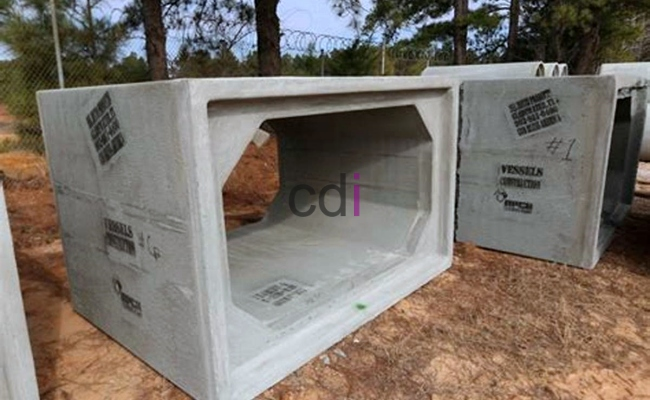

**Jual Box Culvert Precast di Caringin Sukabumi** – Halo Mitra CDI! Apakah Anda sedang mencari solusi drainase yang handal dan efisien di Caringin Sukabumi? Kami hadir sebagai penyedia Box Culvert Precast berkualitas tinggi, dirancang khusus untuk menjawab tantangan infrastruktur drainase modern. Produk ini adalah jawaban tepat untuk penyaluran air di saluran drainase bawah tanah, menawarkan kemudahan instalasi dan kekuatan struktural yang optimal. Yuk, simak detailnya!



Berikut adalah spesifikasi Box Culvert Precast yang tersedia di Caringin Sukabumi: 

## Mengapa Memilih Box Culvert Precast dari Kami di Caringin Sukabumi?

*   **Daya Tahan Unggul:** Box Culvert Precast kami dibuat dari material beton berkualitas tinggi. Ini menjamin ketahanan terhadap cuaca ekstrem dan tekanan berat, sehingga awet digunakan bertahun-tahun tanpa perbaikan berkala.
*   **Instalasi Cepat & Mudah:** Produk precast kami hadir sebagai solusi siap pasang. Proses instalasinya jauh lebih cepat dibandingkan metode konvensional, menghemat waktu dan tenaga Anda.
*   **Pilihan Dimensi Lengkap:** Kami menyediakan beragam pilihan dimensi Box Culvert Precast, dari ukuran kecil hingga besar. Anda bisa memilih yang paling sesuai dengan kebutuhan proyek drainase atau gorong-gorong Anda di Caringin Sukabumi.
*   **Struktur Kokoh & Stabil:** Desain struktur yang kuat memastikan Box Culvert Precast kami mampu menahan beban berat dan tetap stabil, menjaga kelancaran sistem drainase tanpa masalah.
*   **Percepatan Penyelesaian Proyek:** Dengan kemudahan pemasangan dan produksi standar, penggunaan Box Culvert Precast akan mempercepat penyelesaian proyek Anda, mengurangi biaya operasional dan waktu pengerjaan.

## Aplikasi Box Culvert Precast di Caringin Sukabumi untuk Drainase dan Gorong-Gorong yang Tahan Lama:

*   **Drainase Jalan Raya:** Ideal untuk mengelola volume air besar di jalan raya, mampu menahan beban kendaraan berat tanpa kompromi.
*   **Drainase Perumahan:** Solusi sempurna untuk mencegah genangan air dan memastikan sistem drainase perumahan berfungsi optimal, terutama saat musim hujan di Caringin Sukabumi.
*   **Pembangunan Gorong-Gorong:** Box Culvert Precast kami menjadi pilihan efisien dan tahan lama untuk proyek pembangunan gorong-gorong.
*   **Drainase Industri:** Dirancang untuk memenuhi kebutuhan drainase khusus di area industri, dengan kemampuan menahan beban berat dan material korosif.

## Daftar Harga Box Culvert Precast di Caringin Sukabumi per Buah:



Keterangan: Informasi harga Box Culvert Precast di Caringin Sukabumi per buah, berdasarkan tipe produk, mutu beton, dan dimensi.

## Mengapa Box Culvert Precast Lebih Unggul Dibandingkan Drainase Konvensional?

*   **Efisiensi Biaya:** Box Culvert Precast kami menawarkan harga yang lebih kompetitif dibandingkan konstruksi drainase tradisional. Ini membantu mengoptimalkan anggaran proyek Anda.
*   **Kualitas Terjamin:** Dibuat dengan teknologi modern dan material berkualitas, produk kami menjamin kualitas dan performa yang lebih baik.
*   **Fungsi Optimal:** Dirancang khusus untuk saluran drainase yang efisien, memastikan aliran air lancar dan mencegah penyumbatan.
*   **Waktu Pengerjaan Lebih Singkat:** Proses pemasangan yang cepat memperpendek durasi konstruksi, menghemat waktu dan sumber daya.

## Cara Mudah Memesan Box Culvert Precast di Caringin Sukabumi

*   **Langkah 1: Kirimkan Data Lengkap:** Sampaikan detail proyek Anda melalui email customercdi@gmail.com. Sertakan nama, alamat lengkap di Caringin Sukabumi, dan jumlah Box Culvert Precast yang dibutuhkan.
*   **Langkah 2: Penawaran Harga:** Tim kami akan segera memproses pesanan Anda dan mengirimkan penawaran harga yang disesuaikan dengan kebutuhan proyek.
*   **Langkah 3: Konfirmasi & Pemesanan:** Periksa proposal yang kami kirimkan. Jika sudah sesuai, Anda dapat melanjutkan ke tahap pemesanan.

## Tips Penting Sebelum Membeli Box Culvert Precast di Caringin Sukabumi

Berikut beberapa hal yang perlu diperhatikan sebelum Anda melakukan pembelian:

*   **Perhitungan Kebutuhan:** Pastikan Anda telah menghitung kebutuhan Box Culvert Precast secara akurat. Pertimbangkan ukuran, jumlah, dan detail lain yang relevan dengan proyek Anda. Dengan begitu, kami bisa memberikan solusi yang paling tepat.
*   **Kualitas Produk:** Pastikan Anda memahami standar kualitas produk yang kami tawarkan. Box Culvert Precast kami dibuat dari bahan berkualitas tinggi dan melalui proses kontrol kualitas yang ketat. Kami juga menyediakan sertifikat mutu sebagai jaminan.
*   **Biaya & Jadwal Pengiriman:** Periksa biaya dan estimasi waktu pengiriman yang tertera dalam penawaran. Pastikan Anda memahami dan menyetujui ketentuan tersebut.
*   **Proses Transaksi:** Lakukan pembayaran sesuai instruksi yang diberikan. Jika ada pertanyaan atau kendala, jangan ragu untuk menghubungi kami. Kami siap membantu kelancaran transaksi Anda.

Instalasi Box Culvert Precast di Caringin Sukabumi memerlukan kehati-hatian dan perhitungan yang tepat agar sistem drainase berfungsi dengan baik. Hindari kesalahan pemasangan yang dapat menyebabkan aliran air terhambat dan menimbulkan masalah di kemudian hari. Perencanaan yang matang dan pemilihan bahan berkualitas adalah kunci untuk memastikan saluran drainase Anda tahan lama dan efisien. Jangan sungkan untuk menghubungi kami jika Anda membutuhkan informasi lebih lanjut mengenai produk Box Culvert Precast di Caringin Sukabumi. Kami siap membantu Anda memilih dan menggunakan produk yang paling sesuai dengan kebutuhan drainase Anda. [Jual Box Culvert Precast di Abadijaya Depok](/box-culvert/jual-box-culvert-precast-di-abadijaya-depok/) – kunjungi artikel kami lainnya untuk informasi lebih lengkap!