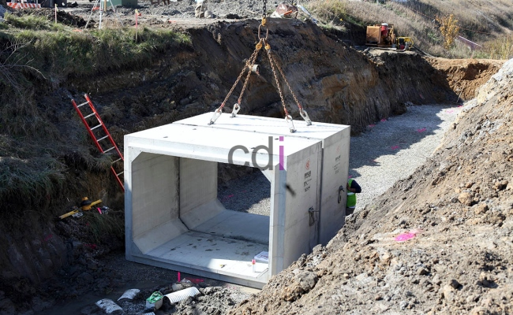

**Jual Box Culvert Precast di Ceger Jakarta** – Halo Mitra CDI! Mencari solusi drainase yang andal dan efisien di Ceger Jakarta? Kami punya jawabannya! Produk Box Culvert Precast kami dirancang untuk mengatasi tantangan sistem drainase modern. Yuk, simak informasi lengkapnya!

Sistem drainase yang baik merupakan fondasi penting bagi keberlangsungan lingkungan dan infrastruktur. Penggunaan Box Culvert Precast menjadi solusi cerdas untuk memastikan aliran air yang lancar dan mencegah masalah seperti genangan air. Apa sebenarnya Box Culvert Precast itu? Produk ini adalah struktur beton pracetak yang difabrikasi khusus untuk mengalirkan air hujan dan limbah dengan optimal. Di CDI, kami menyediakan beragam pilihan Box Culvert Precast berkualitas tinggi, siap memenuhi kebutuhan proyek Anda di Ceger Jakarta.



**Spesifikasi Lengkap Box Culvert Precast di Ceger Jakarta**

## Keunggulan Box Culvert Precast yang Kami Tawarkan di Ceger Jakarta:

*   **Ketahanan Luar Biasa:** Box Culvert Precast kami dibuat dari material beton berkualitas tinggi, menjamin kekuatan dan daya tahan terhadap cuaca ekstrem serta tekanan berat. Produk ini dirancang untuk penggunaan jangka panjang, meminimalkan biaya perawatan dan penggantian.
*   **Proses Pemasangan yang Mudah:** Bentuk yang sudah jadi membuat pemasangan Box Culvert Precast sangat praktis dan cepat. Anda tidak perlu lagi repot dengan proses konstruksi konvensional yang memakan waktu dan tenaga.
*   **Pilihan Dimensi yang Beragam:** Kami menyediakan berbagai ukuran Box Culvert Precast, mulai dari dimensi kecil hingga besar. Anda bebas memilih ukuran yang paling sesuai dengan skala dan kebutuhan proyek drainase Anda.
*   **Struktur yang Kokoh dan Stabil:** Desain Box Culvert Precast kami memastikan kekuatan struktural dan stabilitas tinggi. Produk ini mampu menahan beban berat dan mencegah pergeseran, sehingga aliran air tetap lancar dan sistem drainase berfungsi maksimal.
*   **Efisiensi Waktu Pengerjaan:** Penggunaan Box Culvert Precast mempercepat penyelesaian proyek drainase Anda. Proses produksi yang terstandarisasi dan pemasangan yang mudah menghemat waktu dan biaya operasional.

## Aplikasi Box Culvert Precast di Ceger Jakarta untuk Sistem Drainage dan Gorong-gorong Unggul:

*   **Infra Struktur Jalan Raya:** Cocok untuk saluran drainase di sepanjang jalan raya, mencegah genangan air saat hujan deras dan memastikan keamanan lalu lintas.
*   **Proyek Perumahan:** Ideal sebagai solusi drainase perumahan, mengalirkan air hujan dari area permukiman ke saluran pembuangan utama.
*   **Terowongan dan Basement:** Dapat digunakan dalam konstruksi terowongan dan basement untuk mengendalikan aliran air dan menjaga kestabilan struktur bangunan.
*   **Sistem Irigasi Pertanian:** Memfasilitasi pengairan lahan pertanian dengan menyalurkan air dari sumber ke area tanaman, meningkatkan produktivitas hasil panen.

## Daftar Harga Box Culvert Precast di Ceger Jakarta (Per Buah):



Catatan: Harga di atas merupakan harga per unit Box Culvert Precast di Ceger Jakarta dalam Rupiah.

## Analisis Perbandingan: Box Culvert Precast vs. Drainase Konvensional di Ceger Jakarta

\- **Efisiensi Biaya:** Investasi pada box culvert precast kami seringkali lebih ekonomis dibandingkan metode drainase konvensional yang membutuhkan pengerjaan manual dan biaya material terpisah. Dengan memilih produk kami, Anda dapat mengoptimalkan anggaran proyek.

\- **Kualitas Terjamin:** Kualitas box culvert precast kami jauh melampaui konstruksi drainase konvensional yang memanfaatkan bahan seperti beton cor. Produk kami dirancang untuk memberikan performa dan daya tahan yang superior dalam jangka panjang.

\- **Kepraktisan & Kecepatan:** Box culvert precast menawarkan kemudahan pemasangan dan efisiensi waktu yang signifikan dibandingkan drainase konvensional yang memakan waktu lebih lama dan memerlukan tenaga kerja lebih banyak.

\- **Minim Perawatan:** Box culvert precast kami dirancang untuk tahan lama, meminimalkan kebutuhan perawatan rutin. Sementara drainase konvensional seringkali membutuhkan perawatan berkala yang menambah biaya operasional.

## Cara Mudah Memesan Box Culvert Precast di Ceger Jakarta:

*   **Tahap 1: Pengiriman Informasi:** Sampaikan detail lengkap pesanan Anda melalui email ke customercdi@gmail.com. Sertakan nama lengkap, alamat pengiriman, dan jumlah Box Culvert Precast yang dibutuhkan.
*   **Tahap 2: Proses Order:** Tim kami akan segera memproses pesanan Anda dan menghitung total biaya berdasarkan permintaan Anda.
*   **Tahap 3: Penawaran Resmi:** Kami akan mengirimkan penawaran resmi melalui email untuk Anda tinjau. Jika sudah sesuai, Anda dapat melanjutkan ke tahap pembayaran.

## Tips Penting Sebelum Membeli Box Culvert Precast di Ceger Jakarta:

*   **Perencanaan yang Matang:** Pastikan Anda sudah mempertimbangkan dengan cermat dimensi dan kebutuhan Box Culvert yang tepat untuk proyek Anda.
*   **Cek Ketersediaan Stok:** Selalu periksa ketersediaan stok sebelum melakukan pemesanan. Kami siap memberikan informasi yang akurat mengenai stok saat ini.
*   **Alamat Pengiriman yang Valid:** Berikan alamat pengiriman yang lengkap dan benar agar produk dapat sampai ke tujuan dengan tepat waktu.
*   **Jangan Ragu Bertanya:** Jika Anda memiliki pertanyaan atau membutuhkan bantuan, jangan sungkan untuk menghubungi tim kami. Kami siap membantu Anda dengan senang hati.

Pemasangan Box Culvert Precast yang tepat merupakan kunci keberhasilan sistem drainase. Pastikan pemasangan dilakukan dengan rapi dan sesuai standar untuk menghindari masalah seperti banjir atau kerusakan infrastruktur. Hindari kesalahan umum seperti penyambungan yang tidak sempurna, pergeseran posisi, penumpukan material, dan penggunaan material yang tidak sesuai. Konsultasikan dengan ahlinya untuk memastikan instalasi optimal. Jika Anda mencari informasi lebih lanjut tentang Box Culvert Precast di Ceger Jakarta, segera hubungi kami! [Jual Box Culvert Precast di Abadijaya Depok](/box-culvert/jual-box-culvert-precast-di-abadijaya-depok/) untuk referensi tambahan.